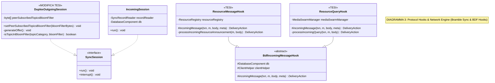
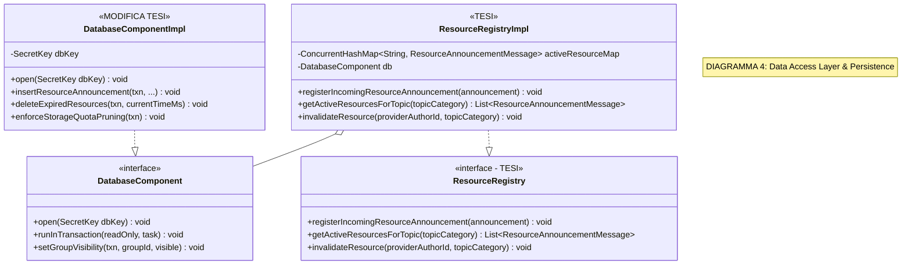
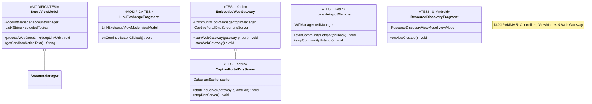

# Documentazione Architetturale: Class Diagrams, Pattern e Classificazione del Codice Sorgente (Briar vs Tesi)

Questo documento costituisce la guida architetturale formale alla **struttura delle classi, dei Design Pattern e della classificazione dei componenti** del progetto Briar/Bramble e delle estensioni di Tesi (Modulo 1 e Modulo 2).

---

## 1. Classificazione Architetturale dei Layer e delle Componenti

Il codice sorgente di Briar e le modifiche della Tesi vengono classificati secondo i pattern architetturali tradizionali:

```
 ┌────────────────────────────────────────────────────────────────────────────────┐
 │                         CLASSIFICAZIONE DEL CODICE                             │
 ├──────────────────────────┬─────────────────────────────────────────────────────┤
 │ LAYER / CATEGORIA        │ COMPONENTI BRIAR NATIVE & ESTENSIONI TESI           │
 ├──────────────────────────┼─────────────────────────────────────────────────────┤
 │ 1. DOMAIN MODEL          │ • Nativio: `Author`, `Message`, `Group`, `Identity` │
 │    (DTO & Value Objects) │ • [TESI]: `ResourceAnnouncementMessage`,            │
 │                          │   `ResourceQueryMessage`, `DidIdentity`,            │
 │                          │   `VerifiableCredential`, `OnboardingRequest`       │
 ├──────────────────────────┼─────────────────────────────────────────────────────┤
 │ 2. BUSINESS LOGIC        │ • Nativi: `IdentityManager`, `ClientHelper`         │
 │    (Services & Managers) │ • [MODIFICA]: `AccountManagerImpl`, `TrustManager`  │
 │                          │ • [TESI]: `ResourceDiscoveryClientImpl`,            │
 │                          │   `CommunityTopicManagerImpl`, `MediaSwarmManager`  │
 ├──────────────────────────┼─────────────────────────────────────────────────────┤
 │ 3. ORM & PERSISTENCE     │ • Nativi: `DatabaseComponentImpl`, `JdbcDatabase`   │
 │    (Data Access Layer)   │ • [MODIFICA]: Tabella SQL `resource_announcements`  │
 │                          │ • [TESI]: `ResourceRegistryImpl` (Mappa DB/Mem)     │
 ├──────────────────────────┼─────────────────────────────────────────────────────┤
 │ 4. CONTROLLERS & ENTRY   │ • Nativi: `SetupActivity`, `AuthorNameFragment`     │
 │    (ViewModels & Gateway)│ • [MODIFICA]: `SetupViewModel`, `LinkExchangeFrag`  │
 │                          │ • [TESI]: `EmbeddedWebGateway.kt`, `HotspotMgr`     │
 ├──────────────────────────┼─────────────────────────────────────────────────────┤
 │ 5. PROTOCOL HOOKS        │ • Nativi: `BdfIncomingMessageHook`, `SyncSession`   │
 │    (Message Handlers)    │ • [MODIFICA]: `DuplexOutgoingSession` (Bloom)       │
 │                          │ • [TESI]: `ResourceMessageHook`, `ResourceQueryHook`│
 └──────────────────────────┴─────────────────────────────────────────────────────┘
```

---

## 2. Design Pattern Guida in Briar e nel Progetto di Tesi

La progettazione si basa su **6 Design Pattern Fondamentali**:

### A. Dependency Injection (`Dagger 2`) `[Fonte: Briar Core Architecture]`
* **In Briar**: Tutte le dipendenze tra classi e moduli sono gestite con l'annotazione `@Inject` e `@Singleton` nei moduli Dagger (`BrambleCoreModule`, `BriarCoreModule`).
* **Uso per la Tesi**: I nuovi componenti (`ResourceDiscoveryClientImpl`, `EmbeddedWebGateway`, `TrustManagerImpl`) vengono iniettati tramite Dagger senza instanziazioni manuali.

### B. Observer / Event-Driven Pattern (`EventBus`) `[Fonte: EventBusImpl.java]`
* **In Briar**: Disaccoppiamento tra il livello di sincronizzazione P2P e l'interfaccia utente. Quando un messaggio viene salvato nel DB, si scatena un evento sul bus `EventBus.fireEvent(new MessageAddedEvent())`.
* **Uso per la Tesi**: L'arrivo di un nuovo endorsement o annuncio di risorsa scatena `ResourceAnnouncementReceivedEvent` per aggiornare al volo la UI ed il Quorum.

### C. Hook / Template Method Pattern (`BdfIncomingMessageHook`) `[Fonte: BdfIncomingMessageHook.java]`
* **In Briar**: Definisce lo scheletro dell'algoritmo di intercettazione BDF, lasciando alle sottoclassi l'elaborazione specifica del messaggio.
* **Uso per la Tesi**: `ResourceMessageHook` e `ResourceQueryHook` estendono `BdfIncomingMessageHook` implementando `incomingMessage()`.

### D. Factory Pattern (`GroupFactory`, `MessageFactory`) `[Fonte: GroupFactory.java]`
* **In Briar**: Isola la logica di creazione degli oggetti complessi del protocollo.
* **Uso per la Tesi**: Usato da `CommunityTopicManagerImpl` per istanziare i `Group` Bramble per ciascun Topic.

### E. Façade / Client Pattern (`ClientHelper`, `ResourceDiscoveryClient`)
* **In Briar**: `ClientHelper` fornisce un'interfaccia semplificata per la codifica BDF, firma Ed25519 e memorizzazione DB.
* **Uso per la Tesi**: `ResourceDiscoveryClientImpl` agisce da Façade applicativa per la pubblicazione e sottoscrizione Pub/Sub delle risorse.

### F. Value Object & Immutabilità (`@Immutable`) `[Fonte: Message.java]`
* **In Briar**: Tutti i DTO BDF sono immutabili per garantire la sicurezza del multithreading.
* **Uso per la Tesi**: Tutti i DTO di Tesi (`ResourceAnnouncementMessage`, `VerifiableCredential`) sono `@Immutable` e thread-safe.

---

## 3. Roadmap Sequenziale dei Class Diagram Modulari

Per evitare diagrammi monolitici ed illeggibili, la struttura è suddivisa in **5 Diagrammi Sequenziali per Strato**:

1. **DIAGRAMMA 1**: Domain Model & DTO (Dati Nativi vs Dati di Tesi).
2. **DIAGRAMMA 2**: Business Logic & Service Managers (Account, Trust, Onboarding, Resource Client).
3. **DIAGRAMMA 3**: Protocol Hooks & Sync Session (Bramble Sync, Bloom Filters & Message Hooks).
4. **DIAGRAMMA 4**: Data Access Layer & Persistence (Database Cifrato & Resource Registry).
5. **DIAGRAMMA 5**: Controllers, ViewModels & Web Gateway (Ingresso Browser, Deep Link & UI).

---

## 4. Diagrammi delle Classi Dettagliati per Strato

---

### DIAGRAMMA 1: Domain Model & DTOs (Data Transfer Objects BDF)

Questo diagramma mostra i DTO datoriali BDF del modello di dominio, evidenziando la separazione tra le classi native di Briar ed i **nuovi DTO immutabili creati per la Tesi**:

```mermaid
classDiagram
    direction TB
    note "DIAGRAMMA 1: Domain Model & DTOs (Nativi vs Tesi)"

    %% Classi NATIVE di Briar
    class Author {
        -AuthorId id
        -String name
        -byte[] publicKey
        +getId() AuthorId
        +getName() String
        +getPublicKey() byte[]
    }

    class Message {
        -MessageId id
        -GroupId groupId
        -long timestamp
        -byte[] body
        +getId() MessageId
        +getGroupId() GroupId
        +getTimestamp() long
        +getBody() byte[]
    }

    class Group {
        -GroupId id
        -ClientId clientId
        -byte[] descriptor
        +getId() GroupId
        +getClientId() ClientId
        +getDescriptor() byte[]
    }

    %% Nuovi DTO per il MODULO 1 (TESI)
    class DidIdentity {
        <<TESI>>
        -Author author
        -String didKeyString
        +getDidKeyString() String
        +toW3cDidDocumentJson() String
    }

    class VerifiableCredential {
        <<TESI>>
        -String credentialId
        -String issuerDid
        -String subjectDid
        -String credentialType
        -long issuanceDateMs
        -byte[] signature
        +toW3cJsonLd() String
    }

    class OnboardingRequest {
        <<TESI>>
        -Author applicantAuthor
        -List~String~ requestedTopics
        -long timestamp
    }

    class TrustEndorsementMessage {
        <<TESI>>
        -Author applicantAuthor
        -Author approverAuthor
        -long timestamp
    }

    %% Nuovi DTO per il MODULO 2 (TESI)
    class ResourceAnnouncementMessage {
        <<TESI>>
        -MessageId messageId
        -Author providerAuthor
        -String topicCategory
        -String skillTitle
        -List~String~ hardwareAvailable
        -int batteryLevelPercent
        -String locationDescriptor
        -long timestampMs
        -long ttlDurationMs
        -byte[] signature
        +isExpired(long now) boolean
    }

    class ResourceQueryMessage {
        <<TESI>>
        -MessageId queryId
        -Author requesterAuthor
        -String targetTopicCategory
        -String locationSector
        -List~String~ searchKeywords
        -long timestampMs
        -long ttlDurationMs
    }

    %% Relazioni tra DTO
    DidIdentity o-- Author
    OnboardingRequest o-- Author
    TrustEndorsementMessage o-- Author
    ResourceAnnouncementMessage o-- Author
    ResourceAnnouncementMessage o-- MessageId
    ResourceQueryMessage o-- Author
    ResourceQueryMessage o-- MessageId
```



---

### DIAGRAMMA 2: Business Logic & Service Managers

Questo diagramma illustra le componenti della logica di business e dei manager di servizio, evidenziando le modifiche apportate alle classi native di Briar (`AccountManagerImpl`, `TrustManagerImpl`) ed i nuovi Manager introdotti per la Tesi:

```mermaid
classDiagram
    direction TB
    note "DIAGRAMMA 2: Business Logic & Service Managers"

    %% Interfacce NATIVE
    class AccountManager {
        <<interface>>
        +createAccount(name, password) boolean
    }

    class TrustManager {
        <<interface>>
        +getTrustTier(authorId) TrustTier
    }

    %% Modifiche alle Classi NATIVE (TESI)
    class AccountManagerImpl {
        <<MODIFICA TESI>>
        -SettingsManager settingsManager
        -IdentityManager identityManager
        +createAccount(name, password, topics, token) boolean
        -initializeCommunitySandboxProfile(authorId, topics, token) void
    }

    class TrustManagerImpl {
        <<MODIFICA TESI>>
        -SettingsManager settingsManager
        +evaluatePromotionEligibility() boolean
        +calculateDynamicQuorum(N_est) int
        +calculateDynamicTimeLock(rate) long
        +registerIncomingEndorsement(approverId) void
        -executePromotionToFullMember(dynamicK) void
    }

    %% Nuove Interfacce e Manager (TESI)
    class ResourceDiscoveryClient {
        <<interface - TESI>>
        +publishResourceAnnouncement(topic, skill, hardware, battery, location, ttl) void
        +subscribeToResourceTopic(topic) void
    }

    class ResourceDiscoveryClientImpl {
        <<TESI>>
        -DatabaseComponent db
        -ClientHelper clientHelper
        -IdentityManager identityManager
        -GroupFactory groupFactory
        +publishResourceAnnouncement(...) void
        +subscribeToResourceTopic(topic) void
    }

    class CommunityTopicManagerImpl {
        <<TESI>>
        -DatabaseComponent db
        -GroupFactory groupFactory
        +initializeDefaultCommunityTopics() void
        +getTopicsAsJson() String
        +subscribeToTopics(selectedTopics) void
    }

    class MediaSwarmManagerImpl {
        <<TESI>>
        -CryptoComponent crypto
        -ClientHelper clientHelper
        +processAndSwarmMediaFile(file, group) MediaManifestMessage
        +reconstructMediaFile(manifest, chunks) File
        -applyRaptorQEncoding(payload) List~byte[]~
    }

    %% Ereditarietà e Relazioni
    AccountManagerImpl ..|> AccountManager
    TrustManagerImpl ..|> TrustManager
    ResourceDiscoveryClientImpl ..|> ResourceDiscoveryClient
```



---

### DIAGRAMMA 3: Protocol Hooks & Network Engine (BTP & Bramble Sync)

Questo diagramma descrive il livello di rete e sincronizzazione, mostrando come la sessione uscente BSS (`DuplexOutgoingSession`) applica il **Filtro di Bloom (128 byte)** e come gli **Hook BDF** intercettano ed elaborano i messaggi ricevuti:



---

### DIAGRAMMA 4: Data Access Layer & Persistence (ORM & Registry)

Questo diagramma illustra il livello di accesso ai dati e persistenza, mostrando le modifiche alla classe principale del database cifrato (`DatabaseComponentImpl`) e l'integrazione del nuovo registro in-memory/DB (`ResourceRegistryImpl`):



---

### DIAGRAMMA 5: Controllers, ViewModels & Entrypoints (UI / Web Gateway)

Questo diagramma illustra il livello di presentazione Android ed il punto d'ingresso offline via browser, mostrando le modifiche al wizard (`SetupViewModel`, `LinkExchangeFragment`) ed i nuovi componenti di Gateway ed Hotspot Wi-Fi:



---

## 5. Sintesi e Corrispondenza delle Responsabilità

1. **Dominio Pulito e Disaccoppiato**: La separazione tra i contratti DTO BDF (`ResourceAnnouncementMessage`, `OnboardingRequest`, `DidIdentity`) e la logica di business garantisce che i dati siano sempre immutabili e verificabili.
2. **Integrazione Trasparente con Briar**: L'uso dei pattern nativi di Briar (Dagger Injection, EventBus, `BdfIncomingMessageHook`) consente di estendere la piattaforma senza rompere il funzionamento originario del software.
3. **Mappatura Completa dello Sviluppo**: I 5 class diagram modulari forniscono la guida esatta per l'implementazione del codice nativo sul repository Briar in Android Studio.
