# Documentazione Architetturale: Diagramma dei Package di Briar e Moduli di Tesi

Questo documento descrive l'**architettura software del progetto Briar/Bramble**, illustrando la suddivisione nei vari **sub-project** e **package**, le responsabilità di ciascun modulo e la collocazione esatta dei **nuovi pacchetti estesi per il progetto di tesi** (Modulo 1 ed Modulo 2).

---

## 1. Panoramica dell'Architettura Modulare

Il progetto Briar adotta un'architettura modulare rigorosa a strati con disaccoppiamento tra le API astratte, le implementazioni della logica di business ed il livello di presentazione Android:

```
 ┌─────────────────────────────────────────────────────────────────────────────┐
 │                         LIVELLO PRESENTAZIONE (UI/UX)                       │
 │  `:briar-android` (App Android, Activity, Fragment, ViewModel, Hotspot)     │
 └──────────────────────────────────────┬──────────────────────────────────────┘
                                        │
                                        ▼
 ┌─────────────────────────────────────────────────────────────────────────────┐
 │                    LIVELLO LOGICA DI APPLICAZIONE (BRIAR)                   │
 │  `:briar-api`  (Interfacce e DTO: Resource, DID, Community, Forum, Media)   │
 │  `:briar-core` (Client, Web Gateway, Resource Discovery, Swarm, Hook)       │
 └──────────────────────────────────────┬──────────────────────────────────────┘
                                        │
                                        ▼
 ┌──────────────────────────────────────────────────────────────────────────────┐
 │                    LIVELLO PROTOCOLLI E SERVIZI BASE (BRAMBLE)               │
 │  `:bramble-api`     (Interfacce: Sync, Crypto, Identity, DB, Trust, BTP)     │
 │  `:bramble-core`    (BTP Transport, BSS Sync Engine, Scrypt/H2, TrustManager)│
 │  `:bramble-android` (Plugin Wi-Fi/Bluetooth Android Native)                  │
 └──────────────────────────────────────────────────────────────────────────────┘
```

---

## 2. Diagramma dei Package e dei Subproject (Architecture Flowchart)

Il seguente diagramma Mermaid mappa con chiarezza la gerarchia dei **subproject Gradle** e dei **package Java/Kotlin**, distinguendo visivamente le componenti native di Briar da quelle **[MODIFICATE]** o aggiunte ex-novo per la **[NUOVO]**:

```mermaid
flowchart TB
    subgraph BRIAR_APP ["STRATO PRESENTAZIONE UI ANDROID - Subproject :briar-android"]
        direction LR
        subgraph P_AND_HOTSPOT ["briar.android.hotspot [NUOVO]"]
            N_HOTSPOT["LocalHotspotManager.kt<br/>(WifiManager.startLocalOnlyHotspot)"]
        end
        subgraph P_AND_ACCOUNT ["briar.android.account [MODIFICA]"]
            N_SETUP_VM["SetupViewModel.java<br/>(Parsing Deep Link briar://)"]
        end
        subgraph P_AND_CONTACT ["briar.android.contact [MODIFICA]"]
            N_LINK_FRAG["LinkExchangeFragment.java<br/>(Parsing QR Invito & Sponsor)"]
        end
        subgraph P_AND_RESOURCE ["briar.android.resource [NUOVO]"]
            N_RES_UI["ResourceDiscoveryFragment<br/>ResourcePublishFragment"]
        end
    end

    subgraph BRIAR_CORE_LAYER ["STRATO LOGICA APPLICATIVA & SERVICES - Subproject :briar-core"]
        direction LR
        subgraph P_CORE_WEB ["briar.web [NUOVO]"]
            N_WEB_GATEWAY["EmbeddedWebGateway.kt<br/>CaptivePortalDnsServer.kt"]
        end
        subgraph P_CORE_RESOURCE ["briar.resource [NUOVO]"]
            N_RES_CLIENT["ResourceDiscoveryClientImpl<br/>ResourceRegistryImpl<br/>ResourceMessageHook"]
        end
        subgraph P_CORE_COMMUNITY ["briar.community [NUOVO]"]
            N_TOPIC_MGR["CommunityTopicManagerImpl<br/>CommunityOnboardingManagerImpl"]
        end
        subgraph P_CORE_MEDIA ["briar.media [NUOVO]"]
            N_MEDIA_SWARM["MediaSwarmManagerImpl<br/>(Chunking BDF 256KB & RaptorQ)"]
        end
    end

    subgraph BRIAR_API_LAYER ["STRATO CONTRATTI E DTO APPLICATIVI - Subproject :briar-api"]
        direction LR
        subgraph P_API_RESOURCE ["briar.api.resource [NUOVO]"]
            N_RES_DTO["ResourceAnnouncementMessage<br/>ResourceQueryMessage"]
        end
        subgraph P_API_IDENTITY ["briar.api.identity [NUOVO]"]
            N_DID_DTO["DidIdentity (W3C did:key)<br/>VerifiableCredential"]
        end
        subgraph P_API_COMMUNITY ["briar.api.community [NUOVO]"]
            N_COMM_DTO["OnboardingRequest<br/>TrustEndorsementMessage"]
        end
    end

    subgraph BRAMBLE_CORE_LAYER ["STRATO ENGINE PROTOCOLLARE E PERSISTENZA - Subproject :bramble-core"]
        direction LR
        subgraph P_BRAMBLE_ACCOUNT ["bramble.account [MODIFICA]"]
            N_ACC_MGR["AccountManagerImpl<br/>(Inizializzazione PROBATION Sandbox)"]
        end
        subgraph P_BRAMBLE_DB ["bramble.db [MODIFICA]"]
            N_DB_COMP["DatabaseComponentImpl<br/>(Tabella SQL resource_announcements & LRU)"]
        end
        subgraph P_BRAMBLE_TRUST ["bramble.trust [MODIFICA]"]
            N_TRUST_MGR["TrustManagerImpl<br/>(Algoritmo Quorum K_dynamic & Time-Lock)"]
        end
        subgraph P_BRAMBLE_SYNC ["bramble.sync [MODIFICA]"]
            N_DUPLEX_SESS["DuplexOutgoingSession<br/>(Filtro OFFER via Filtri di Bloom 128B)"]
        end
    end

    subgraph BRAMBLE_API_LAYER ["STRATO INTERFACCE ASTRATTE BRAMBLE - Subproject :bramble-api"]
        direction LR
        subgraph P_BRAMBLE_API_ALL ["bramble.api.* [NATIVO BRIAR]"]
            N_BRAMBLE_API_NODES["AccountManager | DatabaseComponent<br/>TrustManager | IdentityManager<br/>Group | GroupId | Message | BDF Format"]
        end
    end

    %% Gerarchia delle Dipendenze tra Subproject
    BRIAR_APP --> BRIAR_CORE_LAYER
    BRIAR_APP --> BRIAR_API_LAYER
    BRIAR_CORE_LAYER --> BRIAR_API_LAYER
    BRIAR_CORE_LAYER --> BRAMBLE_CORE_LAYER
    BRIAR_API_LAYER --> BRAMBLE_API_LAYER
    BRAMBLE_CORE_LAYER --> BRAMBLE_API_LAYER
```



---

## 3. Descrizione Dettagliata delle Responsabilità dei Package

---

### A. Sub-project `:bramble-api` (Interfacce del Protocollo di Base)
Fornisce le interfacce astratte e le strutture dati fondamentali di Bramble:
* **`org.briarproject.bramble.api.account`**: Interfaccia `AccountManager` per la creazione e gestione dell'account locale.
* **`org.briarproject.bramble.api.crypto`**: Componenti crittografiche (`CryptoComponent`, `SecretKey`, firme Ed25519 RFC 8032).
* **`org.briarproject.bramble.api.db`**: Interfacce per il database cifrato H2/SQLite (`DatabaseComponent`, `Transaction`).
* **`org.briarproject.bramble.api.identity`**: Strutture d'identità di base (`Author`, `AuthorId`, `IdentityManager`).
* **`org.briarproject.bramble.api.sync`**: Costrutti del Bramble Sync Protocol (messaggi `Message`, `MessageId`, gruppi `Group`, `GroupId`, `ClientId` e tipi record BSS `RecordTypes`).
* **`org.briarproject.bramble.api.trust`**: Definizione del livello di fiducia dell'account (`TrustManager`, enum `TrustTier`).
* **`org.briarproject.bramble.api.plugin`**: Interfacce per la gestione dei plugin di trasporto (`PluginManager`, `DuplexPlugin`).

---

### B. Sub-project `:bramble-core` (Implementazione Logica di Base Bramble)
Contiene le implementazioni concrete delle componenti di rete e persistenza:
* **`org.briarproject.bramble.account.AccountManagerImpl`** `[MODIFICATO per la Tesi]`:
  Gestisce la generazione delle chiavi DB con `ScryptKdf` e la registrazione iniziale dell'account in **Sandbox (`PROBATION`)**.
* **`org.briarproject.bramble.db.DatabaseComponentImpl`** `[MODIFICATO per la Tesi]`:
  Gestisce il DB cifrato H2/SQLite. Esteso per creare la tabella SQL `resource_announcements`, eseguire query TTL e gestire il **Pruning LRU** guidato dal Quorum.
* **`org.briarproject.bramble.trust.TrustManagerImpl`** `[MODIFICATO per la Tesi]`:
  Implementa l'algoritmo di valutazione per la promozione a `FULL_MEMBER` calcolando dinamicamente il quorum $K_{\text{dynamic}}$ ed il time-lock $\Delta T_{\text{dynamic}}$.
* **`org.briarproject.bramble.sync.DuplexOutgoingSession`** `[MODIFICATO per la Tesi]`:
  Gestisce l'invio dei record BSS. Esteso per integrare l'intersezione probabilistica $O(k)$ con i **Filtri di Bloom (128 byte)** dei topic del peer prima di generare i record `OFFER`.
* **`org.briarproject.bramble.plugin.PollerImpl`**:
  Gestisce la ricerca ed il reconnect dei contatti con algoritmo di **Backoff Esponenziale** in caso di disconnessione radio.

---

### C. Sub-project `:bramble-android` (Servizi Android per Bramble)
* **`org.briarproject.bramble.android.plugin`**: Plugin Android nativi per le interfacce radio Wi-Fi Direct e Bluetooth (`AbstractBluetoothPlugin`).
* **`org.briarproject.bramble.android.battery`**: Gestione del risparmio energetico e delle esenzioni Doze di Android.

---

### D. Sub-project `:briar-api` (Interfacce ed Estensioni Applicative per la Tesi)
Definisce le strutture applicative per le funzionalità utente:
* **`org.briarproject.briar.api.identity`** `[NUOVO PACKAGE TESI]`:
  Contiene `DidIdentity.java` (wrapper W3C `did:key` / `did:peer` dell'oggetto `Author`) e `VerifiableCredential.java` (DTO W3C VC per sponsor e quorum).
* **`org.briarproject.briar.api.resource`** `[NUOVO PACKAGE TESI]`:
  Contiene `ResourceAnnouncementMessage.java` (DTO BDF per annunci di risorse), `ResourceQueryMessage.java` (DTO per ricerche attive) e le interfacce `ResourceDiscoveryClient` e `ResourceRegistry`.
* **`org.briarproject.briar.api.community`** `[NUOVO PACKAGE TESI]`:
  Contiene `OnboardingRequest.java` e `TrustEndorsementMessage.java` (DTO BDF per le attestazioni di quorum).

---

### E. Sub-project `:briar-core` (Logica Applicativa, Web Gateway & Media Swarm)
Gestisce la logica ad alto livello dell'applicazione:
* **`org.briarproject.briar.web`** `[NUOVO PACKAGE TESI]`:
  Contiene `EmbeddedWebGateway.kt` (Server HTTP Ktor per Landing Page HTML5, download APK ed API Topic) e `CaptivePortalDnsServer.kt` (Server DNS UDP Fake per Captive Portal).
* **`org.briarproject.briar.resource`** `[NUOVO PACKAGE TESI]`:
  Contiene `ResourceDiscoveryClientImpl.java` (Client Pub/Sub), `ResourceRegistryImpl.java` (Mappa in-memory e DB) e `ResourceMessageHook.java` (Hook BDF con Invalida dello Stato per provider).
* **`org.briarproject.briar.community`** `[NUOVO PACKAGE TESI]`:
  Contiene `CommunityTopicManagerImpl.java` (Gestore gruppi Topic e visibilità BSS) e `CommunityOnboardingManagerImpl.java`.
* **`org.briarproject.briar.media`** `[NUOVO PACKAGE TESI]`:
  Contiene `MediaSwarmManagerImpl.java` (Chunking 256 KB, Erasure Coding RaptorQ RFC 6330 e ricostruzione file pesanti).

---

### F. Sub-project `:briar-android` (Interfaccia Grafica Android & Hotspot)
Contiene l'applicazione Android nativa:
* **`org.briarproject.briar.android.hotspot`** `[NUOVO PACKAGE TESI]`:
  Contiene `LocalHotspotManager.kt` per l'attivazione dell'Access Point Wi-Fi con `WifiManager.startLocalOnlyHotspot()`.
* **`org.briarproject.briar.android.account.SetupViewModel`** `[MODIFICATO per la Tesi]`:
  ViewModel del wizard d'installazione modificato per estrarre e pre-compilare i parametri dal Deep Link `briar://community-onboard?...`.
* **`org.briarproject.briar.android.contact.add.remote.LinkExchangeFragment`** `[MODIFICATO per la Tesi]`:
  Fragment modificato per riconoscere ed importare i QR Code d'Invito Personale `briar://community-invite/...` registrando lo `sponsorAuthorId`.
* **`org.briarproject.briar.android.resource`** `[NUOVO PACKAGE TESI]`:
  Contiene `ResourcePublishFragment` e `ResourceDiscoveryFragment` per la pubblicazione e visualizzazione della mappa delle risorse sulla UI Android.

---

## 4. Matrice delle Dipendenze tra Subproject

La struttura delle dipendenze in Gradle rispetta il principio della freccia verso il basso (le componenti ad alto livello dipendono dalle interfacce a basso livello, mai il contrario):

```
                       ┌────────────────────────┐
                       │     briar-android      │
                       └───────────┬────────────┘
                                   │
               ┌───────────────────┴───────────────────┐
               ▼                                       ▼
    ┌────────────────────┐                  ┌────────────────────┐
    │     briar-core     │                  │  bramble-android   │
    └──────────┬─────────┘                  └──────────┬─────────┘
               │                                       │
     ┌─────────┴─────────┐                             │
     ▼                   ▼                             │
┌───────────┐   ┌─────────────────┐                    │
│ briar-api │   │  bramble-core   │ <──────────────────┘
└───────────┘   └────────┬────────┘
                         │
                         ▼
                ┌─────────────────┐
                │   bramble-api   │
                └─────────────────┘
```

---

## 5. Sintesi della Mappatura per la Fasi di Sviluppo

| Subproject Gradle | Linguaggio Principale | Modulo di Tesi | Componenti Chiave Aggiunte / Modificate |
| :--- | :---: | :---: | :--- |
| **`:briar-api`** | Java | Modulo 1 & Modulo 2 | DTO BDF (`ResourceAnnouncementMessage`, `DidIdentity`, `VerifiableCredential`, `OnboardingRequest`) |
| **`:bramble-core`** | Java | Modulo 1 & Modulo 2 | `AccountManagerImpl`, `DatabaseComponentImpl`, `TrustManagerImpl`, `DuplexOutgoingSession` |
| **`:briar-core`** | Kotlin / Java | Modulo 1 & Modulo 2 | `EmbeddedWebGateway.kt`, `CaptivePortalDnsServer.kt`, `ResourceDiscoveryClientImpl`, `ResourceRegistryImpl`, `MediaSwarmManagerImpl` |
| **`:briar-android`** | Kotlin / Java | Modulo 1 & Modulo 2 | `LocalHotspotManager.kt`, `SetupViewModel`, `LinkExchangeFragment`, UI Risorse |
