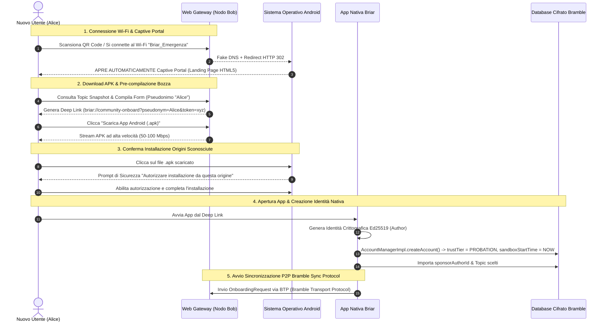

# Specifica di Modulo 1: Accesso via Browser ed Onboarding Progressivo

Questo documento costituisce la **specifica formale del Modulo 1**, definendo i requisiti, l'architettura d'accesso, la distinzione tra i QR Code, i flussi di sistema e lo pseudocodice architetturale per la riprogettazione del meccansimo d'ingresso di Briar, in aderenza alle specifiche di **Statement Progetto Tesi - v1.1.md**.

---

## 1. Requisiti di Sistema

### 1.1 Requisiti Funzionali
* **RF-01 (Accesso Browser Offline)**: Un utente privo dell'applicazione e senza connessione Internet deve potersi connettere al Gateway Web locale tramite Wi-Fi e consultare la Landing Page HTML5 della comunità.
* **RF-02 (Distribuzione Offline dell'APK)**: Il Gateway Web deve consentire il download diretto dell'APK firmato dell'applicazione Android tramite HTTP locale.
* **RF-03 (Separazione Tipologie QR Code)**: Il sistema deve gestire in modo distinto il **QR Code Pubblico di Comunità** (ingresso generico in Sandbox) e il **QR Code d'Invito Personale** (ingresso con sponsorizzazione autenticata).
* **RF-04 (Integrazione Deep Link Sicuro)**: Il form web deve generare un Deep Link Android (`briar://community-onboard?...`) per pre-compilare automaticamente lo pseudonimo ed i topic scelti nel wizard d'installazione.
* **RF-05 (Profili Sandbox `PROBATION`)**: Ogni nuovo account generato viene avviato in modalità restrittiva Sandbox (**`TrustTier.PROBATION`**), applicando un rate-limiting (max 1 post al giorno) e restrizioni di sincronizzazione.
* **RF-06 (Scoperta Snapshot Topic)**: I topic erogati dal Gateway Web rappresentano la **fotografia locale del DB del nodo Gateway**, integrando l'identità del nodo emittente ed il timestamp dell'ultimo aggiornamento.
* **RF-07 (Promozione via Quorum Multicriterio)**: Il passaggio da Sandbox a membro effettivo (**`FULL_MEMBER`**) avviene solo al soddisfacimento concorrente di 5 requisiti (Time-lock 72h, Quorum $K=3$ endorsement distinti, Sponsor iniziale, 1 post valido, 0 segnalazioni di abuso).

### 1.2 Requisiti di Sicurezza (RS)
* **RS-01 (Protezione Dati Sensibili nei Deep Link)**: I Deep Link non devono esporre in chiaro chiavi private, token di sessione o credenziali del database nella query string dell'browser. Tutti i parametri sensibili devono essere codificati/cifrati o collegati tramite token effimeri.
* **RS-02 (Autenticabilità e Scadenza QR d'Invito)**: I QR Code d'Invito Personale devono essere firmati digitalmente via Ed25519 dal `FULL_MEMBER` emittente ed includere un timestamp di scadenza (*TTL*) per prevenire attacchi di replay.
* **RS-03 (Isolamento dei Gruppi in Sandbox)**: Un nodo in Sandbox non deve poter accedere ai gruppi di discussione riservati o ai report bollati come `CRITICAL` finché non viene promosso.

### 1.3 Requisiti di Rete e Hardware (RN)
* **RN-01 (Hotspot Wi-Fi Local-Only)**: Lo smartphone gateway deve attivare l'Access Point Wi-Fi tramite l'API `WifiManager.startLocalOnlyHotspot()`.
* **RN-02 (Captive Portal Automatico)**: Il gateway deve eseguire un server DNS UDP Fake (porta 53) per reindirizzare i controlli di connettività dei browser verso la Landing Page HTTP locale.
* **RN-03 (Protocollo di Trasporto BTP e Bramble Sync)**: La comunicazione P2P nativa tra smartphone deve avvenire sopra il livello di trasporto **BTP (Bramble Transport Protocol)** ed il motore di sincronizzazione epidemica **Bramble Sync Protocol**.

---

## 2. Distinzione tra QR Code e Sicurezza dei Deep Link

```
 ┌────────────────────────────────────────────────────────────────────────────────────┐
 │                                 TIPOLOGIE DI QR CODE                               │
 ├────────────────────────────────────────────┬───────────────────────────────────────┤
 │ 1. QR CODE PUBBLICO DI COMUNITÀ            │ 2. QR CODE D'INVITO PERSONALE         │
 ├────────────────────────────────────────────┼───────────────────────────────────────┤
 │ • Affisso su cartelli nell'area d'emergenza│ • Mostrato a schermo da un FULL       │
 │ • SSID Wi-Fi + URL Gateway HTTP locale     │ • URL URI Scheme "briar://invite"     │
 │ • Ingresso autonomo senza sponsor          │ • Firmato con chiave Ed25519          │
 │ • Account avviato in Sandbox rigorosa      │ • TTL / Data di Scadenza (Anti-Replay)│
 │                                            │ • Registra SponsorAuthorId nel DB     │
 └────────────────────────────────────────────┴───────────────────────────────────────┘
```

### 2.1 QR Code Pubblico di Comunità (Ingresso Autonomo)
* **Scopo**: Consentire l'accesso informativo ed il download dell'APK a chiunque arrivi sul posto.
* **Esito Onboarding**: L'utente installa l'app e crea l'account in autonomia. Non essendoci uno sponsor iniziale predefinito, la promozione a `FULL_MEMBER` richiederà l'incontro P2P ed il voto favorevole di $K membri della comunità ed il trascorrere del time-lock di 72 ore.

### 2.2 QR Code d'Invito Personale (Invito Autenticato da Sponsor)
* **Scopo**: Consentire a un `FULL_MEMBER` (*Bob*) di invitare sul campo un nuovo utente (*Alice*), fungendo da primo sponsor.
* **Caratteristiche di Sicurezza**:
  * **Firma Digitalmente Verificabile**: La firma Ed25519 garantisce che l'invito sia stato emesso da un membro autentico.
  * **Timestamp di Scadenza (TTL)**: L'invito scade dopo un intervallo definito (es. 24 ore) per evitare che il QR Code venga fotografato e riutilizzato indebitamente in momenti successivi.
  * **Registrazione dello Sponsor**: L'app nativa di Alice estrae l'AuthorId di Bob e lo salva nel proprio DB come `sponsorAuthorId`, soddisfacendo il **Requisito di Sponsor Iniziale**.

### 2.3 Sicurezza dei Deep Link e Collegamento tra Richiesta Web e App Nativa
* **Codifica dei Parametri**: Tutti i parametri scambiati nel Deep Link (`briar://community-onboard?...`) utilizzano la codifica percentuale ed il formato `Base64URL`.
* **Protezione dei Dati Sensibili**: Nessuna chiave privata o secret key del database cifrato viene mai passata nella query string.
* **Binding Sicuro (Nonce Effimero)**: Il form web HTML5 invia la bozza al gateway generandone un token effimero mono-uso (`draftToken`). Quando l'app nativa si avvia tramite Deep Link, convalida il token con il Gateway locale, garantendo la corrispondenza univoca tra la bozza web ed l'account nativo generato.

### 2.4 Fotografia Locale dei Topic (Local Snapshot)
I topic serviti dal Gateway Web alla rotta `/api/topics` **non rappresentano un elenco globale centralizzato**, ma costituiscono la **fotografia snapshot del database locale del nodo Gateway**:
* **Payload JSON Erogato**:
  ```json
  {
    "gatewayNodeId": "a8f3b2...",
    "snapshotTimestampMs": 1728315000000,
    "activeTopics": ["#emergenza-sanitaria", "#soccorsi-infrastrutture", "#distribuzione-viveri"]
  }
  ```
L'interfaccia web mostra chiaramente all'utente l'indicazione: *"Topic aggiornati al nodo Gateway di Bob (10 minuti fa)"*.

---

## 3. Flussi di Sistema ed End-to-End User Journey

Il seguente diagramma illustra il percorso completo del nuovo utente:



---

## 4. Gestione dei Gruppi Bramble e Visibilità dei Contenuti (BTP & Bramble Sync Protocol)

### 4.1 Terminologia Protocollare Verificata
Nel codebase di Briar/Bramble, le componenti di rete e sincronizzazione utilizzano una terminologia rigorosa:

* **BTP (Bramble Transport Protocol)**: Livello di trasporto fisico e framing dei pacchetti cifrati su canali Bluetooth e Wi-Fi Direct.
* **Bramble Sync Protocol (Sync Engine)**: Motore di sincronizzazione epidemica basato sui 5 record BSS: `VERSIONS` (negoziazione), `OFFER` (annuncio MessageId), `REQUEST` (richiesta corpo), `MESSAGE` (trasferimento payload BDF) ed `ACK` (conferma di ricezione).
* **BDF (Bramble Data Format)**: Formato binario di serializzazione dati basato sulle strutture `BdfList` e `BdfDictionary`.
* **Group, GroupId, ClientId & GroupVisibility**:
  * `ClientId`: Identificatore del modulo client applicativo (es. `org.briarproject.briar.community`).
  * `GroupId`: Hash SHA-256 del gruppo topic/comunità.
  * `GroupVisibility`: Matrice di condivisione che definisce se un messaggio appartenente ad un `GroupId` debba essere offerto ad un determinato `ContactId`.

---

### 4.2 Matrice di Condivisione dei Gruppi: Chi Condivide con Chi

In Bramble, la visibilità dei gruppi determina l'instradamento dei messaggi sulla rete ad-hoc:

```
┌────────────────────────────────────────────────────────────────────────────────┐
│                   MATRICE DI CONDIVISIONE GRUPPI BRAMBLE                       │
├──────────────────────────┬─────────────────────────────────────────────────────┤
│ NODO IN SANDBOX          │ • Ha visibilità abilitata SOLO per il Gruppo        │
│ (`PROBATION`)            │   Generale Comunità (per inviare OnboardingRequest) │
│                          │ • Sincronizza solo coi peer direttamente adiacenti  │
├──────────────────────────┼─────────────────────────────────────────────────────┤
│ MEMBRO EFFETTIVO         │ • Possiede visibilità COMPLETA su tutti i Topic     │
│ (`FULL_MEMBER`)          │ • Sottoscrive e propaga i messaggi della rete       │
│                          │ • Può emettere messaggi `TrustEndorsementMessage`   │
└──────────────────────────┴─────────────────────────────────────────────────────┘
```

1. **Condivisione tra `FULL_MEMBER` e Nodo `PROBATION`**:
   Quando il membro esistente (*Bob*) si connette al nuovo membro (*Alice* in Sandbox), Bob abilita la visibilità verso Alice **unicamente per il Gruppo Generale di Onboarding**. Bob riceve la `OnboardingRequest` di Alice e può risponderle inviandole un `TrustEndorsementMessage`.
2. **Promozione e Sblocco Bidirezionale Completati**:
   Quando Alice raccoglie i requisiti del Quorum Multicriterio ed invoca `executePromotionToFullMember()`, il suo `TrustManagerImpl` aggiorna `GroupVisibility`, abilitando la sincronizzazione bidirezionale completa per tutti i gruppi dei Topic a cui è sottoscritta.

---

## 5. Mappatura Classi Briar e Pseudocodice di Specifica

> ⚠️ **Nota di Specifica**: Tutti i frammenti di codice riportati in questa sezione costituiscono **Pseudocodice Architetturalmente Verificato**. Tali classi rappresentano la specifica tecnica per le modifiche da applicare sul codebase nativo del repository Briar.

---

### 5.1 Tabella di Mappatura delle Classi Coinvolte

| Classe / Componente | Package di Riferimento | Ruolo Architetturale | Status Modifica |
| :--- | :--- | :--- | :---: |
| **`AccountManagerImpl`** | `bramble-core/.../account/` | Inizializzazione profilo Sandbox e Time-lock DB | **MODIFICA** |
| **`TrustManagerImpl`** | `bramble-core/.../trust/` | Algoritmo di valutazione Quorum Multicriterio | **MODIFICA** |
| **`SetupViewModel`** | `briar-android/.../account/` | Parsing Deep Link e wizard d'ingresso Android | **MODIFICA** |
| **`LinkExchangeFragment`** | `briar-android/.../contact/add/remote/` | Parsing QR d'Invito Personale e registrazione Sponsor | **MODIFICA** |
| **`EmbeddedWebGateway`** | `briar-core/.../web/` | Gateway HTTP Ktor, Captive Portal e Stream APK | **NUOVO** |
| **`CommunityTopicManager`** | `briar-core/.../community/` | Gestione Snapshot Topic locali e Gruppi Bramble | **NUOVO** |
| **`CommunityOnboardingManager`**| `briar-core/.../community/` | Generazione e gestione messaggi BDF di Quorum | **NUOVO** |

---

### 5.2 Pseudocodice delle Componenti Chiave

#### A. `AccountManagerImpl.java` (Pseudocodice Inizializzazione Sandbox)
```java
// PSEUDOCODICE SPECIFICA - Package: org.briarproject.bramble.account.AccountManagerImpl

package org.briarproject.bramble.account;

import org.briarproject.bramble.api.account.AccountManager;
import org.briarproject.bramble.api.identity.IdentityManager;
import org.briarproject.bramble.api.settings.Settings;
import org.briarproject.bramble.api.settings.SettingsManager;
import java.util.List;
import javax.annotation.Nullable;

class AccountManagerImpl implements AccountManager {

    private static final String SETTINGS_NAMESPACE_COMMUNITY = "community.trust";
    private final SettingsManager settingsManager;
    private final IdentityManager identityManager;

    // Pseudocodice estensione createAccount per supporto Onboarding Tesi
    public boolean createAccount(String name, String password, List<String> topics, @Nullable String inviteToken) {
        synchronized (stateChangeLock) {
            // 1. Generazione Identità Ed25519
            Identity identity = identityManager.createIdentity(name);
            identityManager.registerIdentity(identity);

            // 2. Inizializzazione Impostazioni Sandbox Multicriterio
            Settings settings = new Settings();
            long now = System.currentTimeMillis();
            
            settings.put("trustTier", "PROBATION");
            settings.put("sandboxStartTime", String.valueOf(now)); // Inizio Time-lock 72h
            settings.put("endorsementCount", "0");
            settings.put("validPostsCount", "0");
            settings.put("abuseFlagCount", "0");
            settings.put("maxPostsPerDay", "1");
            
            if (topics != null) settings.put("subscribedTopics", String.join(",", topics));
            if (inviteToken != null) settings.put("onboardingToken", inviteToken);

            settingsManager.mergeSettings(settings, SETTINGS_NAMESPACE_COMMUNITY);
            return true;
        }
    }
}
```

---

#### B. `TrustManagerImpl.java` (Pseudocodice Algoritmo Quorum Multicriterio)
```java
// PSEUDOCODICE SPECIFICA - Package: org.briarproject.bramble.trust.TrustManagerImpl

package org.briarproject.bramble.trust;

import org.briarproject.bramble.api.db.DbException;
import org.briarproject.bramble.api.settings.Settings;
import org.briarproject.bramble.api.settings.SettingsManager;

public class TrustManagerImpl {

    private static final String NAMESPACE_COMMUNITY = "community.trust";
    private static final long MIN_SANDBOX_DURATION_MS = 3 * 86_400_000L; // 72 Ore
    private static final int REQUIRED_ENDORSEMENT_QUORUM = 3;             // K = 3
    private final SettingsManager settingsManager;

    /**
     * Pseudocodice di valutazione dei 5 requisiti concorrenti di promozione.
     */
    public synchronized boolean evaluatePromotionEligibility() throws DbException {
        Settings settings = settingsManager.getSettings(NAMESPACE_COMMUNITY);

        if ("FULL_MEMBER".equals(settings.get("trustTier"))) return true;

        long startTime = Long.parseLong(settings.getOrDefault("sandboxStartTime", "0"));
        int endorsementCount = Integer.parseInt(settings.getOrDefault("endorsementCount", "0"));
        int postsCount = Integer.parseInt(settings.getOrDefault("validPostsCount", "0"));
        int abuseFlags = Integer.parseInt(settings.getOrDefault("abuseFlagCount", "0"));
        String sponsorId = settings.get("sponsorAuthorId");

        // VERIFICA DEI 5 REQUISITI
        boolean timeLockPassed = (System.currentTimeMillis() - startTime) >= MIN_SANDBOX_DURATION_MS;
        boolean quorumPassed = endorsementCount >= REQUIRED_ENDORSEMENT_QUORUM;
        boolean sponsorPresent = (sponsorId != null && !sponsorId.isEmpty());
        boolean activityPassed = postsCount >= 1;
        boolean cleanRecord = (abuseFlags == 0);

        if (timeLockPassed && quorumPassed && sponsorPresent && activityPassed && cleanRecord) {
            executePromotionToFullMember();
            return true;
        }
        return false;
    }

    private void executePromotionToFullMember() throws DbException {
        Settings update = new Settings();
        update.put("trustTier", "FULL_MEMBER");
        update.put("promotionTimestamp", String.valueOf(System.currentTimeMillis()));
        settingsManager.mergeSettings(update, NAMESPACE_COMMUNITY);
    }
}
```

---

#### C. `EmbeddedWebGateway.kt` (Pseudocodice Server HTTP, Captive Portal e Stream APK)
```kotlin
// PSEUDOCODICE SPECIFICA - Package: org.briarproject.briar.web.EmbeddedWebGateway

package org.briarproject.briar.web

import io.ktor.server.application.*
import io.ktor.server.engine.*
import io.ktor.server.netty.*
import io.ktor.server.response.*
import io.ktor.server.routing.*
import io.ktor.http.HttpStatusCode
import java.io.File

class EmbeddedWebGateway(private val topicManager: CommunityTopicManager) {

    fun startWebGateway(gatewayIp: String = "192.168.43.1", port: Int = 8080) {
        embeddedServer(Netty, port = port) {
            routing {
                // Intercettazione Captive Portal Android/iOS
                get("/generate_204") { call.respondRedirect("/") }
                get("/gen_204") { call.respondRedirect("/") }

                // Landing Page HTML5
                staticResources("/", "web_landing")

                // Stream APK Android Offline
                get("/download/briar-community.apk") {
                    val apkFile = File("/sdcard/Download/briar-community.apk")
                    if (apkFile.exists()) {
                        call.response.header("Content-Disposition", "attachment; filename=\"briar-community.apk\"")
                        call.respondFile(apkFile)
                    } else {
                        call.respondText("APK non trovato sul gateway", status = HttpStatusCode.NotFound)
                    }
                }

                // Erogazione Snapshot Topic Locali
                get("/api/topics") {
                    val topicsJson = topicManager.getTopicsAsJsonSnapshot(gatewayIp)
                    call.respondText(topicsJson, contentType = io.ktor.http.ContentType.Application.Json)
                }
            }
        }.start(wait = false)
    }
}
```

---

## 6. Fonti Ufficiali e Bibliografia

1. **Briar Project Official Repository & Architecture**:
   * Repository GitLab: [code.briarproject.org/briar/briar](https://code.briarproject.org/briar/briar)
   * Specifiche BSS, BTP e BDF: [Briar Architecture Wiki](https://code.briarproject.org/briar/briar/-/wikis/home)
2. **Android Developer Documentation**:
   * Local-Only Hotspot API: [WifiManager.startLocalOnlyHotspot](https://developer.android.com/reference/android/net/wifi/WifiManager#startLocalOnlyHotspot(android.net.wifi.WifiManager.LocalOnlyHotspotCallback,%20android.os.Handler))
   * Deep Links & Intent Filters: [Handling Android App Links](https://developer.android.com/training/app-links/deep-linking)
3. **IETF & RFC Standards**:
   * RFC 8032: Edwards-Curve Digital Signature Algorithm (Ed25519).
   * RFC 8908: Captive-Portal Identification API.
4. **Letteratura Accademica sulla Sicurezza P2P**:
   * Douceur, J. R. (2002). *"The Sybil Attack"*. International Workshop on Peer-to-Peer Systems (IPTPS). Springer.
5. **Framework Ktor Embedded**:
   * JetBrains Ktor Server Documentation: [ktor.io/docs/server-overview.html](https://ktor.io/docs/server-overview.html)
