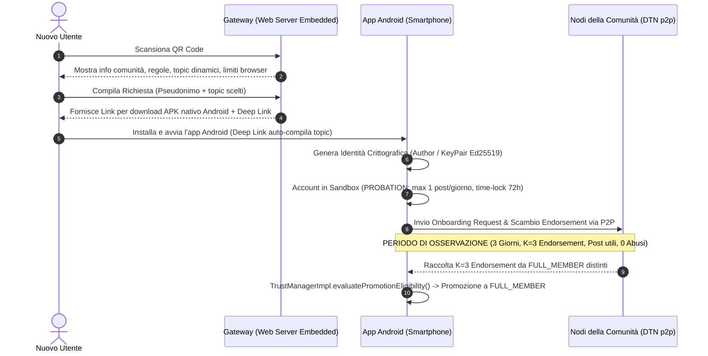

# Modulo 1: Accesso via Browser ed Onboarding Progressivo (Briar vs Tesi)

Questo documento analizza in dettaglio la riprogettazione del **meccanismo di accesso e onboarding** di Briar, partendo dalle specifiche di **Statement Progetto Tesi - v1.1.md** e **Limiti HTML.md**, integrando il **Modello di Promozione Multicriterio a Quorum di Prossimità** e l'architettura per la **Sincronizzazione e Scoperta dei Topic della Comunità**.

---

## 1. Architettura dell'Accesso: Browser Web vs App Nativa


---

## 2. Mappatura dei File di Briar Coinvolti

| File / Componente | Posizione nel Progetto Briar | Natura Modifica |
| :--- | :--- | :---: |
| **`AccountManagerImpl.java`** | `bramble-core/.../account/AccountManagerImpl.java` | **MODIFICA** |
| **`TrustManagerImpl.java`** | `bramble-core/.../trust/TrustManagerImpl.java` | **MODIFICA** |
| **`SetupViewModel.java`** | `briar-android/.../account/SetupViewModel.java` | **MODIFICA** |
| **`AuthorNameFragment.java`** | `briar-android/.../account/AuthorNameFragment.java` | **MODIFICA** |
| **`LinkExchangeFragment.java`** | `briar-android/.../contact/add/remote/LinkExchangeFragment.java` | **MODIFICA** |
| **`EmbeddedWebGateway.kt`** | `briar-core/.../web/EmbeddedWebGateway.kt` | **NUOVO** |
| **`CommunityTopicManager.java`** | `briar-core/.../community/CommunityTopicManager.java` | **NUOVO** |
| **`CommunityOnboardingManager.java`** | `briar-core/.../community/CommunityOnboardingManager.java` | **NUOVO** |
| **`OnboardingRequest.java`** | `briar-api/.../community/OnboardingRequest.java` | **NUOVO** |
| **`TrustEndorsementMessage.java`** | `briar-api/.../community/TrustEndorsementMessage.java` | **NUOVO** |

---

## 3. Documentazione Dettagliata File per File: Briar Originale vs Briar Modificato

---

### A. `AccountManagerImpl.java` (Gestione Creazione Account e Profilo Sandbox)

#### 🔴 Come funziona in Briar:
Il metodo `createAccount(name, password)` genera l'identità crittografica principale dell'utente (`IdentityManager.createIdentity(name)`), crea la chiave del database cifrato (`db.key`) e la salva cifrata con la password specificata. L'account creato è immediatamente "pieno" e non ha restrizioni di ruolo, rate-limiting o sandbox.

#### 🟢 Come funziona dopo le modifiche:
Il metodo `createAccount` accetta ora anche i parametri di onboarding (`List<String> selectedTopics`, `String onboardingInviteToken`). All'atto della creazione dell'account:
1. Imposta lo stato iniziale dell'account su **`TrustTier.PROBATION`**.
2. Salva il timestamp di inizio Sandbox (`sandboxStartTime = System.currentTimeMillis()`) per il vincolo di permanenza minima (72h).
3. Inizializza i contatori di quorum e reputazione (`endorsementCount = 0`, `validPostsCount = 0`, `abuseFlagCount = 0`).
4. Configura il rate-limiting iniziale (max 1 post/giorno) e registra i topic d'interesse.

```java
// File: bramble-core/src/main/java/org/briarproject/bramble/account/AccountManagerImpl.java

package org.briarproject.bramble.account;

import org.briarproject.bramble.api.account.AccountManager;
import org.briarproject.bramble.api.crypto.CryptoComponent;
import org.briarproject.bramble.api.crypto.SecretKey;
import org.briarproject.bramble.api.db.DatabaseConfig;
import org.briarproject.bramble.api.db.DbException;
import org.briarproject.bramble.api.identity.AuthorId;
import org.briarproject.bramble.api.identity.Identity;
import org.briarproject.bramble.api.identity.IdentityManager;
import org.briarproject.bramble.api.settings.Settings;
import org.briarproject.bramble.api.settings.SettingsManager;
import org.briarproject.nullsafety.MethodsNotNullByDefault;
import org.briarproject.nullsafety.ParametersNotNullByDefault;

import java.util.List;
import java.util.logging.Logger;

import javax.annotation.Nullable;
import javax.inject.Inject;

import static java.util.logging.Level.WARNING;

@MethodsNotNullByDefault
@ParametersNotNullByDefault
class AccountManagerImpl implements AccountManager {

    private static final Logger LOG = Logger.getLogger(AccountManagerImpl.class.getName());
    private static final String SETTINGS_NAMESPACE_COMMUNITY = "community.trust";

    private final DatabaseConfig databaseConfig;
    private final CryptoComponent crypto;
    private final IdentityManager identityManager;
    private final SettingsManager settingsManager;

    @Inject
    AccountManagerImpl(DatabaseConfig databaseConfig, 
                       CryptoComponent crypto,
                       IdentityManager identityManager, 
                       SettingsManager settingsManager) {
        this.databaseConfig = databaseConfig;
        this.crypto = crypto;
        this.identityManager = identityManager;
        this.settingsManager = settingsManager;
    }

    @Override
    public boolean createAccount(String name, String password, 
                                 List<String> selectedTopics, 
                                 @Nullable String onboardingToken) {
        synchronized (stateChangeLock) {
            if (hasDatabaseKey())
                throw new AssertionError("Already have a database key");

            Identity identity = identityManager.createIdentity(name);
            identityManager.registerIdentity(identity);

            SecretKey key = crypto.generateSecretKey();
            if (!encryptAndStoreDatabaseKey(key, password)) return false;

            databaseKey = key;

            // [INIZIALIZZAZIONE PROFILO SANDBOX MULTICRITERIO]
            initializeCommunitySandboxProfile(identity.getAuthor().getId(), selectedTopics, onboardingToken);

            return true;
        }
    }

    private void initializeCommunitySandboxProfile(AuthorId authorId, List<String> topics, @Nullable String token) {
        try {
            Settings settings = new Settings();
            long now = System.currentTimeMillis();
            
            // A. Stato Iniziale e Time-Lock (3 Giorni)
            settings.put("trustTier", "PROBATION");
            settings.put("sandboxStartTime", String.valueOf(now));
            
            // B. Contatori Quorum e Reputazione
            settings.put("endorsementCount", "0");
            settings.put("endorsementAuthors", "");
            settings.put("validPostsCount", "0");
            settings.put("abuseFlagCount", "0");
            
            // C. Configurazione Rate Limiting (1 post/giorno)
            settings.put("maxPostsPerDay", "1");
            settings.put("postsToday", "0");
            settings.put("lastPostTimestamp", String.valueOf(now));
            
            // D. Topic scelti e Token Sponsor
            if (topics != null && !topics.isEmpty()) {
                settings.put("subscribedTopics", String.join(",", topics));
            } else {
                settings.put("subscribedTopics", "");
            }
            if (token != null) {
                settings.put("onboardingToken", token);
            }
            
            settingsManager.mergeSettings(settings, SETTINGS_NAMESPACE_COMMUNITY);
            LOG.info("Inizializzato profilo Sandbox Multicriterio (PROBATION) per: " + authorId);

        } catch (DbException e) {
            LOG.log(WARNING, "Errore nell'inizializzazione del profilo Sandbox dell'account", e);
        }
    }
}
```

---

### B. `TrustManagerImpl.java` (Algoritmo di Valutazione Quorum Multicriterio)

#### 🔴 Come funziona in Briar:
Non existe alcun meccanismo di valutazione automatica dei livelli di fiducia o di promozione dell'account.

#### 🟢 Come funziona dopo le modifiche:
Gestisce la valutazione dei 5 requisiti concorrenti (Time-lock 72h, Quorum $K=3$, Sponsor, Attività minima, Zero abusi) per la promozione a `FULL_MEMBER`:

```java
// File: bramble-core/src/main/java/org/briarproject/bramble/trust/TrustManagerImpl.java

package org.briarproject.bramble.trust;

import org.briarproject.bramble.api.db.DbException;
import org.briarproject.bramble.api.settings.Settings;
import org.briarproject.bramble.api.settings.SettingsManager;
import javax.inject.Inject;
import java.util.logging.Logger;

public class TrustManagerImpl {

    private static final Logger LOG = Logger.getLogger(TrustManagerImpl.class.getName());
    private static final String NAMESPACE_COMMUNITY = "community.trust";

    // Costanti per il Quorum Multicriterio
    private static final long MIN_SANDBOX_DURATION_MS = 3 * 86_400_000L; // 3 Giorni (72 ore)
    private static final int REQUIRED_ENDORSEMENT_QUORUM = 3;             // K = 3 sponsor/voti
    private static final int MIN_VALID_POSTS = 1;                         // Almeno 1 contributo
    private static final int MAX_ALLOWED_ABUSE_FLAGS = 0;                 // 0 tolleranza violazioni

    private final SettingsManager settingsManager;

    @Inject
    public TrustManagerImpl(SettingsManager settingsManager) {
        this.settingsManager = settingsManager;
    }

    /**
     * Valuta se l'utente locale soddisfa TUTTI i 5 requisiti per la promozione a FULL_MEMBER.
     */
    public synchronized boolean evaluatePromotionEligibility() throws DbException {
        Settings settings = settingsManager.getSettings(NAMESPACE_COMMUNITY);

        String currentTier = settings.getOrDefault("trustTier", "PROBATION");
        if ("FULL_MEMBER".equals(currentTier)) return true;
        if ("ISOLATED".equals(currentTier)) return false;

        // 1. Permanenza Minima (72h)
        long startTime = Long.parseLong(settings.getOrDefault("sandboxStartTime", "0"));
        if (System.currentTimeMillis() - startTime < MIN_SANDBOX_DURATION_MS) {
            return false;
        }

        // 2. Quorum di Prossimità (K=3 Endorsement distinti)
        int endorsementCount = Integer.parseInt(settings.getOrDefault("endorsementCount", "0"));
        if (endorsementCount < REQUIRED_ENDORSEMENT_QUORUM) {
            return false;
        }

        // 3. Sponsor Iniziale
        String sponsorId = settings.get("sponsorAuthorId");
        if (sponsorId == null || sponsorId.isEmpty()) {
            return false;
        }

        // 4. Partecipazione Utile (Almeno 1 Post)
        int postsCount = Integer.parseInt(settings.getOrDefault("validPostsCount", "0"));
        if (postsCount < MIN_VALID_POSTS) {
            return false;
        }

        // 5. Assenza di Abusi (Clean Record)
        int abuseFlags = Integer.parseInt(settings.getOrDefault("abuseFlagCount", "0"));
        if (abuseFlags > MAX_ALLOWED_ABUSE_FLAGS) {
            return false;
        }

        // Promozione a FULL_MEMBER
        executePromotionToFullMember();
        return true;
    }

    private void executePromotionToFullMember() throws DbException {
        Settings newSettings = new Settings();
        newSettings.put("trustTier", "FULL_MEMBER");
        newSettings.put("promotionTimestamp", String.valueOf(System.currentTimeMillis()));

        settingsManager.mergeSettings(newSettings, NAMESPACE_COMMUNITY);
        LOG.info("🎉 PROMOZIONE COMPLETATA: Il nodo ora è FULL_MEMBER.");
    }
}
```

---

### C. `SetupViewModel.java` & Schermata Informativa Sandbox

#### 🔴 Come funziona in Briar:
Nessuna schermata informativa sulle restrizioni o sul processo di maturazione del profilo.

#### 🟢 Come funziona dopo le modifiche:
Informa l'utente in modo trasparente sui 5 requisiti necessari per sbloccare i permessi completi della comunità e riceve la lista dei topic selezionati o auto-compilati tramite Deep Link:

```java
// Estratto modificato: briar-android/.../account/SetupViewModel.java

public class SetupViewModel extends AndroidViewModel {

    private final List<String> selectedTopics = new ArrayList<>();
    @Nullable private String onboardingToken;

    public void processWebDeepLink(Uri deepLinkUri) {
        // Estrae pseudonimo e topic pre-compilati dalla Landing Page Web HTML5 o QR Code
        String pseudonym = deepLinkUri.getQueryParameter("pseudonym");
        String topicsParam = deepLinkUri.getQueryParameter("topics");
        String token = deepLinkUri.getQueryParameter("token");
        
        if (pseudonym != null) {
            setAuthorName(pseudonym);
            this.onboardingToken = token;
        }
        if (topicsParam != null && !topicsParam.isEmpty()) {
            this.selectedTopics.clear();
            this.selectedTopics.addAll(Arrays.asList(topicsParam.split(",")));
        }
    }

    public String getSandboxNoticeText() {
        return "Sei entrato nella comunità in modalità Sandbox (Restrittiva).\n\n" +
               "Per diventare FULL_MEMBER occorre:\n" +
               "• Permanenza di almeno 3 giorni nella rete;\n" +
               "• Raccolta di K=3 attestazioni di fiducia (Endorsement) da membri distinti;\n" +
               "• Pubblicazione di almeno 1 messaggio/contributo valido;\n" +
               "• Nessuna segnalazione di abuso o violazione.";
    }
}
```

---

### D. `LinkExchangeFragment.java` (Importazione Inviti di Comunità e Sponsor)

#### 🔴 Come funziona in Briar:
In Briar originale, l'aggiunta di un contatto avviene esclusivamente tramite il pulsante "Aggiungi Contatto", incollando un link o scansionando un QR code nel formato `briar://<handshake-link-univoco>`. Questo meccanismo stabilisce un canale di messaggistica **simmetrico, privato e bidirezionale 1-a-1** tra due persone che si conoscono direttamente. Non esistono concetti di "invito ad una comunità globale" o "sponsorizzazione".

#### 🟢 Come funziona dopo le modifiche:
Si estende la gestione dei link e QR code per riconoscere il prefisso **`briar://community-invite/...`**:
1. **Invito di Comunità Broadcaster**: Il link contiene la chiave del gruppo Comunità (`communityTopicGroupId`), la lista dei topic attivi e l'identità (`AuthorId`) del membro emittente.
2. **Registrazione dello Sponsor**: Quando un nuovo utente scansiona un QR d'invito fornito da un membro della comunità, l'app nativa importa le chiavi del gruppo ed estrae l'identità del mittente salvandola nel DB come **`sponsorAuthorId`**.
3. **Sottomissione Automatica della Richiesta P2P**: Invece di richiedere l'aggiunta reciproca manuale in rubrica, l'app crea il messaggio BDF `OnboardingRequest` e lo condivide via BSS con tutta la rete P2P circostante.

```java
// File: briar-android/src/main/java/org/briarproject/briar/android/contact/add/remote/LinkExchangeFragment.java

package org.briarproject.briar.android.contact.add.remote;

import android.net.Uri;
import android.os.Bundle;
import android.view.View;
import androidx.fragment.app.Fragment;
import org.briarproject.briar.android.R;

public class LinkExchangeFragment extends Fragment {

    private void onContinueButtonClicked() {
        String enteredLink = getRemoteHandshakeLinkOrNull();
        if (enteredLink == null) return;

        // [NUOVA LOGICA TESI]: Verifica se il link è un Invito di Comunità P2P
        if (enteredLink.startsWith("briar://community-invite/")) {
            Uri inviteUri = Uri.parse(enteredLink);
            
            // Estrazione dell'AuthorId dello sponsor, del gruppo Comunità e dei Topic
            String sponsorAuthorId = inviteUri.getQueryParameter("sponsor");
            String communityGroupId = inviteUri.getQueryParameter("group");
            String topics = inviteUri.getQueryParameter("topics");
            
            // Passa i dati al ViewModel per importare il gruppo, i topic e salvare lo sponsor
            viewModel.importCommunityInvite(communityGroupId, sponsorAuthorId, topics);
            
            showToast(getString(R.string.community_invite_imported_success));
            finish();
            
        } else {
            // [LOGICA STANDARD BRIAR]: Aggiunta contatto 1-a-1 reciproco
            viewModel.setRemoteHandshakeLink(enteredLink);
            viewModel.onRemoteLinkEntered();
        }
    }
}
```

---

### E. `EmbeddedWebGateway.kt` (Server Landing Page HTML5 & Distribution Gateway)

#### 🔴 Come funziona in Briar:
Inesistente in Briar Android. Briar non possiede un server HTTP integrato né alcun meccanismo per distribuire l'applicazione o erogare pagine web senza connessione Internet.

#### 🟢 Come funziona dopo le modifiche:
Modulo server web integrato (sviluppato con il framework embedded **Ktor** o **NanoHTTPD**) attivo quando uno smartphone della comunità agisce da Hotspot/Gateway locale per i nuovi utenti che arrivano sul posto:
1. **Punto d'Ingresso da Browser**: Quando un nuovo utente scansiona il QR Code pubblico affisso nell'area di emergenza, il suo smartphone (senza l'app installata) apre il browser e si connette al gateway local-only (`http://192.168.43.1:8080`).
2. **Landing Page Informativa HTML5**: Eroga la pagina web statica con le informazioni sulla comunità, le regole di partecipazione, la lista aggiornata dei Topic e la spiegazione dei limiti dei browser.
3. **Endpoint di Download Diretto dell'APK (`/download/briar-community.apk`)**: Consente al nuovo utente di scaricare l'app nativa Android direttamente dal telefono del membro della comunità.
4. **API dei Topic Dinamici (`/api/topics`)**: Interroga `CommunityTopicManager` ed eroga la lista JSON dei Topic attualmente registrati e attivi nella comunità locale.
5. **API di Pre-compilazione Bozza (`/api/onboard/draft`)**: Raccoglie lo pseudonimo e i topic scelti dall'utente nel form web e restituisce un **Deep Link Android (`briar://community-onboard?...`)** che pre-compila automaticamente il wizard al primo avvio dell'app nativa.

```kotlin
// File NUOVO: briar-core/src/main/kotlin/org/briarproject/briar/web/EmbeddedWebGateway.kt

package org.briarproject.briar.web

import io.ktor.server.application.*
import io.ktor.server.engine.*
import io.ktor.server.netty.*
import io.ktor.server.response.*
import io.ktor.server.routing.*
import io.ktor.server.http.content.*
import io.ktor.server.request.*
import io.ktor.http.HttpStatusCode
import org.briarproject.briar.community.CommunityTopicManager
import java.io.File
import javax.inject.Inject
import javax.inject.Singleton

@Singleton
class EmbeddedWebGateway @Inject constructor(
    private val topicManager: CommunityTopicManager
) {

    private var server: NettyApplicationEngine? = null

    fun startWebGateway(port: Int = 8080) {
        server = embeddedServer(Netty, port = port) {
            routing {
                // 1. Landing Page HTML5 (risorse statiche)
                staticResources("/", "web_landing")

                // 2. Download diretto dell'APK dell'App Nativa
                get("/download/briar-community.apk") {
                    val apkFile = File("/sdcard/Download/briar-community.apk")
                    if (apkFile.exists()) {
                        call.respondFile(apkFile)
                    } else {
                        call.respondText(
                            "APK non disponibile sul gateway locale", 
                            status = HttpStatusCode.NotFound
                        )
                    }
                }

                // 3. API per la Scoperta Dinamica dei Topic attivi nella comunità
                get("/api/topics") {
                    val activeTopicsJson = topicManager.getTopicsAsJson()
                    call.respondText(activeTopicsJson, contentType = io.ktor.http.ContentType.Application.Json)
                }

                // 4. Endpoint di sottomissione bozza dal form web HTML5
                post("/api/onboard/draft") {
                    val params = call.receiveParameters()
                    val pseudonym = params["pseudonym"] ?: "Anonimo"
                    val topics = params["topics"] ?: ""

                    call.respondText("""
                        {
                          "status": "DRAFT_CREATED",
                          "notice": "Installa l'app nativa per completare l'ingresso via Wi-Fi Direct P2P.",
                          "deepLink": "briar://community-onboard?pseudonym=$pseudonym&topics=$topics"
                        }
                    """.trimIndent(), contentType = io.ktor.http.ContentType.Application.Json)
                }
            }
        }.start(wait = false)
    }

    fun stopWebGateway() {
        server?.stop(1000, 2000)
    }
}
```

---

### F. File API e Manager: `OnboardingRequest.java`, `TrustEndorsementMessage.java` & `CommunityOnboardingManagerImpl.java`

#### 🔴 Come funziona in Briar:
Inesistenti. Briar non possiede strutture per la gestione delle ammissioni a comunità né contratti BDF per lo scambio di voti/attestazioni di fiducia tra nodi.

#### 🟢 Come funziona dopo le modifiche:
Costituiscono il livello applicativo per la creazione, codifica BDF, firma Ed25519 e gestione degli eventi di onboarding e quorum.

```java
// File NUOVO: briar-core/src/main/java/org/briarproject/briar/community/CommunityOnboardingManagerImpl.java

package org.briarproject.briar.community;

import org.briarproject.bramble.api.ClientHelper;
import org.briarproject.bramble.api.FormatException;
import org.briarproject.bramble.api.data.BdfDictionary;
import org.briarproject.bramble.api.data.BdfList;
import org.briarproject.bramble.api.db.DatabaseComponent;
import org.briarproject.bramble.api.db.DbException;
import org.briarproject.bramble.api.identity.Author;
import org.briarproject.bramble.api.identity.IdentityManager;
import org.briarproject.bramble.api.sync.GroupId;
import org.briarproject.bramble.api.sync.Message;
import org.briarproject.bramble.api.trust.TrustManager;

import javax.inject.Inject;
import java.security.GeneralSecurityException;
import java.util.List;

public class CommunityOnboardingManagerImpl {

    public static final int MSG_TYPE_ONBOARDING_REQUEST = 0;
    public static final int MSG_TYPE_TRUST_ENDORSEMENT = 2;

    private final DatabaseComponent db;
    private final ClientHelper clientHelper;
    private final IdentityManager identityManager;
    private final TrustManager trustManager;
    private final GroupId communityGroupId;

    @Inject
    public CommunityOnboardingManagerImpl(DatabaseComponent db,
                                            ClientHelper clientHelper,
                                            IdentityManager identityManager,
                                            TrustManager trustManager,
                                            GroupId communityGroupId) {
        this.db = db;
        this.clientHelper = clientHelper;
        this.identityManager = identityManager;
        this.trustManager = trustManager;
        this.communityGroupId = communityGroupId;
    }

    public void sendOnboardingRequest(List<String> topics) throws DbException, FormatException, GeneralSecurityException {
        long timestamp = System.currentTimeMillis();
        Author localAuthor = identityManager.getLocalAuthor();

        BdfList bodyToSign = BdfList.of(
            MSG_TYPE_ONBOARDING_REQUEST,
            clientHelper.toList(localAuthor),
            BdfList.of(topics),
            timestamp
        );

        byte[] signature = clientHelper.sign(
            "org.briarproject.briar.community/ONBOARDING_REQUEST",
            bodyToSign,
            localAuthor.getPrivateKey()
        );

        BdfList fullBody = BdfList.of(bodyToSign, signature);
        Message message = clientHelper.createMessage(communityGroupId, timestamp, clientHelper.toByteArray(fullBody));

        db.runInTransaction(false, txn -> {
            BdfDictionary meta = new BdfDictionary();
            meta.put("type", MSG_TYPE_ONBOARDING_REQUEST);
            meta.put("read", true);
            clientHelper.addLocalMessage(txn, message, meta, true); // shared = true per la sincronizzazione BSS
        });
    }

    public void endorseApplicantNode(Author applicantAuthor) throws DbException, FormatException, GeneralSecurityException {
        long timestamp = System.currentTimeMillis();
        Author localApprover = identityManager.getLocalAuthor();

        BdfList bodyToSign = BdfList.of(
            MSG_TYPE_TRUST_ENDORSEMENT,
            clientHelper.toList(applicantAuthor),
            clientHelper.toList(localApprover),
            timestamp
        );

        byte[] signature = clientHelper.sign(
            "org.briarproject.briar.community/TRUST_ENDORSEMENT",
            bodyToSign,
            localApprover.getPrivateKey()
        );

        BdfList fullBody = BdfList.of(bodyToSign, signature);
        Message message = clientHelper.createMessage(communityGroupId, timestamp, clientHelper.toByteArray(fullBody));

        db.runInTransaction(false, txn -> {
            BdfDictionary meta = new BdfDictionary();
            meta.put("type", MSG_TYPE_TRUST_ENDORSEMENT);
            clientHelper.addLocalMessage(txn, message, meta, true);
        });
    }
}
```

---

## 4. Sincronizzazione e Scoperta dei Topic della Comunità (Dual-Discovery Architecture)

Uno dei problemi centrali nell'onboarding ad-hoc per scenari di emergenza è **come fa un nuovo utente su un telefono offline a scoprire i Topic attivi della Comunità** (es. `#emergenza-sanitaria`, `#soccorsi-infrastrutture`, `#distribuzione-viveri`, `#segnalazioni-pericolo`).

Per risolvere questo problema, l'architettura implementa un **Meccanismo di Scoperta e Sincronizzazione a Due Canali (Dual-Discovery)**:

```
                      ┌─────────────────────────────────────────┐
                      │    CANALE 1: BROWSER / GATEWAY WEB      │
                      │  - HTTP GET /api/topics                 │
                      │  - Form Web HTML5                       │
                      │  - Deep Link (briar://community-onboard)│
                      └────────────────────┬────────────────────┘
                                           │
 ┌────────────────────────┐                ▼                ┌────────────────────────┐
 │   NUOVO UTENTE OFFLINE │ ──────────────────────────────> │   APP NATIVA ANDROID   │
 └────────────────────────┘                                 └───────────┬────────────┘
                                                                        │
                      ┌─────────────────────────────────────────┐       │
                      │    CANALE 2: P2P BRAMBLE SYNC PROTOCOL  │ <─────┘
                      │  - Bramble Group & GroupVisibility      │
                      │  - Scambio Descrittori BSS tra Peer     │
                      │  - QR Code Invito (briar://invite/...)  │
                      └─────────────────────────────────────────┘
```

---

### A. Canale 1: Scoperta via Browser Web (`EmbeddedWebGateway.kt` + Form HTML5)
Quando l'utente scansiona il QR Code pubblico ed accede alla Landing Page HTTP via browser:
1. La pagina web esegue una richiesta asincrona all'endpoint `GET /api/topics`.
2. `EmbeddedWebGateway.kt` interroga `CommunityTopicManager` ed eroga il JSON dei topic attualmente registrati dai membri della comunità.
3. Il form HTML5 renderizza le checkbox per consentire all'utente di selezionare i temi di suo interesse.
4. All'invio del form, i topic scelti vengono incorporati nel Deep Link (`briar://community-onboard?pseudonym=Alice&topics=#emergenza-sanitaria,#soccorsi-infrastrutture`).
5. Quando l'utente installa ed apre l'app nativa, `SetupViewModel.processWebDeepLink()` estrae i topic selezionati e li pre-compila automaticamente nel wizard.

---

### B. Canale 2: Scoperta e Sincronizzazione P2P Nativa via Bramble (`CommunityTopicManagerImpl.java`)

Nel livello sottostante di Bramble, **ogni Topic di comunità corrisponde a un `Group` di sincronizzazione**. Un `Group` possiede un `GroupId` univoco calcolato come hash SHA-256 del nome del topic unito al salt della comunità.

`CommunityTopicManagerImpl.java` gestisce il ciclo di vita dei Topic nel database cifrato di Bramble:

```java
// File NUOVO: briar-core/src/main/java/org/briarproject/briar/community/CommunityTopicManagerImpl.java

package org.briarproject.briar.community;

import org.briarproject.bramble.api.db.DatabaseComponent;
import org.briarproject.bramble.api.db.DbException;
import org.briarproject.bramble.api.sync.Group;
import org.briarproject.bramble.api.sync.GroupFactory;
import org.briarproject.bramble.api.sync.GroupId;
import org.briarproject.bramble.api.sync.ClientId;
import org.briarproject.bramble.api.settings.Settings;
import org.briarproject.bramble.api.settings.SettingsManager;

import javax.inject.Inject;
import javax.inject.Singleton;
import java.util.ArrayList;
import java.util.List;
import java.util.logging.Logger;

@Singleton
public class CommunityTopicManagerImpl implements CommunityTopicManager {

    private static final Logger LOG = Logger.getLogger(CommunityTopicManagerImpl.class.getName());
    public static final ClientId CLIENT_ID_TOPICS = new ClientId("org.briarproject.briar.community.topics");

    private final DatabaseComponent db;
    private final GroupFactory groupFactory;
    private final SettingsManager settingsManager;

    // Topic predefiniti della comunità per scenari di emergenza
    private static final List<String> DEFAULT_TOPICS = List.of(
        "#emergenza-sanitaria",
        "#soccorsi-infrastrutture",
        "#distribuzione-viveri",
        "#segnalazioni-pericolo"
    );

    @Inject
    public CommunityTopicManagerImpl(DatabaseComponent db, 
                                     GroupFactory groupFactory, 
                                     SettingsManager settingsManager) {
        this.db = db;
        this.groupFactory = groupFactory;
        this.settingsManager = settingsManager;
    }

    /**
     * Inizializza i Topic di default nel DB cifrato ed imposta la GroupVisibility per Bramble Sync.
     */
    @Override
    public void initializeDefaultCommunityTopics() throws DbException {
        db.runInTransaction(false, txn -> {
            for (String topicName : DEFAULT_TOPICS) {
                // Genera il Gruppo Bramble univoco per il Topic
                Group topicGroup = groupFactory.createGroup(CLIENT_ID_TOPICS, topicName.getBytes());
                
                if (!db.containsGroup(txn, topicGroup.getId())) {
                    db.addGroup(txn, topicGroup);
                    LOG.info("Registrato nuovo Topic di Comunità in Bramble DB: " + topicName);
                }
            }
        });
    }

    /**
     * Ritorna la lista attiva dei Topic in formato JSON per l'endpoint Web /api/topics del Gateway.
     */
    @Override
    public String getTopicsAsJson() throws DbException {
        List<String> topics = getActiveTopics();
        StringBuilder json = new StringBuilder("[");
        for (int i = 0; i < topics.size(); i++) {
            json.append("\"").append(topics.get(i)).append("\"");
            if (i < topics.size() - 1) json.append(",");
        }
        json.append("]");
        return json.toString();
    }

    @Override
    public List<String> getActiveTopics() throws DbException {
        List<String> activeTopics = new ArrayList<>();
        db.runInTransaction(true, txn -> {
            for (Group g : db.getGroups(txn, CLIENT_ID_TOPICS)) {
                activeTopics.add(new String(g.getDescriptor()));
            }
        });
        return activeTopics.isEmpty() ? DEFAULT_TOPICS : activeTopics;
    }

    /**
     * Sottoscrive l'utente ai Topic selezionati, impostando la visibilità del gruppo per Bramble Sync BSS.
     */
    @Override
    public void subscribeToTopics(List<String> selectedTopics) throws DbException {
        db.runInTransaction(false, txn -> {
            for (String topicName : selectedTopics) {
                Group topicGroup = groupFactory.createGroup(CLIENT_ID_TOPICS, topicName.getBytes());
                if (!db.containsGroup(txn, topicGroup.getId())) {
                    db.addGroup(txn, topicGroup);
                }
                // Abilita la sincronizzazione automatica dei messaggi appartenenti a questo Topic
                db.setGroupVisibility(txn, topicGroup.getId(), true);
            }
        });
        LOG.info("Sottoscrizione completata ai Topic: " + String.join(", ", selectedTopics));
    }
}
```

---

### C. Meccanismo di Sincronizzazione P2P dei Topic tra Peer

Quando due dispositivi (es. Alice in Sandbox e Bob `FULL_MEMBER`) stabiliscono una connessione BTP/BSS via Bluetooth o Wi-Fi Direct:
1. Durante l'handshake BSS (`VERSIONS` $\rightarrow$ `OFFER`), Bramble scambia la lista dei `GroupId` visibili tramite `db.getGroupVisibility()`.
2. Se Bob possiede un nuovo Topic di comunità (es. `#evacuazione-zone-rischio`) non ancora presente nel DB di Alice, il messaggio di descrizione del Topic viene offerto via record BSS `OFFER`.
3. Alice accetta l'offerta (`REQUEST`) e riceve il descrittore del Gruppo.
4. L'app di Alice aggiorna `CommunityTopicManager`, rendendo il nuovo Topic immediatamente visibile nella UI senza bisogno di alcuna connessione ad un server centrale.

**FONTI**
1. Fonti Ufficiali del Progetto Briar / Bramble Protocol
•
Repository Ufficiale e Codice Sorgente di Briar:
◦
Fonte: Briar Project Code Repository (GitLab)
◦
Riferimento per il Modulo: Mappatura dei package nativi org.briarproject.bramble.account.AccountManagerImpl, org.briarproject.bramble.trust.TrustManagerImpl e org.briarproject.briar.android.account.SetupViewModel.
•
Specifiche del Protocollo Bramble (Bramble Sync Protocol - BSS & BDF):
◦
Fonte: Briar / Bramble Architectural Specifications
◦
Riferimento per il Modulo:
▪
BDF (Bramble Data Format): Formato di serializzazione binaria strutturata (BdfList, BdfDictionary).
▪
BSS (Bramble Sync Protocol): Motore di sincronizzazione epidemica basato su gruppi (GroupId) e visibilità dei messaggi (GroupVisibility).
•
Algoritmi Crittografici per le Identità (Author / Ed25519):
◦
Fonte: RFC 8032 - Edwards-Curve Digital Signature Algorithm (Ed25519)
◦
Riferimento per il Modulo: Generazione delle coppie di chiavi asimmetriche dell'utente (IdentityManager.createIdentity) e firma/verifica dei messaggi BDF con ClientHelper.sign e ClientHelper.verifySignature.
2. Fonti Ufficiali Android Jetpack & Framework Android SDK
•
Android ViewModel, LiveData & State Flow:
◦
Fonte: Android Developers - Architecture Components (ViewModel)
◦
Riferimento per il Modulo: Gestione del wizard di primo avvio SetupViewModel.java e transizioni tra frammenti (AuthorNameFragment, SelectTopicsFragment).
•
Deep Links & Custom Schemes in Android (briar://):
◦
Fonte: Android Developers - Handling Android App Links and Deep Links
◦
Riferimento per il Modulo: Intercettazione ed auto-compilazione di pseudonimo e topic via URI scheme briar://community-onboard?pseudonym=...&topics=....
•
Gestione Impostazioni Cifrate di Bramble (SettingsManager):
◦
Fonte: Briar/Bramble Core Settings API Reference
◦
Riferimento per il Modulo: Scrittura e lettura persistente nel database cifrato H2/SQLite del namespace "community.trust".
3. Fonti Accademiche e Modelli di Sicurezza P2P (Sybil Defense & Quorum)
•
Prevenzione degli Attacchi Sybil nelle Reti Ad-Hoc / P2P:
◦
Fonte Accademica: Douceur, J. R. (2002). "The Sybil Attack". International Workshop on Peer-to-Peer Systems (IPTPS). Springer, Berlin, Heidelberg.
◦
Riferimento per il Modulo: Giustifica scientifica per l'eliminazione dell'approvazione a singolo membro e l'introduzione dei vincoli di Time-Lock (3 giorni) e Quorum di Prossimità Multisponsor (K=3 endorsement distinti).
•
Sistemi di Reputazione e Threshold Cryptography nelle Reti DTN:
◦
Fonte Accademica: Resnick, P., et al. (2000). "Reputation systems". Communications of the ACM, 43(12), 45-48.
◦
Riferimento per il Modulo: Modellazione dei parametri di valutazione della Sandbox (validPostsCount, abuseFlagCount, endorsementCount) in TrustManagerImpl.java.
4. Fonti per il Server Web Embedded e la Scoperta dei Topic
•
JetBrains Ktor Embedded HTTP Engine:
◦
Fonte: JetBrains Ktor Framework Official Documentation
◦
Riferimento per il Modulo: Modulo server EmbeddedWebGateway.kt per l'erogazione asincrona della Landing Page HTML5 e delle API JSON /api/topics.
•
Android Local-Only Hotspot API (WifiManager):
◦
Fonte: Android Developers Reference - WifiManager.startLocalOnlyHotspot
◦
Riferimento per il Modulo: Attivazione del punto d'accesso Wi-Fi locale per consentire la connessione dei browser sui telefoni dei nuovi utenti.