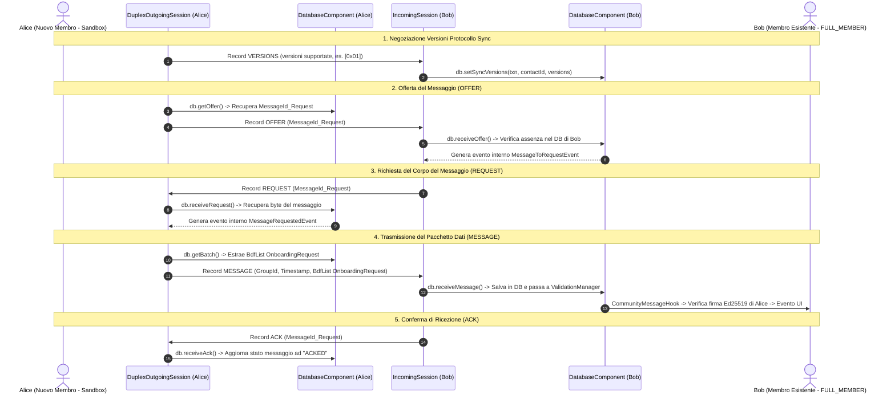
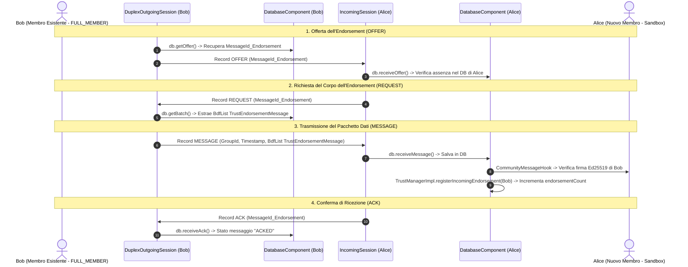

# Dettaglio Tecnico della Comunicazione P2P 1-a-1 tra Peer (BSS & BDF Protocol)

Questo documento descrive nel dettaglio **come avviene la comunicazione diretta 1-a-1** sul canale di trasporto tra un **Nuovo Membro in Sandbox (`Alice`)** ed un **Membro Esistente `FULL_MEMBER` (`Bob`)**.

Lo scopo di questo documento è analizzare l'esatta **sequenza dei Record BSS di basso livello** (Bramble Sync Protocol) e la struttura dei **Messaggi BDF di alto livello** scambiati nei due versi del canale P2P:
1. **Direzione 1 (Alice $\rightarrow$ Bob)**: Invio della `OnboardingRequest` di Alice.
2. **Direzione 2 (Bob $\rightarrow$ Alice)**: Invio del `TrustEndorsementMessage` da parte di Bob (valido come 1 attestazione per il Quorum).

---

## 1. Attori della Sessione P2P 1-a-1

La sessione di sincronizzazione avviene sopra un canale di trasporto cifrato BTP (*Bramble Transport Protocol*), tramite Wi-Fi Direct o Bluetooth:

* **`Alice` (Nuovo Membro / Applicante in Sandbox)**:
  * **Stato DB**: `trustTier = "PROBATION"`.
  * **Ruolo nella sessione**: Genera la richiesta d'ingresso e riceve l'attestazione di fiducia.
* **`Bob` (Membro Esistente / Approfittatore)**:
  * **Stato DB**: `trustTier = "FULL_MEMBER"`.
  * **Ruolo nella sessione**: Riceve la richiesta, valida la firma di Alice e risponde emettendo il proprio `TrustEndorsementMessage`.

---

## 2. Diagrammi di Sequenza della Sincronizzazione P2P 1-a-1

### A. Direzione 1: Trasferimento della `OnboardingRequest` (Alice $\rightarrow$ Bob)



---

### B. Direzione 2: Trasferimento del `TrustEndorsementMessage` (Bob $\rightarrow$ Alice)



---

## 3. Dettaglio Tecnico di Messaggi, Flag, Metadati e Payload

---

### A. RECORD P2P DI BASSO LIVELLO (Bramble Sync Protocol - BSS)

Tutti i record trasmessi sullo stream BTP possiedono un'intestazione fissa composta da:
* **`Protocol Version`** (1 byte: `0x01`)
* **`Record Type`** (1 byte: da `0` a `4`)
* **`Payload Size`** (dimensione variabile del payload racchiuso)

---

#### 1. Record `VERSIONS` (Tipo 4)
* **Flusso**: Inviato all'apertura della connessione P2P.
* **Mittente**: **`Alice`** (o `Bob`) | **Destinatario**: **`Bob`** (o `Alice`)
* **Flag e Metadati**: `Protocol Version = 0x01`, `Record Type = 4`.
* **Payload**: `List<Byte>` contenente le versioni del protocollo Sync supportate (es. `[0x01]`).

---

#### 2. Record `OFFER` (Tipo 2)
* **Flusso**:
  * In Direzione 1: **`Alice`** $\rightarrow$ **`Bob`** (offre `MessageId_Request`).
  * In Direzione 2: **`Bob`** $\rightarrow$ **`Alice`** (offre `MessageId_Endorsement`).
* **Flag e Metadati**: `shared = true` (nel DB mittente), `offered = true` (notificato al peer).
* **Payload**: Sequenza di **`MessageId`** (32 byte ciascuno, hash SHA-256 del messaggio BDF).

---

#### 3. Record `REQUEST` (Tipo 3)
* **Flusso**:
  * In Direzione 1: **`Bob`** $\rightarrow$ **`Alice`** (richiede `MessageId_Request`).
  * In Direzione 2: **`Alice`** $\rightarrow$ **`Bob`** (richiede `MessageId_Endorsement`).
* **Flag e Metadati**: `requested = true` (stato transitorio nel DB di chi richiede).
* **Payload**: Sequenza dei **`MessageId`** (32 byte ciascuno) che il ricevitore chiede di scaricare.

---

#### 4. Record `MESSAGE` (Tipo 1)
* **Flusso**:
  * In Direzione 1: **`Alice`** $\rightarrow$ **`Bob`** (invia `OnboardingRequest`).
  * In Direzione 2: **`Bob`** $\rightarrow$ **`Alice`** (invia `TrustEndorsementMessage`).
* **Header del Record Sync (40 byte totali)**:
  * `GroupId` (32 byte): Hash SHA-256 del gruppo della comunità (`communityTopicGroupId`).
  * `Timestamp` (8 byte / uint64): Timestamp Unix in ms (`System.currentTimeMillis()`).
* **Payload**: Corpo grezzo del messaggio BDF (`fullBody` / `fullResponseBody`) contenente dati e firma Ed25519.

---

#### 5. Record `ACK` (Tipo 0)
* **Flusso**:
  * In Direzione 1: **`Bob`** $\rightarrow$ **`Alice`** (conferma ricezione della richiesta).
  * In Direzione 2: **`Alice`** $\rightarrow$ **`Bob`** (conferma ricezione dell'endorsement).
* **Flag e Metadati**: Nessuno.
* **Payload**: Sequenza dei **`MessageId`** (32 byte ciascuno) salvati con successo nel DB cifrato.

---

### B. MESSAGGI APPLICATIVI DI ALTO LIVELLO (Payload BDF - Bramble Data Format)

Contenuto semantico trasportato all'interno del Record BSS `MESSAGE`:

---

#### 1. Messaggio `OnboardingRequest` (Direzione: Alice $\rightarrow$ Bob)

* **Tipo BDF**: `MSG_TYPE_ONBOARDING_REQUEST` (Integer `0`)
* **Metadati DB**: `type = 0`, `read = true`, `shared = true`
* **Contesto Firma**: `"org.briarproject.briar.community/ONBOARDING_REQUEST"`
* **Struttura Payload (`fullBody` BdfList)**:

```
fullBody (BdfList)
├── [0] bodyToSign (BdfList)
│     ├── [0] MSG_TYPE_ONBOARDING_REQUEST (Integer: 0)
│     ├── [1] applicantAuthor (BdfList dell'identità di Alice)
│     │     ├── [0] AuthorId (32 byte)
│     │     ├── [1] Pseudonimo (String: es. "Alice")
│     │     └── [2] Chiave Pubblica Ed25519 (32 byte)
│     ├── [2] topics (BdfList di Stringhe: es. ["#emergenza", "#soccorsi"])
│     └── [3] timestamp (Long: millisecondi Epoch)
└── [1] signature (byte[]: 64 byte - Firma Ed25519 di Alice generata su bodyToSign)
```

---

#### 2. Messaggio `TrustEndorsementMessage` (Direzione: Bob $\rightarrow$ Alice)

* **Tipo BDF**: `MSG_TYPE_TRUST_ENDORSEMENT` (Integer `2`)
* **Metadati DB**: `type = 2`, `shared = true`
* **Contesto Firma**: `"org.briarproject.briar.community/TRUST_ENDORSEMENT"`
* **Struttura Payload (`fullResponseBody` BdfList)**:

```
fullResponseBody (BdfList)
├── [0] responseBodyToSign (BdfList)
│     ├── [0] MSG_TYPE_TRUST_ENDORSEMENT (Integer: 2)
│     ├── [1] applicantAuthor (BdfList dell'identità di Alice da attestare)
│     ├── [2] approverAuthor (BdfList dell'identità di Bob, FULL_MEMBER votante)
│     │     ├── [0] AuthorId (32 byte di Bob)
│     │     ├── [1] Pseudonimo (String: es. "Bob")
│     │     └── [2] Chiave Pubblica Ed25519 (32 byte di Bob)
│     └── [3] timestamp (Long: millisecondi Epoch)
└── [1] signature (byte[]: 64 byte - Firma Ed25519 di Bob generata su responseBodyToSign)
```

---

## 4. Tabella Riassuntiva del Flusso P2P dei Record BSS

| Passo | Direzione | Mittente | Destinatario | Record BSS / Messaggio BDF | Scopo del Messaggio |
| :---: | :---: | :---: | :---: | :---: | :--- |
| **1.1** | Alice $\leftrightarrow$ Bob | **Alice** | **Bob** | `VERSIONS` (Tipo 4) | Alice dichiara le versioni Sync supportate. |
| **1.1** | Alice $\leftrightarrow$ Bob | **Bob** | **Alice** | `VERSIONS` (Tipo 4) | Bob dichiara le versioni Sync supportate. |
| **1.2** | Alice $\rightarrow$ Bob | **Alice** | **Bob** | `OFFER` (Tipo 2) | Alice offre il `MessageId` della `OnboardingRequest`. |
| **1.3** | Bob $\rightarrow$ Alice | **Bob** | **Alice** | `REQUEST` (Tipo 3) | Bob richiede il payload della `OnboardingRequest`. |
| **1.4** | Alice $\rightarrow$ Bob | **Alice** | **Bob** | `MESSAGE` (Tipo 1) | Alice invia la `OnboardingRequest` BDF firmata. |
| **1.5** | Bob $\rightarrow$ Alice | **Bob** | **Alice** | `ACK` (Tipo 0) | Bob conferma la ricezione e il salvataggio nel DB. |
| **2.1** | Bob $\rightarrow$ Alice | **Bob** | **Alice** | `OFFER` (Tipo 2) | Bob offre il `MessageId` del `TrustEndorsementMessage`. |
| **2.2** | Alice $\rightarrow$ Bob | **Alice** | **Bob** | `REQUEST` (Tipo 3) | Alice richiede il payload dell'attestazione di Bob. |
| **2.3** | Bob $\rightarrow$ Alice | **Bob** | **Alice** | `MESSAGE` (Tipo 1) | Bob invia il `TrustEndorsementMessage` BDF firmato. |
| **2.4** | Alice $\rightarrow$ Bob | **Alice** | **Bob** | `ACK` (Tipo 0) | Alice conferma la ricezione dell'attestazione. |
