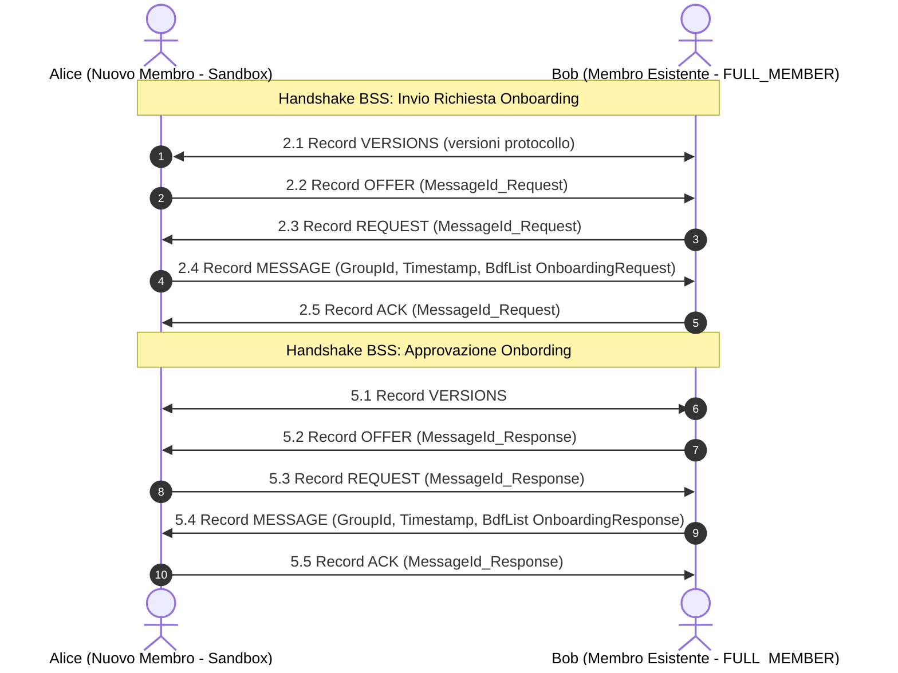

# Dettaglio Tecnico, Flusso Temporale e Diagrammi della Comunicazione di Onboarding

Questo documento descrive e visualizza tramite diagrammi Mermaid l'esatto **flusso temporale**, il numero e il ruolo dei **nodi/attori**, e la struttura di **messaggi, flag, metadati e payload** tra **Alice (Nuovo Membro in Sandbox)** e **Bob (Membro Esistente `FULL_MEMBER`)**, sia in uno scenario di connessione diretta P2P sia in uno scenario epidemico DTN tramite il relè **Charlie**.

---

## 1. Identificazione degli Attori e Nodi Coinvolti

Nella rete P2P / DTN di Briar, il numero di nodi coinvolti può variare a seconda della topologia di rete:

### **A. Scenario Diretto P2P (2 Nodi)**
È lo scenario standard di prossimità fisica (es. Wi-Fi Direct / Bluetooth):
1. **`Alice` (Nuovo Membro / Applicante)**:
   * **Stato/Ruolo**: Nodo in modalità Sandbox / `PROBATION`.
   * **Obiettivo**: Richiedere l'ingresso nella comunità inviando la propria richiesta firmata.
2. **`Bob` (Membro Esistente / Approfittatore)**:
   * **Stato/Ruolo**: Nodo autorizzato con ruolo `FULL_MEMBER`.
   * **Obiettivo**: Ricevere la richiesta, validare la firma di Alice e approvare l'ingresso emettendo una risposta firmata.

---

## 2. Diagramma di Sequenza Dettagliato (Flusso Temporale P2P Diretto)

Il seguente diagramma Mermaid illustra la sequenza completa a livello di codice e di rete tra **Alice** e **Bob**:



---

## 4. Dettaglio Tecnico di Messaggi, Flag, Metadati e Payload

Distinguiamo i record inviati al **Livello di Sincronizzazione P2P (BSS)** dai messaggi del **Livello Applicativo (BDF)**.

---

### A. RECORD P2P DI BASSO LIVELLO (Bramble Sync Protocol - BSS)

Ogni Record BSS possiede un'intestazione fissa composta da:
* `Protocol Version`: 1 byte (`0x01`)
* `Record Type`: 1 byte (da `0` a `4`)
* `Payload Size`: Dimensione in byte del payload racchiuso.

---

#### 1. Record `VERSIONS` (Negoziazione Iniziale)
* **Flusso Temporale**: Inizio di qualsiasi sessione di connessione P2P (Fase 2.1 e Fase 5.1).
* **Mittente**: **`Alice`** (o `Bob`)
* **Destinatario**: **`Bob`** (o `Alice`)
* **Tipo Record BSS**: `RecordTypes.VERSIONS` (Byte `4`)
* **Flag e Metadati**:
  * `Protocol Version` = `0x01`
* **Payload**:
  * `List<Byte>`: Lista delle versioni del protocollo Sync supportate (es. `[0x01]`).

---

#### 2. Record `OFFER` (Annuncio dei Messaggi Posseduti)

* **In Fase 2 (Invio della Richiesta)**:
  * **Mittente**: **`Alice`** (Nuovo Membro)
  * **Destinatario**: **`Bob`** (Membro Esistente)
* **In Fase 5 (Invio della Risposta)**:
  * **Mittente**: **`Bob`** (Membro Esistente)
  * **Destinatario**: **`Alice`** (Nuovo Membro)
* **Tipo Record BSS**: `RecordTypes.OFFER` (Byte `2`)
* **Flag e Metadati**:
  * `shared = true` (stato nel DB del mittente)
  * `offered = true` (marca l'avvenuta notifica dell'offerta al contatto)
* **Payload**:
  * Sequenza di uno o più **`MessageId`** (32 byte ciascuno, hash SHA-256 del messaggio offerto).

---

#### 3. Record `REQUEST` (Richiesta del Corpo del Messaggio)

* **In Fase 2 (Bob richiede la richiesta ad Alice)**:
  * **Mittente**: **`Bob`** (Membro Esistente)
  * **Destinatario**: **`Alice`** (Nuovo Membro)
* **In Fase 5 (Alice richiede la risposta a Bob)**:
  * **Mittente**: **`Alice`** (Nuovo Membro)
  * **Destinatario**: **`Bob`** (Membro Esistente)
* **Tipo Record BSS**: `RecordTypes.REQUEST` (Byte `3`)
* **Flag e Metadati**:
  * `requested = true` (stato transitorio nel DB di chi richiede)
* **Payload**:
  * Sequenza dei **`MessageId`** (32 byte ciascuno) che il ricevitore non possiede e chiede di scaricare.

---

#### 4. Record `MESSAGE` (Trasferimento del Payload Cifrato)

* **In Fase 2 (Alice invia OnboardingRequest)**:
  * **Mittente**: **`Alice`** (Nuovo Membro)
  * **Destinatario**: **`Bob`** (Membro Esistente)
* **In Fase 5 (Bob invia OnboardingResponse)**:
  * **Mittente**: **`Bob`** (Membro Esistente)
  * **Destinatario**: **`Alice`** (Nuovo Membro)
* **Tipo Record BSS**: `RecordTypes.MESSAGE` (Byte `1`)
* **Flag e Metadati**:
  * **Header del Record Sync (40 byte totali)**:
    * `GroupId` (32 byte): Hash del gruppo della comunità (`communityTopicGroupId`).
    * `Timestamp` (8 byte / uint64): Timestamp Unix in ms (`System.currentTimeMillis()`).
* **Payload**:
  * Corpo grezzo del messaggio BDF (`fullBody` / `fullResponseBody`) contenente dati e firma crittografica.

---

#### 5. Record `ACK` (Conferma di Avvenuta Ricezione)

* **In Fase 2 (Bob conferma la ricezione ad Alice)**:
  * **Mittente**: **`Bob`** (Membro Esistente)
  * **Destinatario**: **`Alice`** (Nuovo Membro)
* **In Fase 5 (Alice conferma la ricezione a Bob)**:
  * **Mittente**: **`Alice`** (Nuovo Membro)
  * **Destinatario**: **`Bob`** (Membro Esistente)
* **Tipo Record BSS**: `RecordTypes.ACK` (Byte `0`)
* **Flag e Metadati**:
  * Nessuno.
* **Payload**:
  * Sequenza dei **`MessageId`** (32 byte ciascuno) memorizzati con successo nel DB cifrato.

---

### B. MESSAGGI APPLICATIVI DI ALTO LIVELLO (Payload BDF - Bramble Data Format)

Questi messaggi rappresentano il contenuto semantico effettivo trasportato all'interno del Record BSS `MESSAGE`.

---

#### 1. Messaggio `OnboardingRequest` (Richiesta di Alice)

```
TEMPO: FASE 1 (Generazione locale) -> FASE 2 (Trasferimento P2P)
MITTENTE: Alice (Nuovo Membro / Applicante in Sandbox)
DESTINATARIO: Bob (e qualsiasi FULL_MEMBER del gruppo Comunità)
```

* **Tipo Messaggio BDF**: `MSG_TYPE_ONBOARDING_REQUEST` (Integer `0`)
* **Metadati DB Locale**:
  * `type = 0`
  * `read = true` (per Alice)
  * `shared = true` (abilita la sincronizzazione verso altri nodi)
* **Contesto Crittografico di Firma**: `"org.briarproject.briar.community/ONBOARDING_REQUEST"`
* **Payload (`fullBody` BdfList)**:

```
fullBody (BdfList)
├── [0] bodyToSign (BdfList)
│     ├── [0] MSG_TYPE_ONBOARDING_REQUEST (Integer: 0)
│     ├── [1] applicantAuthor (BdfList dell'identità di Alice)
│     │     ├── [0] AuthorId (32 byte: Hash della chiave pubblica di Alice)
│     │     ├── [1] Pseudonimo (String: es. "Alice")
│     │     └── [2] Chiave Pubblica Ed25519 (32 byte)
│     ├── [2] topics (BdfList di Stringhe: es. ["privacy", "news"])
│     └── [3] timestamp (Long: millisecondi Unix Epoch)
└── [1] signature (byte[]: 64 byte - Firma Ed25519 di Alice su bodyToSign)
```

---

#### 2. Messaggio `OnboardingResponse` (Approvazione di Bob)

```
TEMPO: FASE 4 (Generazione locale) -> FASE 5 (Trasferimento P2P)
MITTENTE: Bob (Membro Esistente con ruolo FULL_MEMBER)
DESTINATARIO: Alice (e diffusione broadcast a tutta la Comunità)
```

* **Tipo Messaggio BDF**: `MSG_TYPE_ONBOARDING_RESPONSE` (Integer `1`)
* **Metadati DB Locale**:
  * `type = 1`
  * `shared = true`
* **Contesto Crittografico di Firma**: `"org.briarproject.briar.community/ONBOARDING_RESPONSE"`
* **Payload (`fullResponseBody` BdfList)**:

```
fullResponseBody (BdfList)
├── [0] responseBodyToSign (BdfList)
│     ├── [0] MSG_TYPE_ONBOARDING_RESPONSE (Integer: 1)
│     ├── [1] applicantAuthor (BdfList dell'identità di Alice che viene approvata)
│     ├── [2] approved (Boolean: true)
│     ├── [3] approverAuthor (BdfList dell'identità di Bob, FULL_MEMBER approvatore)
│     │     ├── [0] AuthorId (32 byte di Bob)
│     │     ├── [1] Pseudonimo (String: es. "Bob")
│     │     └── [2] Chiave Pubblica Ed25519 (32 byte di Bob)
│     └── [4] timestamp (Long: millisecondi Unix Epoch)
└── [1] signature (byte[]: 64 byte - Firma Ed25519 di Bob su responseBodyToSign)
```

---

## 5. Tabella Riassuntiva del Flusso Temporale dei Record BSS

| Passo | Mittente (Sender) | Destinatario (Recipient) | Tipo Record BSS / Messaggio BDF | Scopo del Messaggio |
| :---: | :---: | :---: | :---: | :--- |
| **2.1** | **Alice** | **Bob** | `VERSIONS` (Tipo 4) | Alice dichiara le versioni Sync supportate. |
| **2.1** | **Bob** | **Alice** | `VERSIONS` (Tipo 4) | Bob dichiara le versioni Sync supportate. |
| **2.2** | **Alice** | **Bob** | `OFFER` (Tipo 2) | Alice offre il `MessageId` della sua `OnboardingRequest`. |
| **2.3** | **Bob** | **Alice** | `REQUEST` (Tipo 3) | Bob chiede ad Alice di inviargli il payload della richiesta. |
| **2.4** | **Alice** | **Bob** | `MESSAGE` (Tipo 1) | Alice invia il messaggio BDF `OnboardingRequest` firmato. |
| **2.5** | **Bob** | **Alice** | `ACK` (Tipo 0) | Bob conferma ad Alice di aver ricevuto e salvato la richiesta. |
| **4**   | *Bob (locale)* | *Bob (locale)* | `OnboardingResponse` (BDF) | Bob approva dalla UI e firma la risposta d'approvazione. |
| **5.1** | **Bob** | **Alice** | `VERSIONS` (Tipo 4) | Avvio sessione di ritorno. |
| **5.2** | **Bob** | **Alice** | `OFFER` (Tipo 2) | Bob offre il `MessageId` della sua `OnboardingResponse`. |
| **5.3** | **Alice** | **Bob** | `REQUEST` (Tipo 3) | Alice chiede a Bob di inviarle la risposta d'approvazione. |
| **5.4** | **Bob** | **Alice** | `MESSAGE` (Tipo 1) | Bob invia il messaggio BDF `OnboardingResponse` firmato. |
| **5.5** | **Alice** | **Bob** | `ACK` (Tipo 0) | Alice conferma a Bob la ricezione dell'approvazione. |
| **6**   | *Alice (locale)* | *Alice (locale)* | Promozione Trust | Alice valida la firma di Bob e diventa `FULL_MEMBER`. |
