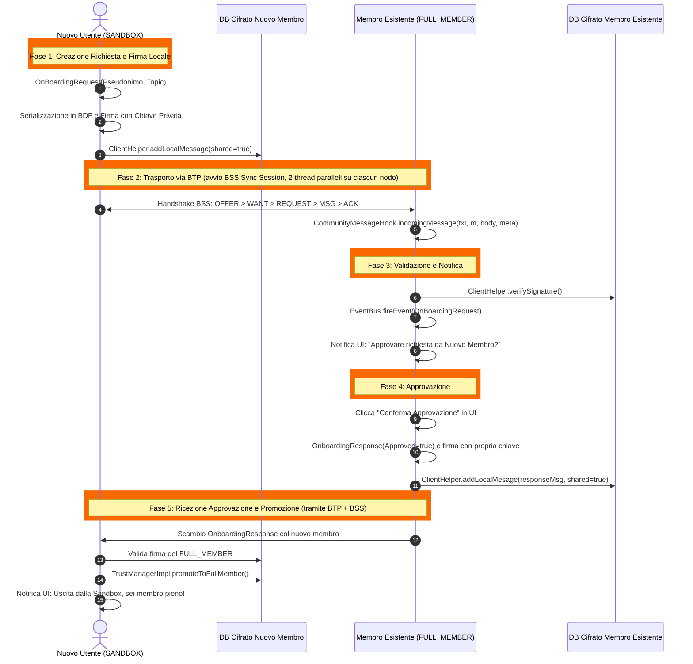
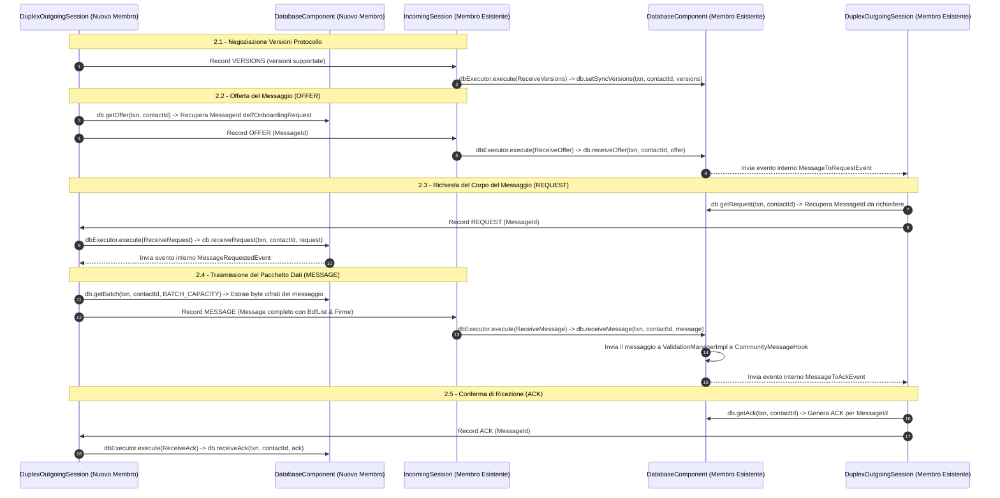

# Documentazione Dettagliata: Flusso di Comunicazione dell'Onboarding (P2P DTN)

Questo documento descrive nel dettaglio il **flusso temporale**, la **sequenza di messaggi** e le **chiamate di codice** necessarie per gestire la comunicazione di una richiesta di onboarding tra un **Nuovo Membro (Applicante in Sandbox)** ed un **Membro Già Esistente (`FULL_MEMBER`)** nella rete Briar.

---

## 1. Diagramma di Sequenza Temporale



---

## 2. Flusso Temporale Dettagliato e Chiamate di Codice

---

### FASE 1: Creazione della Richiesta e Firma Locale (Nuovo Membro)

Quando il nuovo membro completa il wizard d'ingresso nell'app nativa, la sua app genera la richiesta di onboarding e la memorizza nel proprio database cifrato pronta per la trasmissione.

#### Chiamate di Codice:

1. **Creazione dell'Oggetto Dati**:
   L'app raccoglie l'identità locale `Author` (generata durante `createAccount`) ed i topic scelti.

2. **Serializzazione nel Formato Binario BDF (`BdfList`)**:
   In Bramble, ogni messaggio è serializzato in una struttura `BdfList`:
   ```java
   // File: briar-core/.../community/CommunityOnboardingManagerImpl.java

   public Message createOnboardingRequestMessage(Author applicantAuthor, List<String> topics)
           throws FormatException, GeneralSecurityException {

       long timestamp = System.currentTimeMillis();

       // 1. Costruzione del corpo del messaggio BDF
       BdfList bodyToSign = BdfList.of(
           MSG_TYPE_ONBOARDING_REQUEST,          // Integer: 0 per Onboarding Request
           clientHelper.toList(applicantAuthor),  // BdfList dell'autore applicante
           BdfList.of(topics),                   // BdfList dei topic scelti
           timestamp                             // Long: Timestamp
       );

       // 2. Firma del messaggio con la chiave privata Ed25519 dell'applicante
       byte[] signature = clientHelper.sign(
           "org.briarproject.briar.community/ONBOARDING_REQUEST",
           bodyToSign,
           identityManager.getLocalAuthor().getPrivateKey()
       );

       // 3. Aggiunta della firma alla lista finale
       BdfList fullBody = BdfList.of(bodyToSign, signature);
       byte[] bodyBytes = clientHelper.toByteArray(fullBody);

       // 4. Creazione del messaggio Bramble Sync BSS per il Gruppo della Comunità
       return clientHelper.createMessage(communityTopicGroupId, timestamp, bodyBytes);
   }
   ```

3. **Inserimento nel Database di Bramble per la Sincronizzazione**:
   ```java
   db.runInTransaction(false, txn -> {
       BdfDictionary metadata = new BdfDictionary();
       metadata.put("type", MSG_TYPE_ONBOARDING_REQUEST);
       metadata.put("read", true);

       // shared = true comunica a Bramble Sync di offrire questo messaggio ai peer vicini
       clientHelper.addLocalMessage(txn, onboardingMessage, metadata, true);
   });
   ```

---

### FASE 2: Trasporto P2P Epidemico via Bramble Sync Protocol (BSS) - APPROFONDIMENTO TECNICO

Non appena lo smartphone del nuovo membro entra nel raggio Bluetooth o Wi-Fi Direct di un membro della comunità, il protocollo **BTP (Bramble Transport Protocol)** stabilisce un canale di trasporto bidirezionale cifrato.

Sopra questo canale, Bramble avvia una **BSS Sync Session** composta da due thread paralleli su ciascun nodo:
- **`IncomingSession.java`**: Ciclo di lettura in ascolto dei record BSS in arrivo dallo stream.
- **`DuplexOutgoingSession.java`**: Ciclo di scrittura che seleziona ed invia i record BSS verso lo stream.

#### Diagramma di Dettaglio dei Record BSS (Fase 2):



#### Dettaglio delle Funzioni e Chiamate di Codice nella Fase 2:

##### 1. Avvio della Sessione di Sincronizzazione (`SyncSessionFactoryImpl.java`)
Quando il transport plugin (Bluetooth/Wi-Fi Direct) segnala una connessione attiva, viene invocato `SyncSessionFactoryImpl.createDuplexSyncSession(...)` che istanzia:
- `SyncRecordReaderImpl`: Parser che decodifica l'intestazione ed il payload dei record dal `TransportConnectionReader`.
- `SyncRecordWriterImpl`: Encoder che impacchetta e cifra i record verso il `TransportConnectionWriter`.
- `IncomingSession` e `DuplexOutgoingSession`.

##### 2. Ciclo di Lettura dei Record (`IncomingSession.java`)
Il thread `IncomingSession.run()` rimane in ascolto nel ciclo principale ed invoca i metodi del `SyncRecordReader`:
```java
// File: bramble-core/src/main/java/org/briarproject/bramble/sync/IncomingSession.java

while (!interrupted) {
    if (recordReader.hasAck()) {
        Ack a = recordReader.readAck();
        dbExecutor.execute(new ReceiveAck(a));
    } else if (recordReader.hasMessage()) {
        Message m = recordReader.readMessage();
        dbExecutor.execute(new ReceiveMessage(m));
    } else if (recordReader.hasOffer()) {
        Offer o = recordReader.readOffer();
        dbExecutor.execute(new ReceiveOffer(o));
    } else if (recordReader.hasRequest()) {
        Request r = recordReader.readRequest();
        dbExecutor.execute(new ReceiveRequest(r));
    } else if (recordReader.hasVersions()) {
        Versions v = recordReader.readVersions();
        dbExecutor.execute(new ReceiveVersions(v));
    }
}
```

##### 3. Negoziazione delle Versioni (`Versions`)
- **Scrittura**: `DuplexOutgoingSession` invia `recordWriter.writeVersions(new Versions(SUPPORTED_VERSIONS))`.
- **Lettura**: `IncomingSession` esegue `dbExecutor.execute(new ReceiveVersions(versions))`.
- **Chiamata DB**: `db.setSyncVersions(txn, contactId, supported)`.

##### 4. Invio dell'Offerta (`Offer`)
- **Scrittura**: `DuplexOutgoingSession` esegue la transazione `db.getOffer(txn, contactId)` per raccogliere gli ID dei messaggi non ancora offerti al peer. Scrive il record via `recordWriter.writeOffer(offer)`.
- **Lettura**: Nel membro esistente, `IncomingSession` legge l'offerta ed esegue `db.receiveOffer(txn, contactId, offer)`:
  ```java
  // All'interno di DatabaseComponentImpl.java
  public void receiveOffer(Transaction txn, ContactId contactId, Offer offer) {
      for (MessageId id : offer.getMessageIds()) {
          if (!containsMessage(txn, id) && isGroupVisible(txn, contactId, id)) {
              // Marca il messaggio come desiderato (WANT)
              setRequested(txn, contactId, id, true);
              eventBus.fireEvent(new MessageToRequestEvent(contactId, id));
          }
      }
  }
  ```

##### 5. Inoltro della Richiesta (`Request`)
- **Scrittura**: L'evento `MessageToRequestEvent` risveglia la `DuplexOutgoingSession` del membro esistente, che esegue `db.getRequest(txn, contactId)` e trasmette `recordWriter.writeRequest(request)`.
- **Lettura**: L'applicante riceve la richiesta e `IncomingSession` esegue `db.receiveRequest(txn, contactId, request)`:
  ```java
  public void receiveRequest(Transaction txn, ContactId contactId, Request request) {
      for (MessageId id : request.getMessageIds()) {
          setOffered(txn, contactId, id, true);
          eventBus.fireEvent(new MessageRequestedEvent(contactId, id));
      }
  }
  ```

##### 6. Trasmissione ed Inserimento del Pacchetto Dati (`Message`)
- **Scrittura**: L'evento `MessageRequestedEvent` attiva la routine `generateBatchQueued` nella `DuplexOutgoingSession` dell'applicante.
  Esegue `db.getBatch(txn, contactId, BATCH_CAPACITY)`, estrae i byte del messaggio dell'onboarding e li trasmette via `recordWriter.writeMessage(message)`.
- **Lettura & Consegna**: Il membro esistente riceve il messaggio ed esegue `db.receiveMessage(txn, contactId, message)`:
  ```java
  public void receiveMessage(Transaction txn, ContactId contactId, Message message) {
      // 1. Memorizza i byte grezzi nel database cifrato
      addIncomingMessage(txn, message);

      // 2. Sottomette il messaggio al motore di validazione applicativa (ValidationManager)
      validationManager.validateMessage(message);

      // 3. Pianifica l'invio della conferma di ricezione (ACK)
      eventBus.fireEvent(new MessageToAckEvent(contactId, message.getId()));
  }
  ```

##### 7. Conferma di Ricezione (`Ack`)
- **Scrittura**: Il membro esistente invia l'ACK via `recordWriter.writeAck(ack)` ottenuto da `db.getAck(txn, contactId)`.
- **Lettura**: L'applicante riceve l'ACK e `IncomingSession` esegue `db.receiveAck(txn, contactId, ack)`. Il DB aggiorna lo stato del messaggio segnandolo come **consegnato con successo** al peer.

---

### FASE 3: Ricezione, Validazione e Notifica UI (Membro Esistente)

Quando il messaggio arriva sullo smartphone del membro esistente, il motore Bramble lo passa all'hook di validazione applicativo.

#### Chiamate di Codice:

1. **Intercettazione del Messaggio (`CommunityMessageHook.java`)**:
   ```java
   // File: briar-core/.../community/CommunityMessageHook.java

   @Override
   protected DeliveryAction incomingMessage(Transaction txn, Message m, BdfList body, BdfDictionary meta)
           throws DbException, FormatException {

       int msgType = body.getList(0).getInt(0);

       if (msgType == MSG_TYPE_ONBOARDING_REQUEST) {
           return processIncomingOnboardingRequest(txn, m, body);
       }

       return DeliveryAction.ACCEPT;
   }
   ```

2. **Verifica Crittografica della Firma dell'Applicante**:
   ```java
   private DeliveryAction processIncomingOnboardingRequest(Transaction txn, Message m, BdfList body)
           throws FormatException {

       BdfList bodyToSign = body.getList(0);
       byte[] signature = body.getRaw(1);

       Author applicantAuthor = clientHelper.parseAndValidateAuthor(bodyToSign.getList(1));

       try {
           // Verifica che la firma corrisponda alla chiave pubblica dell'autore applicante
           clientHelper.verifySignature(
               signature,
               "org.briarproject.briar.community/ONBOARDING_REQUEST",
               bodyToSign,
               applicantAuthor.getPublicKey()
           );
       } catch (GeneralSecurityException e) {
           // Firma non valida -> Rifiuta e cancella il messaggio malevolo
           return DeliveryAction.REJECT;
       }

       // Estrazione dei topic scelti
       List<String> topics = bodyToSign.getList(2).getStringList();
       OnboardingRequest request = new OnboardingRequest(applicantAuthor, topics, m.getTimestamp());

       // Notifica sull'EventBus interno per aggiornare l'interfaccia utente
       eventBus.fireEvent(new OnboardingRequestReceivedEvent(request));

       return DeliveryAction.ACCEPT;
   }
   ```

3. **Notifica sull'Interfaccia Utente (Android UI)**:
   Il ViewModel dell'app nativa in ascolto sull'event bus cattura l'evento e mostra la notifica all'utente:
   ```java
   // File: briar-android/.../community/OnboardingRequestsViewModel.java

   @EventListener
   public void onOnboardingRequestReceived(OnboardingRequestReceivedEvent event) {
       OnboardingRequest req = event.getRequest();
       // Aggiorna LiveData per la RecyclerView delle richieste pendenti
       pendingRequestsLiveData.postValue(req);
   }
   ```

---

### FASE 4: Approvazione da parte del Membro Esistente (`FULL_MEMBER`)

Il membro esistente legge i dettagli dell'applicante nella schermata d'approvazione e clicca su **"Applica Approvazione"**.

#### Chiamate di Codice:

1. **Generazione del Messaggio di Risposta (`OnboardingResponse`)**:
   ```java
   // File: briar-core/.../community/CommunityOnboardingManagerImpl.java

   public void approveOnboardingRequest(Author applicantAuthor) throws DbException, FormatException, GeneralSecurityException {

       long timestamp = System.currentTimeMillis();
       Author localApprover = identityManager.getLocalAuthor();

       BdfList responseBodyToSign = BdfList.of(
           MSG_TYPE_ONBOARDING_RESPONSE,             // Integer: 1 per Onboarding Response
           clientHelper.toList(applicantAuthor),     // Autore approvato
           true,                                     // Boolean: Approved = true
           clientHelper.toList(localApprover),       // Autore che approva (FULL_MEMBER)
           timestamp
       );

       // Firma del messaggio da parte del membro autorizzato
       byte[] signature = clientHelper.sign(
           "org.briarproject.briar.community/ONBOARDING_RESPONSE",
           responseBodyToSign,
           localApprover.getPrivateKey()
       );

       BdfList fullResponseBody = BdfList.of(responseBodyToSign, signature);
       Message responseMessage = clientHelper.createMessage(
           communityTopicGroupId,
           timestamp,
           clientHelper.toByteArray(fullResponseBody)
       );

       // Salvataggio nel DB locale con shared = true per la trasmissione P2P
       db.runInTransaction(false, txn -> {
           clientHelper.addLocalMessage(txn, responseMessage, new BdfDictionary(), true);
       });
   }
   ```

---

### FASE 5: Ricezione dell'Approvazione e Promozione del Nuovo Membro

Il messaggio di risposta naviga sulla rete BSS e viene consegnato allo smartphone del nuovo membro.

#### Chiamate di Codice:

1. **Verifica dell'Autorità del Firmante**:
   ```java
   // File: briar-core/.../community/CommunityMessageHook.java (sul dispositivo del nuovo membro)

   if (msgType == MSG_TYPE_ONBOARDING_RESPONSE) {
       BdfList bodyToSign = body.getList(0);
       byte[] signature = body.getRaw(1);

       Author approver = clientHelper.parseAndValidateAuthor(bodyToSign.getList(3));

       // Riconoscimento dell'approvatore: verifica che sia un FULL_MEMBER riconosciuto
       if (trustManager.getTrustTier(approver.getId()) == TrustTier.FULL_MEMBER) {

           Author applicant = clientHelper.parseAndValidateAuthor(bodyToSign.getList(1));

           // Se la risposta riguarda me stesso, esegui la PROMOZIONE!
           if (applicant.getId().equals(identityManager.getLocalAuthor().getId())) {

               // Promozione nel database cifrato localmente
               trustManager.promoteToFullMember(applicant.getId());

               // Invia evento di promozione per aggiornare la UI
               eventBus.fireEvent(new TrustTierChangedEvent(TrustTier.FULL_MEMBER));
           }
       }
   }
   ```

2. **Promozione della Fiducia in `TrustManagerImpl`**:
   ```java
   // File: bramble-core/.../trust/TrustManagerImpl.java

   public void promoteToFullMember(AuthorId authorId) throws DbException {
       Settings settings = new Settings();
       settings.put("trustTier", "FULL_MEMBER");

       // Scrittura nel DB cifrato
       settingsManager.mergeSettings(settings, "community.trust");
       LOG.info("PROMOZIONE COMPLETATA: Il nodo " + authorId + " ora è FULL_MEMBER!");
   }
   ```

3. **Notifica UI al Nuovo Membro**:
   L'app mobile del nuovo membro aggiorna l'interfaccia, sblocca la pubblicazione illimitata di post e mostra il messaggio:
   🎉 *"La tua richiesta è stata approvata da un membro della comunità! La modalità Sandbox è stata disattivata."*

---

## 3. Riepilogo dei Vantaggi del Flusso P2P BSS

1. **Sicurezza Crittografica Inconfutabile**: Tutte le richieste e le approvazioni sono firmate asimmetricamente via Ed25519 e verificate con le chiavi pubbliche incluse nel protocollo.
2. **Resilienza alle Disconnessioni (DTN)**: Non è richiesta la presenza contemporanea online di tutti i nodi. L'approvazione fluisce in modalità *Store-Carry-and-Forward* appena due nodi si incontrano.
3. **Piena Integrazione con Bramble**: Il meccanismo usa le primitive native di Briar (`ClientHelper`, `BdfList`, `BdfIncomingMessageHook`, `SettingsManager`), senza introdurre librerie esterne.
