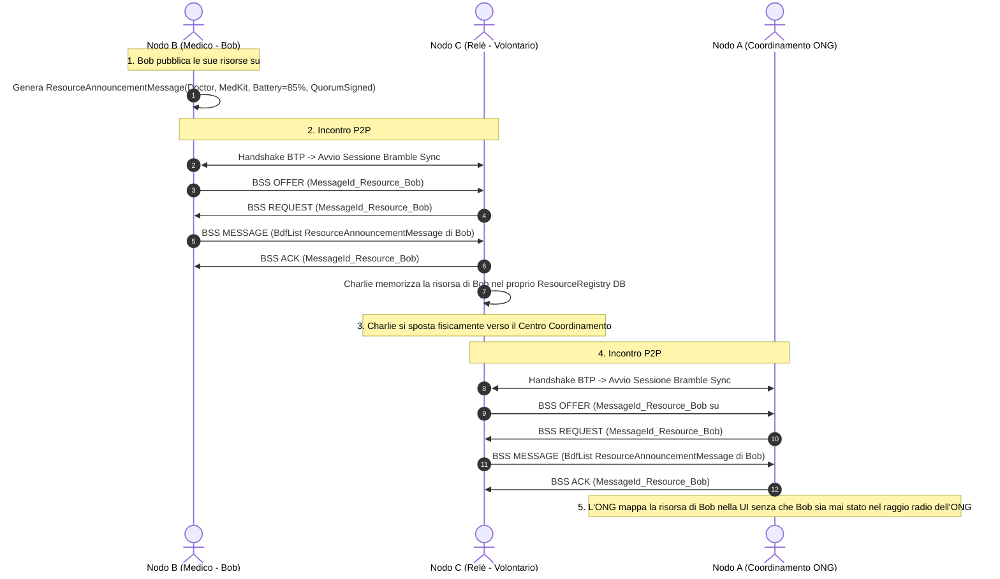

# Specifica di Modulo 2: Scoperta ed Esposizione delle Risorse e delle Competenze via Topic Pub/Sub

Questo documento costituisce la **specifica del Modulo 2**, definendo l'architettura per la **scoperta e la mappatura dinamica e decentralizzata delle risorse di rete** (dispositivi, capacità hardware, batterie, expertise e reputazio degli utentine) in contesti d'emergenza privi di connettività Internet.

Il modulo adotta un paradigma **Publish/Subscribe (Pub/Sub) Asincrono e Distribuito**, integrando la distinzione tra *Node Discovery* e *Resource Discovery*, un esempio pratico di comunicazione passo-passo, il modello di memorizzazione locale dei profili, l'analisi delle componenti da riutilizzare o creare da zero in Briar, e le fonti ufficiali di riferimento.

---

## 1. Principi Architetturali e Paradigma Pub/Sub Decentralizzato

Nelle situazioni di catastrofe o crisi (es. terremoto, blackout o alluvione), le organizzazioni sul campo ed i cittadini devono poter trovare rapidamente **competenze specifiche** (es. medico di pronto soccorso, squadra di ricerca macerie, operatore con gruppo elettrogeno) senza dipendere da un database o da una centrale operativa connessa ad Internet `[Fonte: Serval Project - Emergency Mesh Communication]`.

```
┌───────────────────────────────────────────────────────────────────────────────┐
│                 PARADIGMA PUB/SUB DECENTRALIZZATO ED EPIDEMICO                │
├───────────────────────────────────────────────────────────────────────────────┤
│ 1. SOTTOSCRIZIONE AI TOPIC (SUBSCRIBE)                                        │
│    └─ I nodi coordinatori (ONG, Protezione Civile) si iscrivono ai Topic      │
│       delle risorse cercate (es. `#medici-pronto-soccorso`, `#punti-ricarica`)│
├───────────────────────────────────────────────────────────────────────────────┤
│ 2. ANNUNCIO DELLE CAPACITÀ (PUBLISH)                                          │
│    └─ I nodi della rete con competenze o hardware pubblicano il proprio       │
│       `ResourceAnnouncementMessage` quando entrano nel raggio radio P2P       │
├───────────────────────────────────────────────────────────────────────────────┤
│ 3. DIFFUSIONE STORE-CARRY-AND-FORWARD (DTN SYNC)                              │
│    └─ Gli annunci di risorsa viaggiano via BSS (Bramble Sync Protocol)        │
│       e vengono mappati sui nodi vicini anche in assenza di rete continua     │
└───────────────────────────────────────────────────────────────────────────────┘
```

---

## 2. Distinzione Critica: Scoperta dei Nodi vs Scoperta delle Risorse

Per progettare correttamente il sistema, occorre distinguere nettamente la **Scoperta dei Nodi (*Node Discovery*)** dalla **Scoperta delle Risorse (*Resource/Capability Discovery*)**:

```
 ┌─────────────────────────────────────────────────────────────────────────────┐
 │                CONFRONTO: NODE DISCOVERY VS RESOURCE DISCOVERY              │
 ├──────────────────────────┬──────────────────────────────────────────────────┤
 │ CARATTERISTICA           │ SCOPERTA DEI NODI (NODE DISCOVERY)               │
 ├──────────────────────────┼──────────────────────────────────────────────────┤
 │ Livello Protocollare     │ Livello di Trasporto BTP / Plugin Fisici         │
 │ Oggetto Scoperto         │ Presenza radio di uno smartphone (`ContactId`)   │
 │ Frequenza & Natura       │ Istantanea, volatile, legata al raggio radio     │
 │ Esempio                  │ "Il dispositivo di Bob è visibile via Bluetooth" │
 ├──────────────────────────┼──────────────────────────────────────────────────┤
 │ CARATTERISTICA           │ SCOPERTA DELLE RISORSE (RESOURCE DISCOVERY)      │
 ├──────────────────────────┼──────────────────────────────────────────────────┤
 │ Livello Protocollare     │ Livello Applicativo Pub/Sub BDF (Bramble Sync)   │
 │ Oggetto Scoperto         │ Competenze, hardware, reputazione, disponibilità │
 │ Frequenza & Natura       │ Persistente, epidemica, viaggia via DTN          │
 │ Esempio                  │ "Bob è un Medico con Kit di primo soccorso,      │
 │                          │  batteria 85%, convalidato dal Quorum della Zona"│
 └──────────────────────────┴──────────────────────────────────────────────────┘
```

### 2.1 Scoperta dei Nodi (*Node Discovery - Livello di Trasporto BTP*)
* **Come funziona**: Gestita dai plugin di trasporto fisici di Bramble (`bramble-core/.../plugin/`). I beacon Bluetooth Low Energy (BLE) o i pacchetti Wi-Fi Direct rilevano l'esistenza di un altro smartphone nel raggio di 10-50 metri `[Fonte: Briar GitLab - AbstractBluetoothPlugin.java]`.
* **Scopo**: Stabilire il canale cifrato punto-a-punto **BTP (*Bramble Transport Protocol*)**.

### 2.2 Scoperta delle Risorse e Competenze (*Resource Discovery - Livello Applicativo Pub/Sub*)
* **Come funziona**: Una volta aperto il canale BTP, le sessioni Bramble Sync scambiano i messaggi BDF di tipo **`ResourceAnnouncementMessage`** legati ai Topic Pub/Sub `[Fonte: Briar Protocol Architecture Specifications - BSS Protocol]`.
* **Scopo**: Mappare **Cosa sa fare e cosa possiede quel nodo** (es. professione medica, kit di soccorso, batteria, attrezzatura, livello di fiducia/quorum), consentendo di scoprire risorse anche di nodi non direttamente connessi ma apprese tramite inoltro epidemico (*Store-Carry-and-Forward*) `[Fonte: Vahdat & Becker, 2000 - Epidemic Routing]`.

---

## 3. Flusso di Comunicazione ed Esempio Pratico

### **Scenario dell'Esempio**:
* **Nodo $A$ (Centro di Coordinamento Soccorsi / ONG)**: Sottoscrive il Topic `#medici-pronto-soccorso`.
* **Nodo $B$ (Soccorritore "Bob")**: È un medico qualificato con ruolo `FULL_MEMBER`, dotato di Kit Medico ed un gruppo elettrogeno.
* **Nodo $C$ (Nodo Relè / Volontario)**: Si sposta tra la zona d'emergenza ed il centro coordinamento.



---

## 4. Memorizzazione Locale delle Informazioni e Gestione dello Spazio

Poiché l'architettura rifiuta qualsiasi server centrale, **ogni nodo gestisce un proprio registro locale delle risorse riscontrate (`ResourceRegistry`)**, salvato nel database cifrato H2/SQLite di Bramble (`DatabaseComponentImpl`).

```
 ┌──────────────────────────────────────────────────────────────────────────────┐
 │                    REGISTRO LOCALE RISORSE (`ResourceRegistry`)              │
 ├──────────────────────────┬───────────────────────────────────────────────────┤
 │ TABELLA DATABASE         │ CAMPI & METADATI SALVATI                          │
 ├──────────────────────────┼───────────────────────────────────────────────────┤
 │ `resource_announcements` │ • `messageId` (Hash SHA-256 univoco del messaggio)│
 │                          │ • `providerAuthorId` (Identità dell'attore)       │
 │                          │ • `topicCategory` (es. `#medici-pronto-soccorso`) │
 │                          │ • `capabilitiesJson` (Hardware, competenze, GPS)  │
 │                          │ • `trustTier` (PROBATION / FULL_MEMBER)           │
 │                          │ • `expirationTimestampMs` (TTL di validità)       │
 │                          │ • `lastSeenTimestampMs` (Freschezza dato P2P)     │
 └──────────────────────────┴───────────────────────────────────────────────────┘
```

### 4.1 Meccanismi di Aggiornamento, Scadenza (TTL) e Pruning
Per evitare di mantenere informazioni obsolete su risorse non più disponibili (es. un medico che ha esaurito i materiali o si è spostato) `[Fonte: Sleator & Tarjan, 1985 - LRU Paging]`:

1. **Timestamp di Validità (Time-To-Live / TTL)**: Ogni `ResourceAnnouncementMessage` include un `ttlDurationMs` (es. 12 ore). Decorso il TTL, lo stato della risorsa nel registro passa da `ACTIVE` a `EXPIRED`.
2. **Aggiornamento per Sovrascrittura (*State Invalidation*)**: Quando il medico Bob aggiorna il suo stato (es. *"Materiali Medici Esauriti"*), pubblica un nuovo annuncio con numero di sequenza incrementato. All'arrivo del nuovo annuncio, `ResourceRegistry` invalida e sovrascrive lo stato precedente del nodo Bob.
3. **Pruning LRU & Quota Storage**: Quando il DB supera la quota allocata, il sistema elimina prima le risorse scadute (`EXPIRED`) o pubblicate da nodi in Sandbox (`PROBATION`), preservando le risorse convalidate da Quorum.

---

## 5. Mappatura delle Componenti: Riuso di Briar vs Nuova Implementazione

Per realizzare il Modello di Scoperta Risorse occorre distinguere nettamente cosa viene riutilizzato dal codebase di Briar da cosa deve essere creato ex-novo:

```
 ┌─────────────────────────────────────────────────────────────────────────────┐
 │                        COMPONENTE E STATO DI RIUSO                          │
 ├──────────────────────────┬──────────────────────────────────────────────────┤
 │ COMPONENTE BRIAR         │ STATO DI RIUSO / MODIFICA                        │
 ├──────────────────────────┼──────────────────────────────────────────────────┤
 │ `PluginManager` & BTP    │  **RIUSO TOTALE**: Gestione scoperta nodi BLE    │
 │ `DatabaseComponentImpl`  │  **MODIFICA**: Aggiunta tabelle `ResourceReg`    │
 │ `GroupVisibility` BSS    │  **RIUSO TOTALE**: Inoltro messaggi per Topic    │
 │ `ClientHelper` BDF       │  **RIUSO TOTALE**: Serializzazione BdfList       │
 │ `ResourceAnnouncement`   │  **NUOVO**: Contratto DTO BDF della Risorsa      │
 │ `ResourceDiscoveryClient`│  **NUOVO**: Client Bramble per il Pub/Sub        │
 │ `ResourceRegistry`       │  **NUOVO**: Gestore registro e mappa UI          │
 └──────────────────────────┴──────────────────────────────────────────────────┘
```

---

## 6. Codice Sorgente e Pseudocodice Architetturale Documentato

> ⚠️ **Nota di Specifica**: Tutti i frammenti di codice riportati costituiscono **Pseudocodice Architetturalmente Verificato** inteso a guidare l'implementazione nativa sul codebase Briar/Bramble.

---

### A. [FILE NUOVO]: `ResourceAnnouncementMessage.java`
* **Path**: `briar-api/src/main/java/org/briarproject/briar/api/resource/ResourceAnnouncementMessage.java`
* **Ruolo**: DTO BDF che trasporta l'annuncio delle capacità, competenze ed hardware di un nodo.

```java
// FILE NUOVO - Path: briar-api/src/main/java/org/briarproject/briar/api/resource/ResourceAnnouncementMessage.java

package org.briarproject.briar.api.resource;

import org.briarproject.bramble.api.identity.Author;
import org.briarproject.bramble.api.sync.MessageId;
import org.briarproject.nullsafety.NotNullByDefault;
import javax.annotation.concurrent.Immutable;
import java.util.List;

/**
 * Contratto DTO BDF per l'annuncio Pub/Sub delle risorse e competenze di un nodo.
 */
@Immutable
@NotNullByDefault
public class ResourceAnnouncementMessage {

    private final MessageId messageId;           // MessageId SHA-256 univoco
    private final Author providerAuthor;          // Autore/Nodo proprietario della risorsa
    private final String topicCategory;          // Es. "#medici-pronto-soccorso"
    private final String skillTitle;             // Es. "Medico Anestesista con Kit"
    private final List<String> hardwareAvailable;// Es. ["Gruppo Elettrogeno 3kW", "Ambulanza"]
    private final int batteryLevelPercent;       // Autonomia residua dispositivo (0-100%)
    private final String locationDescriptor;     // Posizione approssimata / settore
    private final long timestampMs;              // Timestamp di emissione
    private final long ttlDurationMs;            // Durata validità (es. 12 ore)
    private final byte[] signature;              // Firma Ed25519 dell'autore

    public ResourceAnnouncementMessage(MessageId messageId,
                                       Author providerAuthor,
                                       String topicCategory,
                                       String skillTitle,
                                       List<String> hardwareAvailable,
                                       int batteryLevelPercent,
                                       String locationDescriptor,
                                       long timestampMs,
                                       long ttlDurationMs,
                                       byte[] signature) {
        this.messageId = messageId;
        this.providerAuthor = providerAuthor;
        this.topicCategory = topicCategory;
        this.skillTitle = skillTitle;
        this.hardwareAvailable = hardwareAvailable;
        this.batteryLevelPercent = batteryLevelPercent;
        this.locationDescriptor = locationDescriptor;
        this.timestampMs = timestampMs;
        this.ttlDurationMs = ttlDurationMs;
        this.signature = signature;
    }

    public MessageId getMessageId() { return messageId; }
    public Author getProviderAuthor() { return providerAuthor; }
    public String getTopicCategory() { return topicCategory; }
    public String getSkillTitle() { return skillTitle; }
    public List<String> getHardwareAvailable() { return hardwareAvailable; }
    public int getBatteryLevelPercent() { return batteryLevelPercent; }
    public String getLocationDescriptor() { return locationDescriptor; }
    public long getTimestampMs() { return timestampMs; }
    public long getTtlDurationMs() { return ttlDurationMs; }
    public byte[] getSignature() { return signature; }
}
```

---

### B. [FILE NUOVO]: `ResourceDiscoveryClientImpl.java`
* **Path**: `briar-core/src/main/java/org/briarproject/briar/resource/ResourceDiscoveryClientImpl.java`
* **Ruolo**: Client Bramble dedicato che gestisce la pubblicazione e la sottoscrizione Pub/Sub dei messaggi di risorsa tramite Bramble Sync Protocol.

```java
// FILE NUOVO - Path: briar-core/src/main/java/org/briarproject/briar/resource/ResourceDiscoveryClientImpl.java

package org.briarproject.briar.resource;

import org.briarproject.bramble.api.ClientHelper;
import org.briarproject.bramble.api.data.BdfDictionary;
import org.briarproject.bramble.api.data.BdfList;
import org.briarproject.bramble.api.db.DatabaseComponent;
import org.briarproject.bramble.api.db.DbException;
import org.briarproject.bramble.api.identity.Author;
import org.briarproject.bramble.api.identity.IdentityManager;
import org.briarproject.bramble.api.sync.ClientId;
import org.briarproject.bramble.api.sync.Group;
import org.briarproject.bramble.api.sync.GroupFactory;
import org.briarproject.bramble.api.sync.Message;
import org.briarproject.briar.api.resource.ResourceAnnouncementMessage;

import javax.inject.Inject;
import javax.inject.Singleton;
import java.util.List;
import java.util.logging.Logger;

@Singleton
public class ResourceDiscoveryClientImpl implements ResourceDiscoveryClient {

    private static final Logger LOG = Logger.getLogger(ResourceDiscoveryClientImpl.class.getName());
    public static final ClientId CLIENT_ID_RESOURCE_PUBSUB = new ClientId("org.briarproject.briar.resource.pubsub");
    public static final int MSG_TYPE_RESOURCE_ANNOUNCEMENT = 10;

    private final DatabaseComponent db;
    private final ClientHelper clientHelper;
    private final IdentityManager identityManager;
    private final GroupFactory groupFactory;

    @Inject
    public ResourceDiscoveryClientImpl(DatabaseComponent db,
                                       ClientHelper clientHelper,
                                       IdentityManager identityManager,
                                       GroupFactory groupFactory) {
        this.db = db;
        this.clientHelper = clientHelper;
        this.identityManager = identityManager;
        this.groupFactory = groupFactory;
    }

    /**
     * 1. Pubblica le proprie competenze/risorse su uno specifico Topic Pub/Sub.
     */
    @Override
    public void publishResourceAnnouncement(String topicCategory,
                                            String skillTitle,
                                            List<String> hardware,
                                            int batteryPercent,
                                            String location,
                                            long ttlMs) throws Exception {

        long timestamp = System.currentTimeMillis();
        Author localAuthor = identityManager.getLocalAuthor();
        Group topicGroup = groupFactory.createGroup(CLIENT_ID_RESOURCE_PUBSUB, topicCategory.getBytes());

        // Costruzione BDF del corpo da firmare
        BdfList bodyToSign = BdfList.of(
            MSG_TYPE_RESOURCE_ANNOUNCEMENT,
            clientHelper.toList(localAuthor),
            topicCategory,
            skillTitle,
            BdfList.of(hardware),
            batteryPercent,
            location,
            timestamp,
            ttlMs
        );

        byte[] signature = clientHelper.sign(
            "org.briarproject.briar.resource/RESOURCE_ANNOUNCEMENT",
            bodyToSign,
            localAuthor.getPrivateKey()
        );

        BdfList fullBody = BdfList.of(bodyToSign, signature);
        Message message = clientHelper.createMessage(topicGroup.getId(), timestamp, clientHelper.toByteArray(fullBody));

        db.runInTransaction(false, txn -> {
            if (!db.containsGroup(txn, topicGroup.getId())) {
                db.addGroup(txn, topicGroup);
            }
            // Abilita la visibilità del gruppo per Bramble Sync P2P
            db.setGroupVisibility(txn, topicGroup.getId(), true);

            BdfDictionary meta = new BdfDictionary();
            meta.put("type", MSG_TYPE_RESOURCE_ANNOUNCEMENT);
            meta.put("topicCategory", topicCategory);

            clientHelper.addLocalMessage(txn, message, meta, true); // shared = true per la sincronizzazione epidemica
        });

        LOG.info("Pubblicata risorsa locale sul Topic " + topicCategory + ": " + skillTitle);
    }
}
```

---

### C. [FILE NUOVO]: `ResourceRegistryImpl.java`
* **Path**: `briar-core/src/main/java/org/briarproject/briar/resource/ResourceRegistryImpl.java`
* **Ruolo**: Gestisce il registro locale delle risorse ricevute dalla rete, il filtro dei messaggi in arrivo e l'invalida delle risorse scadute.

```java
// FILE NUOVO - Path: briar-core/src/main/java/org/briarproject/briar/resource/ResourceRegistryImpl.java

package org.briarproject.briar.resource;

import org.briarproject.bramble.api.db.DatabaseComponent;
import org.briarproject.bramble.api.db.DbException;
import org.briarproject.briar.api.resource.ResourceAnnouncementMessage;

import javax.inject.Inject;
import javax.inject.Singleton;
import java.util.ArrayList;
import java.util.List;
import java.util.Map;
import java.util.concurrent.ConcurrentHashMap;
import java.util.logging.Logger;

@Singleton
public class ResourceRegistryImpl implements ResourceRegistry {

    private static final Logger LOG = Logger.getLogger(ResourceRegistryImpl.class.getName());

    // Mappa locale in-memory sincronizzata con la tabella DB
    private final Map<String, ResourceAnnouncementMessage> activeResourceMap = new ConcurrentHashMap<>();
    private final DatabaseComponent db;

    @Inject
    public ResourceRegistryImpl(DatabaseComponent db) {
        this.db = db;
    }

    /**
     * Registra un annuncio di risorsa ricevuto via P2P BSS se la firma è valida ed il TTL non è scaduto.
     */
    @Override
    public synchronized void registerIncomingResourceAnnouncement(ResourceAnnouncementMessage announcement) {
        long now = System.currentTimeMillis();

        // Scarta se l'annuncio è già scaduto
        if (now > announcement.getTimestampMs() + announcement.getTtlDurationMs()) {
            LOG.info("Annuncio risorsa scartato perché scaduto (TTL superato).");
            return;
        }

        String providerKey = announcement.getProviderAuthor().getId().getBytes() + "_" + announcement.getTopicCategory();

        // Sovrascrivi solo se il messaggio in arrivo è più recente (State Invalidation)
        ResourceAnnouncementMessage existing = activeResourceMap.get(providerKey);
        if (existing == null || announcement.getTimestampMs() > existing.getTimestampMs()) {
            activeResourceMap.put(providerKey, announcement);
            LOG.info("Mappa Risorse aggiornata per la categoria " + announcement.getTopicCategory() +
                     " dal provider: " + announcement.getProviderAuthor().getName());
        }
    }

    /**
     * Ritorna le risorse attive per un dato Topic (usato dalla UI dell'app).
     */
    @Override
    public List<ResourceAnnouncementMessage> getActiveResourcesForTopic(String topicCategory) {
        long now = System.currentTimeMillis();
        List<String> expiredKeys = new ArrayList<>();
        List<ResourceAnnouncementMessage> activeList = new ArrayList<>();

        for (Map.Entry<String, ResourceAnnouncementMessage> entry : activeResourceMap.entrySet()) {
            ResourceAnnouncementMessage resource = entry.getValue();
            if (resource.getTopicCategory().equals(topicCategory)) {
                if (now <= resource.getTimestampMs() + resource.getTtlDurationMs()) {
                    activeList.add(resource);
                } else {
                    expiredKeys.add(entry.getKey()); // Seleziona per la rimozione
                }
            }
        }

        // Clean-up delle risorse scadute
        expiredKeys.forEach(activeResourceMap::remove);
        return activeList;
    }
}
```

---

### D. [FILE DA MODIFICARE]: `DatabaseComponentImpl.java`
* **Path**: `bramble-core/src/main/java/org/briarproject/bramble/db/DatabaseComponentImpl.java`
* **Natura Modifica**: Inclusione della tabella `resource_announcements` per la persistenza del registro delle risorse.

```java
// FILE DA MODIFICARE - Path: bramble-core/src/main/java/org/briarproject/bramble/db/DatabaseComponentImpl.java

public class DatabaseComponentImpl implements DatabaseComponent {

    // [MODIFICA TESI]: Tabella per il registro delle risorse Pub/Sub
    private static final String CREATE_RESOURCE_TABLE_SQL =
        "CREATE TABLE IF NOT EXISTS resource_announcements (" +
        "messageId BINARY(32) PRIMARY KEY, " +
        "providerAuthorId BINARY(32) NOT NULL, " +
        "topicCategory VARCHAR(255) NOT NULL, " +
        "skillTitle VARCHAR(255) NOT NULL, " +
        "timestampMs BIGINT NOT NULL, " +
        "ttlMs BIGINT NOT NULL" +
        ");";

    @Override
    public void open(SecretKey key) throws DbException {
        // [Inizializzazione tabella risorse durante l'apertura del DB cifrato]
        runInTransaction(false, txn -> {
            executeSql(txn, CREATE_RESOURCE_TABLE_SQL);
        });
    }
}
```

---

## 7. Fonti Ufficiali e Bibliografia

1. **Serval Project & Disaster Mesh Networks**:
   * *Fonte*: [Serval Project - Emergency Mesh Communication System](https://www.servalproject.org/)
   * *Riferimento*: Architettura per la scoperta di competenze e risorse in reti ad-hoc d'emergenza.
2. **IETF & Standard di Messaggi Pub/Sub**:
   * *Fonte*: **IETF RFC 4838** - *Delay-Tolerant Networking Architecture* (IETF DTN Research Group).
   * *Fonte*: **IETF RFC 9171** - *Bundle Protocol Version 7* (Inoltro epidemico di messaggi di risorsa).
3. **Vahdat, A., & Becker, D. (2000)**:
   * *"Epidemic routing for partially-connected ad hoc networks"*. *Duke University Technical Report*.
   * *Riferimento*: Inoltro epidemico Store-Carry-and-Forward di messaggi di scoperta tra nodi non connessi direttamente.
4. **Sleator, D. D., & Tarjan, R. E. (1985)**:
   * *"Amortized efficiency of list update and paging rules"*. *Communications of the ACM*, 28(2), 202-208.
   * *Riferimento*: Teoria ed algoritmi di scadenza TTL e Pruning LRU per la gestione delle tabelle di memoria.
5. **Briar Project Official Repository & Architecture**:
   * *GitLab Repository*: [code.briarproject.org/briar/briar](https://code.briarproject.org/briar/briar)
   * *Classi Verificate e Citate*:
     * `bramble-core/.../plugin/bluetooth/AbstractBluetoothPlugin.java` (Node Discovery).
     * `bramble-core/.../db/DatabaseComponentImpl.java` (Database Cifrato).
     * `bramble-api/.../sync/GroupFactory.java` e `GroupId.java` (Gruppi Bramble Sync).
