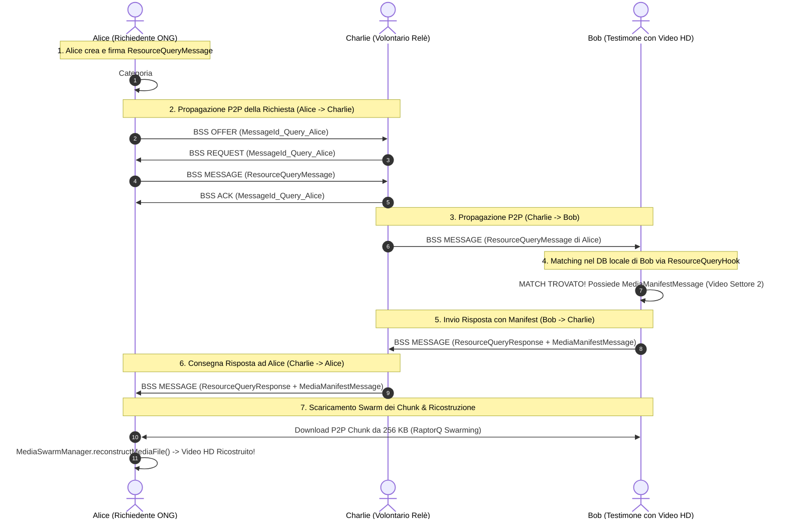

# Studio Architetturale: Meccanismo di Richiesta, Ricerca e Recupero di Risorse Multimediali Pesanti in Reti P2P/DTN

Questo documento costituisce lo studio architetturale formale dedicato alla progettazione del **Protocollo di Richiesta e Ricerca Attiva di Risorse Multimediali Pesanti (`ResourceQueryMessage`)** all'interno della comunità P2P in scenari d'emergenza.

Il documento descrive il funzionamento del sistema quando un utente (es. coordinatore di soccorso o giornalista) intende verificare se nella rete P2P circostante esistono **prove multimediali (Video HD, Foto o Audio) relative ad un preciso evento**, definendo i protocolli coinvolti, il collegamento tra i moduli di sistema, il parallelismo con le strutture native della libreria Bramble di Briar, la sequenza temporale con diagramma Mermaid e le fonti ufficiali.

---

## 1. Inquadramento del Problema: Ricerca Attiva in Reti Ad-Hoc / DTN

Nelle reti tradizionali connesse ad Internet, la ricerca di un contenuto multimediale si affida ad un motore di ricerca centrale o ad un indice DHT globale (es. IPFS / BitTorrent) `[Fonte: Benet, J., 2014 - IPFS]`.

In una rete P2P/DTN mobile priva di Internet:
1. **Nessun Indice Centralizzato**: Non esiste un server a cui chiedere *"Chi possiede il video del crollo nel Settore 4?"*.
2. **Richieste Asincrone Epidemiche**: La richiesta dell'utente deve viaggiare come un **messaggio d'interrogazione Pub/Sub epidemico (`ResourceQueryMessage`)** attraverso gli smartphone dei membri della comunità.
3. **Risposta tramite Swarm Manifest**: Quando un nodo della rete possiede il video o dei blocchi dello sciame (*chunk*) corrispondenti ai criteri di ricerca, risponde inviando il **`MediaManifestMessage`** (con la radice Merkle DAG e la lista dei chunk), attivando il download dello sciame.

---

## 2. Collegamento dei Moduli di Sistema e Protocolli Coinvolti

Il meccanismo di ricerca e recupero collega ed integra in modo coerente **tutti i moduli di progetto realizzati**:

```
 ┌─────────────────────────────────────────────────────────────────────────────┐
 │                    INTEGRAZIONE UNIFICATA DEI MODULI                        │
 ├─────────────────────────────────────────────────────────────────────────────┤
 │ MODULO 1: IDENTITÀ & SICUREZZA                                              │
 │   └─ La richiesta `ResourceQueryMessage` è firmata con `did:key` Ed25519.  │
 │      Solo i nodi `FULL_MEMBER` o in Sandbox autorizzati possono inviarla.  │
 ├─────────────────────────────────────────────────────────────────────────────┤
 │ MODULO 2: TOPIC PUB/SUB & FILTRI DI BLOOM                                   │
 │   └─ La richiesta viene pubblicata sul Topic di ricerca (es. `#ricerca-media`)│
 │      e filtrata nei record BSS `OFFER` tramite il Filtro di Bloom (128 B).  │
 ├─────────────────────────────────────────────────────────────────────────────┤
 │ MODULO MEDIA SWARM & STORAGE DISTRIBUITO                                    │
 │   └─ Il match attiva l'invio del Manifest e lo scaricamento epidemico P2P   │
 │      dei chunk da 256 KB ricostruiti via RaptorQ Erasure Coding (RFC 6330). │
 └─────────────────────────────────────────────────────────────────────────────┘
```

---

## 3. Parallelismo e Meccanismi Affini nella Libreria Bramble di Briar

### **Cosa offre Briar in nativo**:
Nella libreria Bramble di Briar, la ricerca dei contenuti è **esclusivamente locale**: un utente può cercare testo solo all'interno del database cifrato H2/SQLite del proprio dispositivo. Briar non possiede una funzione nativa per inviare "interrogazioni di ricerca attive" ai peer vicini via radio `[Fonte: Briar GitLab Repository]`.

### **Come si risolve il caso d'uso estendendo Bramble (Approccio Tesi)**:
Per realizzare la ricerca attiva senza rompere il paradigma P2P di Bramble, l'architettura sfrutta ed estende le primitive native:
1. **Uso di un `ClientId` dedicato**: Viene registrato un nuovo client `CLIENT_ID_RESOURCE_QUERY = new ClientId("org.briarproject.briar.resource.query")` `[Fonte: Briar GitLab - ClientId.java]`.
2. **In-Band Query Messages BDF**: L'interrogazione viene modellata come un normale messaggio BDF (`ResourceQueryMessage`) inserito nel database con `shared = true`.
3. **Esecuzione tramite BSS e Hook**: Il motore Bramble Sync trasporta la richiesta via record BSS (`OFFER`/`REQUEST`/`MESSAGE`/`ACK`) `[Fonte: Briar Protocol Specifications - BSS Protocol]`. Quando il messaggio arriva su uno smartphone vicino, l'hook BDF `ResourceQueryHook.java` (estensione di `BdfIncomingMessageHook`) esegue una ricerca sul database locale. Se trova un match, genera ed invia la risposta in automatico.

---

## 4. Struttura del Messaggio BDF: `ResourceQueryMessage`

Il messaggio di richiesta è un DTO BDF leggero ($< 1$ KB) firmato digitalmente ed inviato al Topic d'interrogazione:

```java
// FILE NUOVO - Path: briar-api/src/main/java/org/briarproject/briar/api/resource/ResourceQueryMessage.java

package org.briarproject.briar.api.resource;

import org.briarproject.bramble.api.identity.Author;
import org.briarproject.bramble.api.sync.MessageId;
import org.briarproject.nullsafety.NotNullByDefault;
import javax.annotation.concurrent.Immutable;
import java.util.List;

/**
 * Contratto DTO BDF per l'interrogazione P2P di ricerca di risorse multimediali.
 */
@Immutable
@NotNullByDefault
public class ResourceQueryMessage {

    private final MessageId queryId;             // MessageId SHA-256 univoco della richiesta
    private final Author requesterAuthor;         // Autore che cerca le prove (did:key Ed25519)
    private final String targetTopicCategory;    // Topic della risorsa (es. "#emergenza-sanitaria")
    private final String locationSector;         // Settore/Area di riferimento (es. "Settore 4 - Nord")
    private final List<String> searchKeywords;   // Parole chiave (es. ["frana", "crollo", "video"])
    private final long timestampMs;              // Timestamp di emissione
    private final long ttlDurationMs;            // Durata validità della ricerca (es. 6 ore)
    private final byte[] signature;              // Firma digitale Ed25519 del richiedente

    public ResourceQueryMessage(MessageId queryId,
                                Author requesterAuthor,
                                String targetTopicCategory,
                                String locationSector,
                                List<String> searchKeywords,
                                long timestampMs,
                                long ttlDurationMs,
                                byte[] signature) {
        this.queryId = queryId;
        this.requesterAuthor = requesterAuthor;
        this.targetTopicCategory = targetTopicCategory;
        this.locationSector = locationSector;
        this.searchKeywords = searchKeywords;
        this.timestampMs = timestampMs;
        this.ttlDurationMs = ttlDurationMs;
        this.signature = signature;
    }

    public MessageId getQueryId() { return queryId; }
    public Author getRequesterAuthor() { return requesterAuthor; }
    public String getTargetTopicCategory() { return targetTopicCategory; }
    public String getLocationSector() { return locationSector; }
    public List<String> getSearchKeywords() { return searchKeywords; }
    public long getTimestampMs() { return timestampMs; }
    public long getTtlDurationMs() { return ttlDurationMs; }
    public byte[] getSignature() { return signature; }
}
```

---

## 5. Sequenza Temporale ed Esempio Pratico sul Campo

### **Scenario dell'Esempio**:
* **Alice (Giornalista / Coordinatrice ONG)**: Cerca prove video di un allagamento avvenuto nel *Settore 2*.
* **Bob (Soccorritore / Testimone)**: Ha filmato un video HD dell'evento. L'app di Bob ha già elaborato il video generando il `MediaManifestMessage` ed i relativi chunk da 256 KB cifrati e protetti con Erasure Coding RaptorQ (RFC 6330).
* **Charlie (Nodo Relè)**: Un volontario che trasporta i messaggi tra il settore di Alice e quello di Bob.

---

### **Flusso Temporale Passo-Passo**:

#### **Passo 1: Creazione e Pubblicazione della Richiesta (Alice)**
1. Alice apre l'app e compila la scheda di ricerca: Categoria `#allagamenti`, Settore `"Settore 2"`, Parole Chiave `["video", "strada-principale"]`.
2. L'app di Alice genera il messaggio BDF `ResourceQueryMessage`, lo firma con la chiave Ed25519 di Alice e lo salva nel DB con `shared = true`.

#### **Passo 2: Propagazione Epidemica della Richiesta via BSS (Alice $\rightarrow$ Charlie $\rightarrow$ Bob)**
1. Alice incontra Charlie via Bluetooth. Il motore Bramble Sync scambia il filtro di Bloom ed offre il `ResourceQueryMessage` a Charlie (`OFFER` $\rightarrow$ `REQUEST` $\rightarrow$ `MESSAGE` $\rightarrow$ `ACK`).
2. Charlie si sposta ed incontra Bob. Bramble Sync trasferisce la richiesta di Alice a Bob.

#### **Passo 3: Matching Locale ed Intercettazione da parte di Bob (`ResourceQueryHook`)**
1. Lo smartphone di Bob riceve il `ResourceQueryMessage` di Alice.
2. L'hook applicativo `ResourceQueryHook.java` intercetta il messaggio, ne valida la firma Ed25519 ed interroga il database cifrato locale di Bob.
3. Il DB di Bob trova un **MATCH**: Bob possiede il `MediaManifestMessage` di un video HD registrato nel *Settore 2* con tag `#allagamenti`.

#### **Passo 4: Invio della Risposta di Riscontro (Bob $\rightarrow$ Charlie $\rightarrow$ Alice)**
1. L'app di Bob genera automaticamente un messaggio di risposta `ResourceQueryResponse` agganciato all'ID della richiesta di Alice (`queryId`), allegando il `MediaManifestMessage` del video.
2. Il messaggio di risposta naviga sulla rete P2P fino allo smartphone di Alice.

#### **Passo 5: Download dello Sciame (Swarm) e Ricostruzione del Video (Alice)**
1. Alice riceve la risposta ed il Manifest del video (contenente la Merkle Root, le chiavi di decifratura e l'elenco dei chunk).
2. L'app di Alice avvia lo scaricamento P2P dei chunk da 256 KB dai nodi dello sciame presenti nella zona.
3. Appena Alice raccoglie la soglia minima $N$ di blocchi, il modulo `MediaSwarmManager` applica la decodifica **RaptorQ (RFC 6330)**, ricostruisce il video HD originale e lo mostra a schermo!

---

### **Diagramma di Sequenza Mermaid del Flusso di Richiesta e Recupero**



---

## 6. Codice Sorgente dell'Hook di Ricerca: `ResourceQueryHook.java`

* **Path**: `briar-core/src/main/java/org/briarproject/briar/resource/ResourceQueryHook.java`
* **Natura**: **`[FILE NUOVO]`** (Modulo `briar-core`)
* **Ruolo**: Hook BDF che intercetta le richieste di ricerca in arrivo, esegue il matching sul DB locale e genera la risposta con il Manifest multimediale.

```java
// FILE NUOVO - Path: briar-core/src/main/java/org/briarproject/briar/resource/ResourceQueryHook.java

package org.briarproject.briar.resource;

import org.briarproject.bramble.api.ClientHelper;
import org.briarproject.bramble.api.FormatException;
import org.briarproject.bramble.api.data.BdfDictionary;
import org.briarproject.bramble.api.data.BdfList;
import org.briarproject.bramble.api.db.DatabaseComponent;
import org.briarproject.bramble.api.db.DbException;
import org.briarproject.bramble.api.identity.Author;
import org.briarproject.bramble.api.sync.Message;
import org.briarproject.bramble.api.sync.validation.BdfIncomingMessageHook;
import org.briarproject.briar.api.media.MediaManifestMessage;
import org.briarproject.nullsafety.NotNullByDefault;

import javax.annotation.concurrent.Immutable;
import javax.inject.Inject;
import java.security.GeneralSecurityException;
import java.util.List;
import java.util.logging.Logger;

@Immutable
@NotNullByDefault
public class ResourceQueryHook extends BdfIncomingMessageHook {

    private static final Logger LOG = Logger.getLogger(ResourceQueryHook.class.getName());
    public static final int MSG_TYPE_RESOURCE_QUERY = 11;

    private final DatabaseComponent db;
    private final ClientHelper clientHelper;
    private final MediaSwarmManager mediaSwarmManager;

    @Inject
    public ResourceQueryHook(DatabaseComponent db,
                             ClientHelper clientHelper,
                             MediaSwarmManager mediaSwarmManager) {
        super(db, clientHelper);
        this.db = db;
        this.clientHelper = clientHelper;
        this.mediaSwarmManager = mediaSwarmManager;
    }

    @Override
    protected DeliveryAction incomingMessage(Transaction txn, Message m, BdfList body, BdfDictionary meta)
            throws DbException, FormatException {

        int msgType = body.getList(0).getInt(0);

        if (msgType == MSG_TYPE_RESOURCE_QUERY) {
            return processIncomingQuery(txn, m, body);
        }

        return DeliveryAction.ACCEPT;
    }

    private DeliveryAction processIncomingQuery(Transaction txn, Message m, BdfList body) throws DbException, FormatException {
        try {
            BdfList bodyToSign = body.getList(0);
            byte[] signature = body.getRaw(1);

            Author requester = clientHelper.parseAndValidateAuthor(bodyToSign.getList(1));

            // 1. Verifica la firma Ed25519 del richiedente
            clientHelper.verifySignature(
                signature,
                "org.briarproject.briar.resource/RESOURCE_QUERY",
                bodyToSign,
                requester.getPublicKey()
            );

            String targetTopic = bodyToSign.getString(2);
            String locationSector = bodyToSign.getString(3);
            List<String> keywords = bodyToSign.getList(4).getStringList();

            LOG.info("Ricevuta richiesta di ricerca prove media per Topic: " + targetTopic + " Settore: " + locationSector);

            // 2. Esegue il matching sul DB locale per verificare la presenza di media idonei
            List<MediaManifestMessage> matchingManifests = mediaSwarmManager.findLocalMatchingManifests(txn, targetTopic, locationSector, keywords);

            if (!matchingManifests.isEmpty()) {
                LOG.info(" MATCH TROVATO! Trovati " + matchingManifests.size() + " media corrispondenti. Invio risposta P2P...");
                // Genera ed invia automaticamente la risposto BDF allegando i Manifest trovati
                mediaSwarmManager.sendQueryResponse(txn, requester, m.getId(), matchingManifests);
            }

            return DeliveryAction.ACCEPT;

        } catch (GeneralSecurityException e) {
            LOG.warning("Firma Ed25519 sulla richiesta di ricerca non valida -> REJECT.");
            return DeliveryAction.REJECT;
        }
    }
}
```

---

## 7. Fonti Ufficiali e Bibliografia

1. **Benet, J. (2014)**. *"IPFS - Content Addressed, Versioned, P2P File System"*. *arXiv preprint arXiv:1407.3561*.
   * *Riferimento*: Modello di ricerca e recupero di contenuti P2P basato su Merkle DAG ed indirizzamento per contenuto.
2. **Luby, M., Shokrollahi, A., Watson, M., & Stockhammer, T. (2011)**. *"RaptorQ Forward Error Correction Scheme for Object Delivery"*. *IETF RFC 6330*.
   * *Riferimento*: Standard IETF per il recupero e la ricomposizione di oggetti pesanti via Swarming.
3. **Vahdat, A., & Becker, D. (2000)**. *"Epidemic routing for partially-connected ad hoc networks"*. *Duke University Technical Report*.
   * *Riferimento*: Propagazione epidemica di query di ricerca e risposte in reti ad-hoc non connesse.
4. **IETF RFC 8032**: *Edwards-Curve Digital Signature Algorithm (Ed25519)*.
   * *Riferimento*: Firma asimmetrica delle richieste di ricerca e risposte BDF.
5. **Briar Project Official Repository & Architecture**:
   * *GitLab Repository*: [code.briarproject.org/briar/briar](https://code.briarproject.org/briar/briar)
   * *Classi Verificate*: `bramble-api/.../sync/validation/BdfIncomingMessageHook.java`, `bramble-api/.../sync/ClientId.java`, `bramble-core/.../db/DatabaseComponentImpl.java`.
