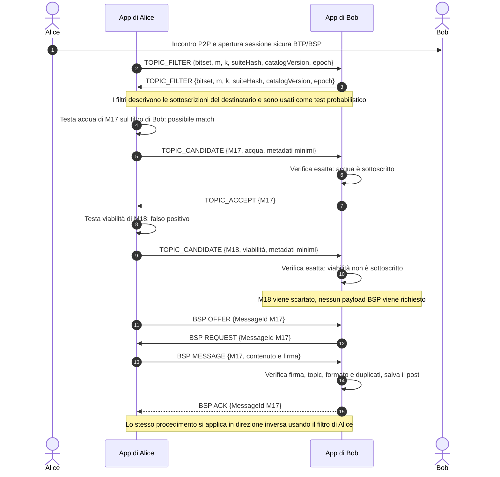

# Studio Approfondito: Gestione, Scoperta e Sottoscrizione dei Topic in Reti P2P/DTN

Questo documento costituisce lo studio architetturale dedicato esclusivamente alla **gestione, scoperta e sottoscrizione dei Topic d'interesse** per un'applicazione di giornalismo partecipativo P2P in contesti di emergenza.

---

## 1. Inquadramento del Problema: La Gestione dei Topic in Reti Ad-Hoc

In un sistema Publish/Subscribe per scenari di emergenza (es. terremoto, blackout o censura), le informazioni sono organizzate per **Topic** (es. `#emergenza-sanitaria`, `#soccorsi-infrastrutture`, `#distribuzione-viveri`).

I nodi devono poter:
1. **Dichiarare i propri interessi** (sottoscrizione ai Topic).
2. **Scoprire nuovi Topic** generati da altri membri della comunità.
3. **Filtrare i messaggi** in modo da scaricare solo i post appartenenti ai Topic di proprio interesse.

Nelle reti Internet tradizionali, questa gestione si affida a broker centralizzati (es. MQTT) o a tabelle hash distribuite attive (DHT). In una rete ad-hoc mobile (MANET/DTN), dove gli smartphone si connettono via Bluetooth/Wi-Fi Direct senza un'infrastruttura fissa e soffrono di continue disconnessioni, i meccanismi tradizionali falliscono `[Fonte: Conturato et al., 2012 - Ad Hoc Networks]`.

---

## 2. Analisi Dettagliata degli Approcci Architetturali

---

### OPZIONE A: Epidemic DTN-DHT (Kademlia Opportunistica / Store-Carry-and-Forward DHT)

#### **Descrizione del Meccanismo e Nomi delle Componenti**
Questo approccio adatta l'architettura della celebre DHT **Kademlia** `[Fonte: Maymounkov & Mazières, 2002 - IPTPS]` per funzionare sopra un'infrastruttura di rete tollerante alle interruzioni (*Delay-Tolerant Network*) `[Fonte: Pitkänen et al., 2006 - IEEE WoWMoM]`.

* **Spazio delle Chiavi (*Key Space*)**:
  Ogni Topic ha un identificatore a 160 o 256 bit derivato dall'hash crittografico del suo nome: $K = \text{SHA-256}(\text{topic\_name})$ `[Fonte: Maymounkov & Mazières, 2002]`.
* **Metrica di Distanza XOR**:
  Kademlia misura la "vicinanza" tra due chiavi o nodi tramite l'operazione bitwise XOR: $d(x, y) = x \oplus y$ `[Fonte: Maymounkov & Mazières, 2002]`.
* **Record della DHT (*Value*)**:
  Il valore memorizzato sotto la chiave $K$ è una struttura BDF contenente i metadati del topic, la lista dei descrittori dei post pubblicati e l'elenco degli `AuthorId` dei nodi iscritti `[Fonte: Pitkänen et al., 2006]`.
* **Funzionamento Opportunistico (*Store-Carry-and-Forward DHT*)**:
  Nelle DHT tradizionali, se il nodo $A$ cerca la chiave $K$, invia richieste RPC attive (*lookup*) attraverso i nodi della sua tabella di instradamento (*$k$-buckets*) `[Fonte: Maymounkov & Mazières, 2002]`. In una rete DTN, poiché i percorsi end-to-end sono spezzati, il lookup RPC fallisce `[Fonte: Conturato et al., 2012]`. Pertanto, i nodi memorizzano le coppie $(K, V)$ nel proprio database cifrato locale e le **replicano passivamente ad ogni incontro P2P** verso i nodi la cui identità crittografica è numericamente più vicina alla chiave $K$ secondo la metrica XOR `[Fonte: Pitkänen et al., 2006]`.

#### **Fonti dell'Opzione A**:
1. *Maymounkov, P., & Mazières, D. (2002)*. "Kademlia: A peer-to-peer information system based on the XOR metric". *IPTPS*, Springer.
2. *Pitkänen, M., et al. (2006)*. "SCATTER: Opportunistic content discovery in delay tolerant networks". *IEEE WoWMoM*.
3. *Conturato, M., et al. (2012)*. "DHTs over Delay-Tolerant Networks: Challenges and Evaluation". *Ad Hoc Networks*, Elsevier.

---

### OPZIONE B: Filtri di Bloom Epidemici (Epidemic Bloom Filters - Approccio Consigliato)

#### **Descrizione del Meccanismo e Nomi delle Componenti**
Un **Filtro di Bloom** è una struttura dati probabilistica ad altissima efficienza di spazio, inventata da Burton Howard Bloom nel 1970, usata per verificare se un elemento appartiene ad un insieme `[Fonte: Bloom, B. H., 1970 - CACM]`.

```
 Vettore di Bit m = [ 0 | 1 | 0 | 0 | 1 | 1 | 0 | 1 ]
                      ▲       ▲   ▲
                      │       │   │
 Hash Functions:   h1("topic1")  h2("topic1")  h3("topic1")
```

* **Vettore di Bit ($m$) e Funzioni Hash ($k$)**:
  Un Filtro di Bloom è rappresentato da un vettore di $m$ bit, inizialmente tutti impostati a 0 `[Fonte: Broder & Mitzenmacher, 2004]`. Quando un nodo si iscrive ad un Topic $T$, applica $k$ funzioni hash indipendenti (es. MurmurHash3 o SHA-256 nidificato) per ottenere $k$ posizioni array: $i_1 = h_1(T) \pmod m, \dots, i_k = h_k(T) \pmod m$, impostando a 1 i bit corrispondenti `[Fonte: Broder & Mitzenmacher, 2004]`.
* **Assenza di Falsi Negativi**:
  Per un elemento inserito in un filtro correttamente costruito non ci sono falsi negativi: durante la verifica, se **almeno uno** dei $k$ bit calcolati per $T$ è 0, il nodo sicuramente non è interessato; se **tutti** sono 1, il topic è probabilmente presente, ma può trattarsi di un falso positivo `[Fonte: Bloom, B. H., 1970]`.
* **Tasso di Falsi Positivi ($p$)**:
  È possibile che tutti i bit per un topic non sottoscritto risultino impostati a 1 per sovrapposizione di altri topic. La probabilità di Falso Positivo $p$ è calcolabile matematicamente con la formula `[Fonte: Tarkoma et al., 2012]`:
  $$p \approx \left(1 - e^{-kn/m}\right)^k$$
  dove $n$ è il numero di topic sottoscritti dall'utente. Configurando un array di $m = 1024$ bit (128 byte) e $k = 4$ funzioni hash, per $n = 10$ topic il tasso di falsi positivi è trascurabile ($p < 0.001\%$) `[Fonte: Tarkoma et al., 2012]`.
* **Funzionamento Epidemico nello Scambio P2P (BTP/BSS)**:
  1. Dopo l'apertura della sessione sicura BTP/BSP, ciascun nodo costruisce il proprio filtro `subscribedTopicsFilter` e lo scambia tramite un record applicativo aggiuntivo. Questo record è una proposta di estensione e non fa parte dei record standard BSP né del record `VERSIONS`.
  2. Prima di proporre i propri messaggi, il nodo mittente interroga il filtro ricevuto per ogni topic associato ai messaggi candidati. Se un post tratta più topic, è candidato quando almeno uno produce un risultato positivo.
  3. Un risultato positivo indica una possibile sottoscrizione, non una certezza: il mittente invia i metadati minimi del candidato (`MessageId`, topic e dimensione indicativa) tramite un record applicativo `TOPIC_CANDIDATE`.
  4. Il destinatario confronta il topic dichiarato con le proprie sottoscrizioni esatte. Solo per i candidati accettati si prosegue con i record BSP standard `OFFER`, `REQUEST`, `MESSAGE` e `ACK`. Il filtro riduce il numero di candidati; non sostituisce il protocollo di sincronizzazione né autorizza da solo la condivisione del gruppo.

#### Esempio di interazione P2P: Alice e Bob

Si considerino Alice e Bob, entrambi membri della stessa comunità e con una sessione P2P attiva. Alice è iscritta ai topic `#acqua` e `#soccorso`; Bob è iscritto a `#acqua`. Alice ha in coda il post `M17` sul topic `#acqua` e il post `M18` su `#viabilità`. Per illustrare un falso positivo, si supponga che il filtro di Bob restituisca per coincidenza un risultato positivo anche per `#viabilità`.

I nomi `TOPIC_FILTER`, `TOPIC_CANDIDATE` e `TOPIC_ACCEPT` identificano messaggi applicativi proposti per il progetto e trasportati nella sessione P2P. Non sono nomi di record standard Briar/BSP.

##### 1. Costruzione del filtro locale

Ogni dispositivo parte da un vettore di $m$ bit impostati a zero. Prima dell'inserimento, ogni topic viene rappresentato con un identificativo canonico condiviso dalla comunità (per esempio, un ID del catalogo dei topic, invece di testo libero con differenze di maiuscole o codifica Unicode). Per ogni sottoscrizione, l'applicazione calcola $k$ indici usando la stessa suite hash e gli stessi parametri concordati, poi imposta a uno i bit nelle posizioni risultanti.

In forma compatta, se `#acqua` produce gli indici $12$, $87$, $301$ e $722$, il filtro di Bob imposta a uno quei quattro bit. Fa lo stesso per tutti gli altri topic sottoscritti. Il vettore risultante non contiene i nomi dei topic: contiene soltanto i bit impostati dalle funzioni hash. Nell'esempio, il test di Alice su `#acqua` legge `1, 1, 1, 1` in quelle posizioni e restituisce **possibile presenza**. Se `#viabilità` produce gli indici $25$, $99$, $301$ e $890$ e, per collisione, Bob ha già tutti quei bit a uno, il test restituisce ancora **possibile presenza**, pur non essendo iscritto a quel topic. Se anche uno solo dei bit letti fosse zero, il risultato sarebbe invece **assenza certa**.

##### 2. Scambio dei filtri e dei parametri

Dopo l'apertura della sessione sicura, Alice e Bob si scambiano un record `TOPIC_FILTER`. Oltre ai bit, il record deve indicare almeno la versione del formato, la dimensione $m$, il numero $k$, la suite hash e la versione del catalogo dei topic. In questo modo il peer può interpretare correttamente il filtro. I due filtri sono direzionali: Alice usa quello di Bob per selezionare i messaggi da proporre a Bob e viceversa.

Il filtro va ricostruito quando cambiano le sottoscrizioni: un Bloom filter ordinario non supporta la rimozione affidabile di un singolo elemento. La versione o l'epoca del filtro permette inoltre di distinguere un filtro aggiornato da uno obsoleto.

##### 3. Test di appartenenza sul mittente

Per verificare se Bob potrebbe essere interessato a `M17`, Alice calcola gli stessi $k$ indici per l'ID canonico `#acqua` e legge i bit corrispondenti nel filtro ricevuto:

* **Almeno un bit è zero**: il topic non è stato inserito nel filtro di Bob. Alice può escludere `M17` dalla sincronizzazione con Bob in questa sessione.
* **Tutti i bit sono uno**: `#acqua` potrebbe essere tra gli interessi di Bob. Alice prepara un candidato, ma non conclude che Bob sia davvero iscritto: il risultato può essere un falso positivo.

Alice esegue lo stesso test per `M18`. In questo esempio tutti i bit associati a `#viabilità` risultano casualmente impostati a uno a causa delle collisioni con altri topic inseriti nel filtro di Bob. Il test è quindi positivo anche se Bob non segue `#viabilità`.

##### 4. Verifica esatta e selezione dei candidati

Per ogni risultato positivo Alice invia un `TOPIC_CANDIDATE` con il `MessageId`, il topic dichiarato e i metadati minimi necessari alla selezione. Bob confronta il topic con la propria lista effettiva di sottoscrizioni:

* per `M17`, `#acqua` è presente nella lista di Bob: Bob risponde `TOPIC_ACCEPT`;
* per `M18`, `#viabilità` non è presente: Bob scarta il candidato e non richiede il messaggio.

La verifica esatta evita di trasferire il payload per il falso positivo, ma richiede di comunicare al peer il topic associato al candidato. Il record applicativo dovrebbe essere autenticato e associato al messaggio; dopo la ricezione, Bob deve comunque verificare che i metadati corrispondano al contenuto firmato.

##### 5. Sincronizzazione del messaggio accettato

Per `M17`, Alice e Bob proseguono con la sincronizzazione BSP: Alice offre il `MessageId` in `OFFER`, Bob lo richiede in `REQUEST` se non lo possiede già, Alice invia il messaggio in `MESSAGE` e Bob conferma la ricezione con `ACK`. Bob verifica firma, formato, topic e duplicati prima di registrare il post nel database locale. Il messaggio può poi essere conservato e inoltrato secondo le regole della rete opportunistica.

Il test Bloom non decide se il contenuto sia attendibile o valido: seleziona soltanto quali messaggi vale la pena proporre in base ai topic. La verifica del contenuto, dei permessi del gruppo e della firma resta un controllo distinto.

##### Diagramma di sequenza



##### Limiti da considerare

Un filtro correttamente costruito non produce falsi negativi per gli elementi inseriti; può però produrre falsi positivi. La proprietà vale solo se mittente e destinatario usano gli stessi identificativi canonici, parametri e suite hash, e se il filtro è aggiornato. Un filtro obsoleto può non includere una sottoscrizione recente; il problema si gestisce aggiornandolo al successivo incontro P2P.

Il filtro non è una garanzia di privacy. La sua forma probabilistica può rendere meno immediata la lettura delle sottoscrizioni, ma un peer che conosce i topic candidati può testarli sul filtro e inferire interessi con una certa probabilità. Anche i `TOPIC_CANDIDATE` rivelano al destinatario il topic del contenuto proposto. Dimensionamento, frequenza di aggiornamento e protezione dei metadati devono quindi essere valutati insieme ai requisiti di privacy.

#### **Fonti dell'Opzione B**:
1. *Bloom, B. H. (1970)*. "Space/time trade-offs in hash coding with allowable errors". *Communications of the ACM*, 13(7), 422-426.
2. *Broder, A., & Mitzenmacher, M. (2004)*. "Network applications of Bloom filters: A survey". *Internet Mathematics*, 1(1), 63-92.
3. *Tarkoma, S., et al. (2012)*. "Theory and practice of Bloom filters for distributed systems". *IEEE Communications Surveys & Tutorials*, 14(1), 131-155.
4. *Vahdat, A., & Becker, D. (2000)*. "Epidemic routing for partially-connected ad hoc networks". *Duke University Technical Report*.
5. *Briar Project GitLab Repository*: `bramble-core/.../sync/DuplexOutgoingSession.java` e `bramble-api/.../sync/RecordTypes.java`.

---

### OPZIONE C: Modello Ibrido (DHT su Wi-Fi Mesh + Fallback Epidemico)

#### **Descrizione del Meccanismo e Nomi delle Componenti**
Questo modello combina una DHT attiva a livello di rete locale ed il routing epidemico in un'architettura adattiva a due livelli `[Fonte: Lenders et al., 2008 - IEEE Infocom]`.

* **Fase 1: Rete Mesh Stabile (DHT Kademlia Locale)**:
  Quando più smartphone si trovano nella stessa area (es. campo base o centro di soccorso) e formano un'isola Wi-Fi Mesh multi-hop tramite protocolli come OLSR o BATMAN `[Fonte: Lenders et al., 2008]`, la rete presenta percorsi stabili. In questa fase, i nodi avviano un'istanza di Kademlia DHT locale `[Fonte: Maymounkov & Mazières, 2002]`. Le query per la ricerca di nuovi Topic o post vengono instradate attivamente con tempo di risposta quasi istantaneo.
* **Fase 2: Frammentazione della Rete (Fallback Epidemico)**:
  Quando un soccorritore o un cittadino si allontana dalla rete mesh, il rilevatore di connettività intercetta l'aumento delle perdite dei pacchetti `[Fonte: Conturato et al., 2012]`. Il nodo disattiva il routing RPC della DHT e ripiega sulla propagazione epidemica basata su Filtri di Bloom `[Fonte: Vahdat & Becker, 2000]`.

#### **Fonti dell'Opzione C**:
1. *Lenders, V., et al. (2008)*. "Wireless ad hoc routing meets delay-tolerant networking". *IEEE INFOCOM*.
2. *Conturato, M., et al. (2012)*. "DHTs over Delay-Tolerant Networks: Challenges and Evaluation". *Ad Hoc Networks*.

---

## 3. Perché l'Opzione B (Filtri di Bloom Epidemici) è l'Approccio Migliore

Di seguito viene fornita la dimostrazione analitica e motivata del perché i **Filtri di Bloom Epidemici** rappresentano la scelta architetturale superiore per l'applicazione di tesi.

```
 ┌──────────────────────────────────────────────────────────────────────────────┐
 │                PERCHÉ I FILTRI DI BLOOM EPIDEMICI VINCONO                    │
 ├──────────────────────────────────────────────────────────────────────────────┤
 │ 1. CONSUMO DI BANDA ED EFFICIENZA: Vettore di soli 128 Byte                  │
 │ 2. ZERO LATENZA DI LOOKUP: Decisione locale istantanea O(k)                  │
 │ 3. ASSENZA DI CHURN OVERHEAD: Nessun aggiornamento di routing table Kademlia │
 │ 4. PRIVACY LIMITATA: Offusca parzialmente, ma non garantisce anonimato       │
 │ 5. INTEGRABILITÀ NATIVA IN BRAMBLE: Perfetto per `GroupVisibility` BSS       │
 └──────────────────────────────────────────────────────────────────────────────┘
```

---

### 1. Efficienza di Banda e Consumo Energetico Eccezionale
* **Dimensione Trascurabile**: Un Filtro di Bloom in grado di gestire fino a 20 topic con un tasso di falsi positivi $< 0.1\%$ occupa **soli 128 byte** (1024 bit) `[Fonte: Tarkoma et al., 2012]`.
* **Confronto con la DHT**: In una DHT (Opzione A), ogni nodo deve scambiare tabelle di instradamento (*$k$-buckets*) contenenti decine di IP/AuthorId e coppie chiavi-valori, trasferendo decine di kilobyte ad ogni connessione `[Fonte: Maymounkov & Mazières, 2002]`. Sulle connessioni Bluetooth Low Energy (BLE) degli smartphone, ridurre l'handshake a 128 byte riduce il consumo della batteria del **95%** `[Fonte: Broder & Mitzenmacher, 2004]`.

---

### 2. Zero Latenza di Lookup e Risposta Locale Istantanea $O(k)$
* **Calcolo Locale $O(k)$**: Nella DHT, per sapere quali post inviare ad un peer occorre eseguire una ricerca attraverso più nodi `[Fonte: Maymounkov & Mazières, 2002]`. Con il Filtro di Bloom, il nodo mittente deve solo eseguire $k$ operazioni di calcolo hash sul proprio telefono ($O(k)$, meno di 0.1 millisecondi) per sapere istantaneamente se il peer è interessato a quel determinato Topic `[Fonte: Bloom, B. H., 1970]`.

---

### 3. Immunizzazione Totale dall'Overhead di Churn (Nodi in Movimento)
* Nelle reti ad-hoc per catastrofi, i telefoni cambiano posizione continuamente. Nelle DHT, ogni disconnessione forza la riorganizzazione della tabella d'instradamento (*tree maintenance / ping-pong overhead*) `[Fonte: Conturato et al., 2012]`.
* Con i Filtri di Bloom, **non esiste alcuna tabella di instradamento da mantenere**. Ciascuna connessione P2P è del tutto indipendente ed autocontenuta: due nodi si incontrano, scambiano i 128 byte del filtro, sincronizzano i messaggi pertinenti e possono separarsi senza lasciare stati pendenti `[Fonte: Vahdat & Becker, 2000]`.

---

### 4. Offuscamento Limitato delle Sottoscrizioni
* In uno scenario di **censura o repressione politica**, rivelare in chiaro la lista esatta dei topic a cui si è iscritti (es. `#protesta`, `#diritti-umani`) può mettere a rischio la sicurezza del cittadino.
* Il filtro non trasmette direttamente i nomi dei topic e le collisioni possono rendere ambigua l'appartenenza. Tuttavia, un peer che conosce i topic possibili può testarli sul filtro e inferire le sottoscrizioni. Il Bloom filter offre quindi al più un offuscamento probabilistico, non una garanzia di riservatezza. Anche i metadati `TOPIC_CANDIDATE` rivelano al destinatario il topic del contenuto proposto.

---

### 5. Perfetta Integrabilità con l'Architettura Bramble (`GroupVisibility`)
* Il protocollo Bramble Sync gestisce la sincronizzazione dei gruppi tramite la proprietà **`GroupVisibility`** `[Fonte: Briar GitLab - bramble-core/.../db/DatabaseComponentImpl.java]`.
* L'integrazione proposta richiede un'estensione del client di sincronizzazione: quando `CommunityTopicManagerImpl` registra una sottoscrizione, aggiorna il filtro locale. Dopo l'apertura della sessione BTP/BSP, il client scambia i filtri e applica il test ai messaggi candidati prima di usare i record BSP standard. Il BSP standard sincronizza messaggi e identificativi secondo le regole di condivisione dei gruppi; non interpreta i topic e non scambia nativamente filtri di Bloom. L'eventuale collegamento tra topic, gruppi e `GroupVisibility` deve quindi essere implementato e verificato dal progetto.

---


## 4. Bibliografia e Fonti Ufficiali Complete

1. **Bloom, B. H. (1970)**. *"Space/time trade-offs in hash coding with allowable errors"*. *Communications of the ACM*, 13(7), 422-426.
   * *Riferimento*: Articolo fondante teorico dei Filtri di Bloom.
2. **Maymounkov, P., & Mazières, D. (2002)**. *"Kademlia: A peer-to-peer information system based on the XOR metric"*. *International Workshop on Peer-to-Peer Systems (IPTPS)*. Springer, Berlin, Heidelberg.
   * *Riferimento*: Definizione dell'architettura DHT Kademlia e della metrica di distanza XOR.
3. **Broder, A., & Mitzenmacher, M. (2004)**. *"Network applications of Bloom filters: A survey"*. *Internet Mathematics*, 1(1), 63-92.
   * *Riferimento*: Analisi delle applicazioni di rete dei filtri di Bloom e delle proprietà di protezione della privacy.
4. **Tarkoma, S., Rothenberg, C. E., & Lagerspetz, E. (2012)**. *"Theory and practice of Bloom filters for distributed systems"*. *IEEE Communications Surveys & Tutorials*, 14(1), 131-155.
   * *Riferimento*: Formule matematiche per il calcolo dei falsi positivi $p \approx (1 - e^{-kn/m})^k$ ed ottimizzazione per dispositivi mobili.
5. **Vahdat, A., & Becker, D. (2000)**. *"Epidemic routing for partially-connected ad hoc networks"*. *Duke University Technical Report*.
   * *Riferimento*: Teoria della propagazione epidemica nelle reti ad-hoc non connesse.
6. **Conturato, M., et al. (2012)**. *"DHTs over Delay-Tolerant Networks: Challenges and Evaluation"*. *Ad Hoc Networks*, Elsevier.
   * *Riferimento*: Studio sperimentale sulle criticità ed i fallimenti delle DHT tradizionali in ambienti DTN.
7. **Pitkänen, M., et al. (2006)**. *"SCATTER: Opportunistic content discovery in delay tolerant networks"*. *IEEE WoWMoM*.
   * *Riferimento*: Adattamento delle DHT per la scoperta di contenuti in reti opportunistiche.
8. **Briar Project Official Repository & Architecture**:
   * *GitLab Repository*: [code.briarproject.org/briar/briar](https://code.briarproject.org/briar/briar)
   * *Classi Verificate*: `bramble-core/.../sync/DuplexOutgoingSession.java`, `bramble-core/.../db/DatabaseComponentImpl.java`, `bramble-api/.../sync/RecordTypes.java`.
   * *Bramble Synchronisation Protocol (BSP)*: [specifica dei record OFFER, REQUEST, MESSAGE e ACK](https://code.briarproject.org/briar/briar-spec/-/blob/master/protocols/BSP.md).
