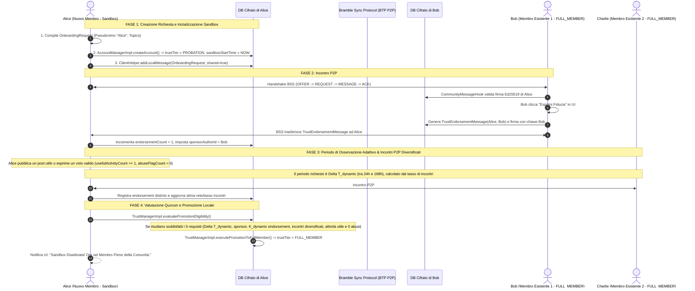

# Documentazione Dettagliata: Flusso di Comunicazione dell'Onboarding e Quorum di Prossimità (P2P DTN)

Questo documento descrive nel dettaglio il **flusso temporale**, la **sequenza dei messaggi**, le **strutture BDF** e le **chiamate di codice** necessarie per gestire l'onboarding di un **Nuovo Membro (Applicante in Sandbox)**, la raccolta degli endorsement da parte dei **Membri Esistenti (`FULL_MEMBER`)** e la **valutazione del Quorum di Prossimità Multicriterio**.

---

## 1. Diagramma di Sequenza Temporale (Flusso a Quorum)



---

## 2. Flusso Temporale Dettagliato e Chiamate di Codice

---

### FASE 1: Creazione della Richiesta e Inizializzazione Sandbox (Alice)

Quando Alice completa il wizard nell'app nativa, la sua app genera la richiesta di onboarding e la memorizza nel proprio database cifrato avviando il contatore temporale di Sandbox.

#### Chiamate di Codice:

1. **Inizializzazione Profilo Sandbox in `AccountManagerImpl.java`**:
   ```java
   // File: bramble-core/.../account/AccountManagerImpl.java

   private void initializeCommunitySandboxProfile(AuthorId authorId, List<String> topics, @Nullable String token) {
       try {
           Settings settings = new Settings();
           long now = System.currentTimeMillis();
           
           settings.put("trustTier", "PROBATION");
           settings.put("sandboxStartTime", String.valueOf(now)); // Inizio periodo di osservazione adattivo
           settings.put("endorsementCount", "0");
           settings.put("usefulActivityCount", "0");
           settings.put("abuseFlagCount", "0");
           settings.put("estimatedNetworkSize", "10"); // Valore iniziale da aggiornare con la stima locale
           settings.put("encounterRatePerHour", "1.0"); // Valore iniziale da aggiornare con gli incontri osservati
           settings.put("maxPostsPerDay", "1");
           
           if (token != null) settings.put("onboardingToken", token);
           if (topics != null) settings.put("subscribedTopics", String.join(",", topics));
           
           settingsManager.mergeSettings(settings, "community.trust");
       } catch (DbException e) {
           LOG.log(WARNING, "Errore inizializzazione profilo Sandbox", e);
       }
   }
   ```

2. **Creazione della `OnboardingRequest` in BDF**:
   ```java
   // File: briar-core/.../community/CommunityOnboardingManagerImpl.java

   public Message createOnboardingRequestMessage(Author applicantAuthor, List<String> topics)
           throws FormatException, GeneralSecurityException {

       long timestamp = System.currentTimeMillis();

       BdfList bodyToSign = BdfList.of(
           MSG_TYPE_ONBOARDING_REQUEST,          // Integer: 0
           clientHelper.toList(applicantAuthor),  // BdfList dell'autore applicante (Alice)
           BdfList.of(topics),                   // Topics scelti
           timestamp
       );

       byte[] signature = clientHelper.sign(
           "org.briarproject.briar.community/ONBOARDING_REQUEST",
           bodyToSign,
           identityManager.getLocalAuthor().getPrivateKey()
       );

       BdfList fullBody = BdfList.of(bodyToSign, signature);
       return clientHelper.createMessage(communityTopicGroupId, timestamp, clientHelper.toByteArray(fullBody));
   }
   ```

---

### FASE 2: Trasporto P2P BSS ed Emissione degli Endorsement (`TrustEndorsementMessage`)

Non appena lo smartphone di Alice entra nel raggio di un membro della comunità (Bob), le sessioni BSS (`IncomingSession` e `DuplexOutgoingSession`) scambiano i record.

#### Chiamate di Codice per l'Invio dell'Endorsement (Bob):

1. **Generazione del Messaggio di Attestazione di Fiducia (`TrustEndorsementMessage`)**:
   ```java
   // File: briar-core/.../community/CommunityOnboardingManagerImpl.java

   public void endorseApplicantNode(Author applicantAuthor) 
           throws DbException, FormatException, GeneralSecurityException {

       long timestamp = System.currentTimeMillis();
       Author localFullMember = identityManager.getLocalAuthor(); // Bob (FULL_MEMBER)

       BdfList bodyToSign = BdfList.of(
           MSG_TYPE_TRUST_ENDORSEMENT,                 // Integer: 2
           clientHelper.toList(applicantAuthor),       // Alice (Applicante)
           clientHelper.toList(localFullMember),      // Bob (Firmante FULL_MEMBER)
           timestamp
       );

       byte[] signature = clientHelper.sign(
           "org.briarproject.briar.community/TRUST_ENDORSEMENT",
           bodyToSign,
           localFullMember.getPrivateKey()
       );

       BdfList fullResponseBody = BdfList.of(bodyToSign, signature);
       Message endorsementMessage = clientHelper.createMessage(
           communityTopicGroupId,
           timestamp,
           clientHelper.toByteArray(fullResponseBody)
       );

       db.runInTransaction(false, txn -> {
           clientHelper.addLocalMessage(txn, endorsementMessage, new BdfDictionary(), true);
       });
   }
   ```

---

### FASE 3: Ricezione degli Endorsement e Incremento Quorum (Alice)

Quando Alice riceve un `TrustEndorsementMessage` via BSS, l'hook di messaggio elabora la firma ed aggiorna i metadati locales del quorum.

#### Chiamate di Codice:

1. **Elaborazione dell'Endorsement in `CommunityMessageHook.java`**:
   ```java
   // File: briar-core/.../community/CommunityMessageHook.java

   if (msgType == MSG_TYPE_TRUST_ENDORSEMENT) {
       BdfList bodyToSign = body.getList(0);
       byte[] signature = body.getRaw(1);

       Author approver = clientHelper.parseAndValidateAuthor(bodyToSign.getList(2));

       // 1. Verifica che l'approvatore sia riconosciuto come FULL_MEMBER
       if (trustManager.getTrustTier(approver.getId()) == TrustTier.FULL_MEMBER) {

           Author applicant = clientHelper.parseAndValidateAuthor(bodyToSign.getList(1));

           // 2. Se l'endorsement riguarda l'utente locale (Alice)
           if (applicant.getId().equals(identityManager.getLocalAuthor().getId())) {
               
               // 3. Registra l'endorsement nel DB ed esegui la verifica del quorum
               trustManager.registerIncomingEndorsement(approver.getId());
           }
       }
   }
   ```

2. **Registrazione dell'Endorsement in `TrustManagerImpl.java`**:
   ```java
   // File: bramble-core/.../trust/TrustManagerImpl.java

   public synchronized void registerIncomingEndorsement(AuthorId approverId) throws DbException {
       Settings settings = settingsManager.getSettings("community.trust");

       String authors = settings.getOrDefault("endorsementAuthors", "");
       List<String> authorList = new ArrayList<>(Arrays.asList(authors.split(",")));

       // Previene voti doppi dallo stesso membro
       if (!authorList.contains(approverId.getBytes())) {
           authorList.add(approverId.getBytes());
           int newCount = authorList.size();

           Settings update = new Settings();
           update.put("endorsementCount", String.valueOf(newCount));
           update.put("endorsementAuthors", String.join(",", authorList));

           // Imposta lo sponsor iniziale se non ancora presente
           if (settings.get("sponsorAuthorId") == null) {
               update.put("sponsorAuthorId", approverId.getBytes());
           }

           settingsManager.mergeSettings(update, "community.trust");

           // VALUTAZIONE ISTANTANEA DEL QUORUM E DEI REQUISITI
           evaluatePromotionEligibility();
       }
   }
   ```

---

### FASE 4: Valutazione del Quorum Multicriterio e Promozione

Quando scade il timer relativo a $\Delta T_{\text{dynamic}}$ o quando arriva un nuovo endorsement, la funzione `evaluatePromotionEligibility()` ricalcola le soglie in base alla stima della dimensione della rete e al tasso degli incontri, quindi verifica tutti i 5 requisiti prima del passaggio a `FULL_MEMBER`.

```java
// File: bramble-core/.../trust/TrustManagerImpl.java

public synchronized boolean evaluatePromotionEligibility() throws DbException {
    Settings settings = settingsManager.getSettings("community.trust");

    if ("FULL_MEMBER".equals(settings.get("trustTier"))) return true;

    long startTime = Long.parseLong(settings.getOrDefault("sandboxStartTime", "0"));
    int endorsementCount = Integer.parseInt(settings.getOrDefault("endorsementCount", "0"));
    int usefulActivityCount = Integer.parseInt(settings.getOrDefault("usefulActivityCount", "0"));
    int abuseFlags = Integer.parseInt(settings.getOrDefault("abuseFlagCount", "0"));
    int estimatedNetworkSize = Integer.parseInt(settings.getOrDefault("estimatedNetworkSize", "10"));
    double encounterRate = Double.parseDouble(settings.getOrDefault("encounterRatePerHour", "1.0"));
    String sponsorId = settings.get("sponsorAuthorId");

    // Calcolo delle soglie secondo il modello dinamico di promozione
    int dynamicK = calculateDynamicQuorum(estimatedNetworkSize);
    long dynamicTimeLockMs = calculateDynamicTimeLock(encounterRate);

    // VERIFICA DEI 5 REQUISITI CONCORRENTI
    boolean timeLockPassed = (System.currentTimeMillis() - startTime) >= dynamicTimeLockMs;
    boolean quorumPassed = endorsementCount >= dynamicK;
    boolean sponsorPresent = sponsorId != null && !sponsorId.isEmpty();
    boolean encounterDiversityPassed = hasDiverseEncounterSessions(settings);
    boolean activityPassed = usefulActivityCount >= 1; // post o voto utile
    boolean cleanRecord = abuseFlags == 0;

    if (timeLockPassed && sponsorPresent && quorumPassed && encounterDiversityPassed && activityPassed && cleanRecord) {
        // PROMOZIONE!
        executePromotionToFullMember();
        return true;
    }

    return false;
}

// Funzioni definite dal modello: calcolo di K_dynamic e Delta T_dynamic,
// verifica di endorsement distinti e sessioni P2P diversificate.
```

---

## 3. Vantaggi del Flusso Multicriterio

1. **Eliminazione dell'Approvazione ad Arbitrio Singolo**: Un singolo utente compromesso non può promuovere autonomamente un nodo malevole.
2. **Protezione dalle Infiltrazioni Lampo**: Il periodo adattivo, il quorum dinamico di membri distinti e la diversità degli incontri aumentano la resistenza agli ingressi opportunistici; non costituiscono da soli una garanzia contro gli attacchi Sybil.
3. **Piena Integrazione Native Bramble**: Sfrutta la messaggistica BDF, l'EventBus locale e le `Settings` cifrate per garantire resilienza senza dipendenze esterne.
