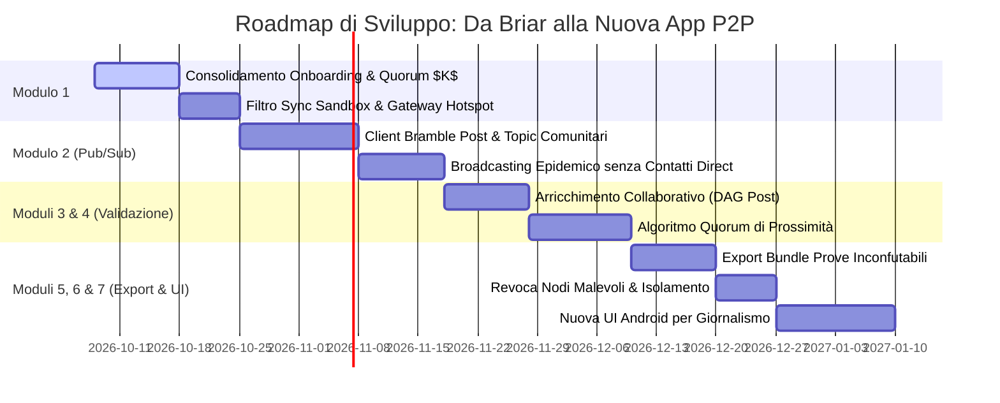

# Analisi Critica dei Requisiti e Roadmap di Sviluppo: Da Briar alla Nuova Applicazione P2P

Questo documento fornisce un'analisi dettagliata dello stato del progetto confrontando lo **Statement della Tesi (`Statement Progetto Tesi - v1.1.md`)** con i documenti di progettazione del primo modulo (**`module1_browser_access_and_onboarding.md`** e **`onboarding_communication_flow.md`**).

Il documento individua ciò che è stato affrontato, **gli aspetti tralasciati o da perfezionare**, la **roadmap per la fase di modifica del codice** e gli **argomenti/moduli architetturali da trattare successivamente** per realizzare la nuova applicazione di Giornalismo Partecipativo P2P in contesti di emergenza.

---

## 1. Quadro Comparativo: Statement Tesi vs. Modulo 1 Attuale

| Ambito / Requisito | Specificato nello Statement Tesi | Trattato nel Modulo 1 / Onboarding | Stato e Note |
| :--- | :--- | :--- | :--- |
| **Punto di Ingresso Web** | Landing Page HTML5 / QR Code per info e bozza richiesta | Implementato via `EmbeddedWebGateway.kt` | 🟡 Parziale (Manca gestione Captive Portal/Hotspot) |
| **Inizio in Sandbox** | Account restrittivo (`PROBATION`): rate limit 1 post/giorno | Implementato in `AccountManagerImpl` e `SetupViewModel` | 🟢 Completo a livello di stato DB locale |
| **Limiti Sandbox in Lettura/Sync** | Accesso ridotto ai contenuti, divieto di propagare info critiche | Trattato solo il rate limit in scrittura | 🔴 **Tralasciato** (Manca il filtro Sync in lettura) |
| **Approvazione e Promozione** | Convalidazione tramite **Quorum di Prossimità** | Approvazione singola 1-a-1 da un `FULL_MEMBER` | 🔴 **Incongruenza** (Singolo membro vs Quorum) |
| **Scoperta dei Topic** | Consultazione e scelta dei Topic di interesse | Selezione manuale nel wizard di registrazione | 🟡 Parziale (Manca la sincronizzazione dei Topic globali) |
| **Paradigma di Comunicazione** | **Publish/Subscribe di Post** (non messaggistica 1-a-1) | Onboarding basato sui meccanismi Bramble | 🔴 Da sviluppare nei moduli successivi |
| **Arricchimento e Prove** | Arricchimento dei post e export di prove non-confutabili | Non trattato nel Modulo 1 | 🔴 Da sviluppare nei moduli successivi |

---

## 2. Dettaglio di Ciò che è Stato Tralasciato o Necessita di Approfondimento

Dall'analisi incrociata dei documenti emergono **5 punti critici** che devono essere integrati o corretti nella fase di onboarding:

### 1. Discrepanza tra "Approvazione Singola" e "Quorum di Prossimità"
* **Criticità**: Lo *Statement della Tesi* richiede espressamente che l'integrazione di un nuovo nodo o la validazione delle sue azioni avvenga tramite un **Quorum di Prossimità** (soglia di $K$ nodi vicini). Nel `onboarding_communication_flow.md` l'approvazione è modellata come l'azione manuale di **un singolo membro** (`FULL_MEMBER`).
* **Soluzione Architetturale Consigliata**:
  * **Ingresso Diretto via Invito**: Se l'utente entra con un QR d'invito fornito da un `FULL_MEMBER`, entra subito in Sandbox e l'approvatore iniziale fa da sponsor.
  * **Promozione da Sandbox a Full Member**: Per rimuovere le restrizioni di Sandbox serve un **Quorum ($K$ risposte `OnboardingResponse` firmate da $K$ membri distinti)**. La transizione in `TrustManagerImpl` deve verificare il conteggio delle firme ricevute prima di impostare `trustTier = "FULL_MEMBER"`.

### 2. Sincronizzazione e Scoperta dei "Topic" della Comunità
* **Criticità**: Nel wizard di registrazione l'utente sceglie i topic (es. `#emergenza-sanitaria`, `#soccorsi`). Tuttavia, al primo avvio su un telefono verginale, come fa l'app a conoscere la lista aggiornata dei Topic attivi nella comunità?
* **Soluzione**: La Landing Page servita dal gateway `EmbeddedWebGateway.kt` deve includere nel payload JSON dell'onboarding la lista dinamica dei `CommunityTopic` attualmente registrati nella rete locale.

### 3. Filtraggio dei Contenuti in Lettura e Inoltro per i Nodi in Sandbox
* **Criticità**: Lo *Statement* stabilisce che i nodi in Sandbox hanno *"accesso ristretto a una sola parte delle informazioni pubblicate"* e il *"divieto di propagare informazioni ritenute critiche"*. Nel Modulo 1 è stato gestito il rate-limit in scrittura (max 1 post/giorno in `TrustManagerImpl`), ma **non è stato definito il filtro di sincronizzazione in lettura e forwarding**.
* **Soluzione**: Occorre implementare un hook in `ValidationManagerImpl` / `GroupVisibility` che impedisca la sincronizzazione dei post marcati come `CRITICAL` o riservati verso i nodi che hanno `trustTier = PROBATION`.

### 4. Gestione della Rete Wi-Fi Hotspot / Captive Portal per il Gateway Web
* **Criticità**: `EmbeddedWebGateway.kt` avvia un server HTTP su porta 8080. Tuttavia, affinché un nuovo utente possa connettersi col browser senza Internet, lo smartphone del membro della comunità deve attivare un **Hotspot Wi-Fi locale con Captive Portal** (DNS Redirect).
* **Soluzione**: Va documentato e previsto il servizio Android per l'attivazione automatica di `LocalOnlyHotspot` e la redirezione delle richieste DNS verso il gateway locale.

### 5. Distinzione tra Ingresso Autonomo (QR Pubblico) ed Ingresso via Invito
* **Criticità**: Nello *Statement* si distinguono nettamente due flussi:
  1. *Scansione autonoma di un QR pubblico affisso*: comporta Sandbox rigorosa.
  2. *Invito diretto da un membro esistente*: richiede una procedura snellita.
* **Soluzione**: Il parametro `onboardingToken` passato a `AccountManagerImpl` deve codificare il tipo di ingresso (`PUBLIC_QR` vs `DIRECT_MEMBER_INVITE`) per impostare quote o condizioni di quorum differenti.

---

## 3. Come Procedere con la Fase di Modifica del Codice (Roadmap Operativa)

La realizzazione della nuova applicazione partendo dal codebase di Briar deve seguire un approccio modulare in **4 fasi sequenziali**:

```
[FASE A] Consolidamento Modulo 1 (Onboarding & Gateway)
   │
   ├──> [FASE B] Modulo 2: Architettura Pub/Sub dei Post & Topic (Invece delle Chat 1-a-1)
   │
   ├──> [FASE C] Modulo 3 & 4: Arricchimento Collaborativo & Quorum di Prossimità
   │
   └──> [FASE D] Modulo 5, 6 & 7: Export Prove Inconfutabili, Revoca Nodi & Nuova UI
```

---

### **FASE A: Consolidamento del Modulo 1 (Accesso ed Onboarding)**

1. **Aggiornamento di `CommunityOnboardingManagerImpl.java`**:
   * Modificare la logica di promozione: accettare $K$ firme d'approvazione (`MIN_QUORUM_SIZE = 3`) prima di invocare `trustManager.promoteToFullMember()`.
2. **Implementazione del Filtro Sync per Sandbox in Bramble**:
   * Intercettare i messaggi in `Bramble` per bloccare la sincronizzazione dei post sensibili verso nodi `PROBATION`.
3. **Integrazione Hotspot Nativo in `EmbeddedWebGateway.kt`**:
   * Aggiungere la gestione del punto d'accesso Wi-Fi locale per la Landing Page Web.

---

### **FASE B: Modulo 2 - Architettura Pub/Sub di Post e Topic (Core dell'App)**

Briar è strutturata principalmente per messaggi privati 1-a-1 e forum ad invito. Per creare la nuova applicazione occorre:

1. **Creazione del Client Bramble per i Post Comunitari (`CommunityPostClient`)**:
   * Creare un nuovo client Bramble che gestisce messaggi di tipo `PostMessage` legati a `TopicGroupId` pubblici.
2. **Struttura del Dato `PostMessage`**:
   * **Payload**: Testo, Timestamp, Categoria/Topic, Posizione Geografica approssimata (opzionale), Media cifrati (con limite di dimensione per reti DTN), Identità dell'Autore, Livello di Riservatezza/Criticità.
3. **Disaccoppiamento dai Contatti Diretti**:
   * I post non devono essere inviati solo ai "contatti aggiunti" (come fa Briar), ma devono essere **diffusi in broadcast epidemico** a tutti i nodi appartenenti allo stesso gruppo di comunità/topic.

---

### **FASE C: Moduli 3 & 4 - Arricchimento Collaborativo e Quorum di Prossimità**

1. **Arricchimento Collaborativo dei Post (`PostEnrichmentMessage`)**:
   * Permettere ai nodi con ruolo `FULL_MEMBER` di aggiungere dettagli, foto o smentite a un post esistente.
   * Il messaggio di arricchimento punta all'hash del post primario (`parentPostId`), formando una struttura ad albero/DAG crittografico.
2. **Sistema di Votazione e Validazione tramite Quorum (`PostValidationMessage`)**:
   * Un nodo della comunità che si trova sul posto esprime un voto di testimonianza (*"Confermo l'evento"* / *"Smentisco"*).
   * Algoritmo di conteggio del Quorum: quando un post accumula $K$ attestazioni da nodi `FULL_MEMBER` geograficamente o temporalmente vicini, lo stato del post passa da `UNVERIFIED` a **`COMMUNITY_VALIDATED`**.

---

### **FASE D: Moduli 5, 6 & 7 - Export Prove, Sicurezza e Nuova Interfaccia UI**

1. **Impacchettamento ed Esportazione di Prove Inconfutabili (Module 5)**:
   * Quando un post diventa `COMMUNITY_VALIDATED`, il sistema genera un **Bundle Crittografico Autocontenuto** (JSON/CBOR firmato o PDF con allegati crittografici) contenente:
     * Post originale e relativi arricchimenti.
     * Lista delle firme Ed25519 del quorum di validazione.
     * Timestamp ed evidenze di catena di custodia.
   * Funzione di export verso chiavette USB, Bluetooth o gateway di uscita verso l'esterno dell'area di emergenza.
2. **Gestione Nodi Malevoli ed Isolamento (`TrustRevocationMessage` - Module 6)**:
   * Implementazione dello stato `ISOLATED`. Se un nodo diffonde dati falsi o tenta attacchi Sybil, un quorum di comunità può emettere un messaggio di revoca che isola il nodo ed ignora i suoi post.
3. **Riprogettazione Completa della UI Android (Module 7)**:
   * Sostituire le schede standard di Briar (Contatti/Forum/Blog) con un'interfaccia moderna per il **Giornalismo Partecipativo**:
     * **Feed Notizie per Topic**: con filtri per stato (`Tutti`, `Convalidati da Quorum`, `In Evidenza`).
     * **Mappa degli Eventi**: visualizzazione geografica degli avvenimenti segnalati.
     * **Pulsante di Segnalazione Rapida**: form ottimizzato per pubblicare un nuovo post di emergenza.

---

## 4. Sintesi della Roadmap di Modifica del Codice



---

## 5. Conclusione

La progettazione svolta finora nel **Modulo 1** costituisce un'ottima base d'inizio per l'accesso e l'onboarding progressivo. Tuttavia, per essere pienamente aderenti allo **Statement della Tesi**, occorre:

1. Rettificare l'approvazione dell'onboarding introducendo il **Quorum di Prossimità ($K$ approvazioni)** anziché l'azione di un singolo membro.
2. Implementare i **filtri di sincronizzazione in lettura** per i nodi in Sandbox.
3. Procedere con la progettazione dei **Moduli Successivi (Pub/Sub per Topic, Arricchimento, Quorum di Validazione dei Post ed Export delle Prove)** per trasformare il paradigma di Briar da "chat privata" a "piattaforma di giornalismo partecipativo e contro-informazione in emergenza".
